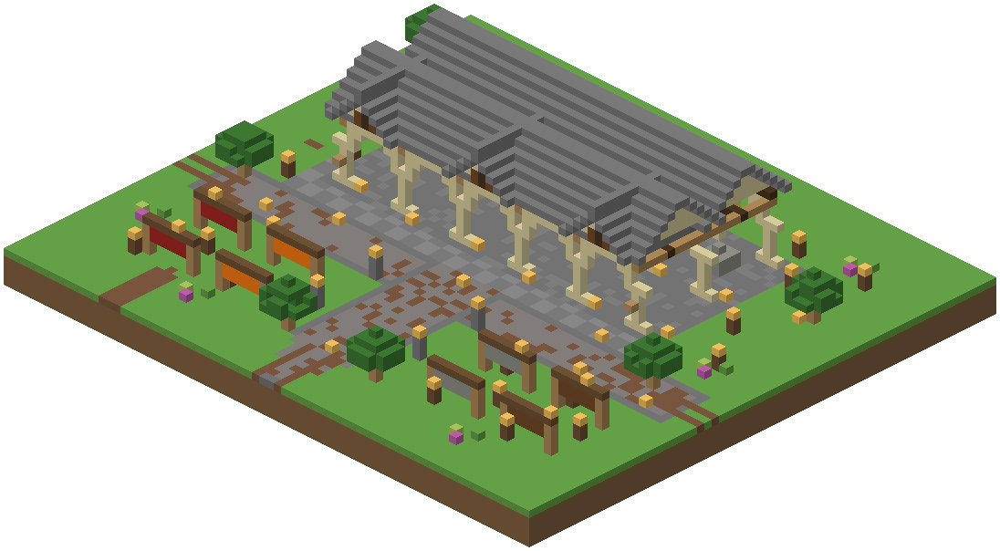
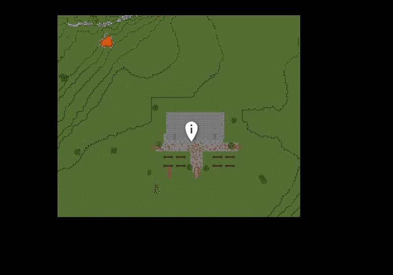
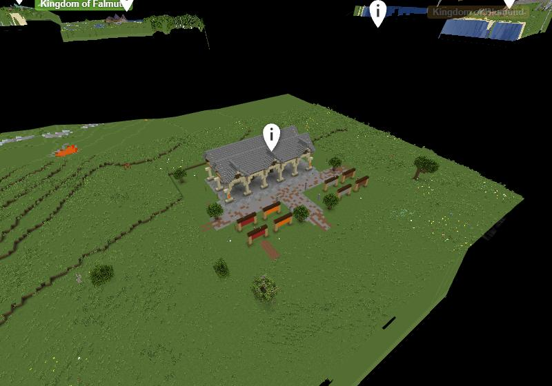

# Nostraille

`id: nostraille` · build (our blueprint) · region **N** (Nostraille)

| | |
|---|---|
| Anchor (Lerfing's map, x, z) | **-1780, 550** (x grows east, z grows south) |
| Audit status (19/11/2026) | **OK** |
| Blueprint | [`blueprints/nostraille.py`](../../../blueprints/nostraille.py), 72 x 33 x 64 blocks (x, y, z), anchor [36, 5, 43] |
| Preview (blueprint only) |  |
| Lore page | [`design/lore/nostraille.md`](../../../design/lore/nostraille.md) |

## Lore (canon)

On the Council map; canon gives geography only.

## What it should look like

A wool hall under two ridges with cart aisles between stone piers, five open bays, a beam balance, stacked fleeces and open tenter frames with russet and undyed cloth across the street.

Why it stands here (anchor table, Lerfing coordinates): Quiet hill kingdom east of Raja, y 81.

## Current state: BlueMap audit of 19/11/2026

Map: Tensura by Lerfing (current, being replaced). The screenshots are from the public BlueMap; positions and terrain will change with the new world, the lore and the design intent above will not.

- **Status:** OK
- **Placed:** -1776 82 558 (corner -1812 77 515)
- Wool hall on open plains; a small surface lava pool about 50 blocks north-west.

  
*Top-down, about 300 blocks across. Map: Tensura by Lerfing (current, being replaced).*

  
*3D perspective, about 100 blocks. Map: Tensura by Lerfing (current, being replaced).*

## What ChatGPT can deliver for this place

- Concept art: `docs/art/places/nostraille.png` + `docs/art/places/nostraille.md` (see [art.md](../art.md)).
- Blueprint design notes or a Python blueprint in the format of [builds.md](../builds.md) (never the placement data: that is Claude's).
- Lore and quest text in EN and NL for this place (see [tasks.md](../tasks.md)).

Back to the [world guide](../world.md) · [knowledge pack](../README.md)
