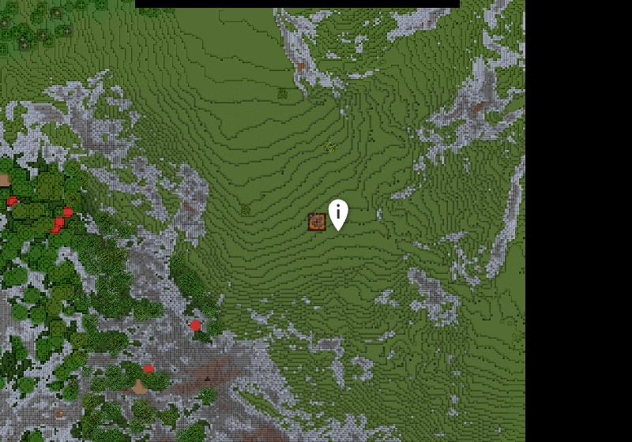
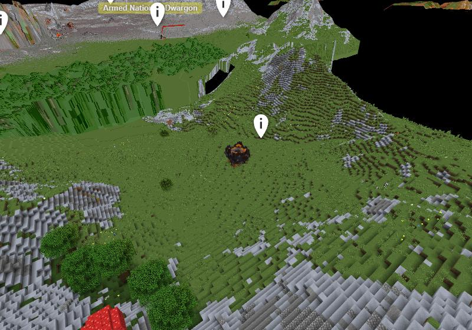

# Hidden ogre village (Kijin homeland, burned)

`id: ogre_village_ruin` · landmark (a Tensura mod structure placed in game) · region **J** (Jura; future Tempest gameplay region)

| | |
|---|---|
| Anchor (Lerfing's map, x, z) | **2150, 400** (x grows east, z grows south) |
| Audit status (19/11/2026) | **ISSUE, medium** |
| Placed from | Tensura mod structure `tensura:ruin/wizard_tower/burnt` (`design/data/landmarks.toml`) |
| Lore | [`design/lore/world.md`](../../../design/lore/world.md), section J |

## Lore (canon)

The ogres (later named Benimaru, Shuna, Shion, Souei, Hakurou, Kurobe) lived in a hidden village in the Jura forest until the Orc Lord's horde burned it. Its exact position is not in canon (placement unverified).

## What it should look like

Today only one burnt wizard tower (`tensura:ruin/wizard_tower/burnt`) stands on a bare hill: a weak fit. Wanted: a burnt village of several ruined buildings in forest. Suggestion: charred beams, collapsed roofs in a Japanese style (the ogres' clothing and weapons look Japanese in the series), a shrine gate, scorch marks, a few graves. **Open blueprint task.**

Why it stands here (anchor table, Lerfing coordinates): North foot of the east-Jura massif ('north-eastern hills'), y 81/89/99.

## Current state: BlueMap audit of 19/11/2026

Map: Tensura by Lerfing (current, being replaced). The screenshots are from the public BlueMap; positions and terrain will change with the new world, the lore and the design intent above will not.

- **Status:** ISSUE, medium
- **Placed:** 2150 89 400 (box 2122 58 378 2156 107 412)
- Lore fit is weak: a single small burnt wizard tower (tensura:ruin/wizard_tower/burnt) alone on a bare grassy hill; the canon ogre village was a burnt village in the Jura forest.
- Not captured (stopped at the lead's request); placed exactly on the anchor (2150 89 400).
- Fix: Consider a bigger burnt-village structure, or several ruin pieces, in forest.

  
*Top-down, about 300 blocks across. Map: Tensura by Lerfing (current, being replaced).*

  
*3D perspective, about 100 blocks. Map: Tensura by Lerfing (current, being replaced).*

## What ChatGPT can deliver for this place

- Concept art: `docs/art/places/ogre_village_ruin.png` + `docs/art/places/ogre_village_ruin.md` (see [art.md](../art.md)).
- Blueprint design notes or a Python blueprint in the format of [builds.md](../builds.md) (never the placement data: that is Claude's).
- Lore and quest text in EN and NL for this place (see [tasks.md](../tasks.md)).

Back to the [world guide](../world.md) · [knowledge pack](../README.md)
