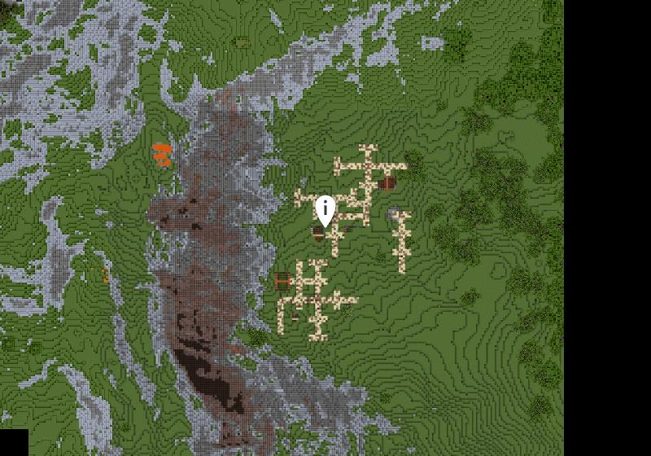
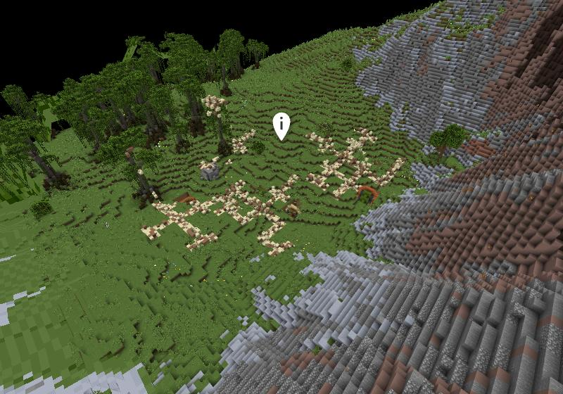

# Orc War battlefield (Orc Lord, Orc Disaster)

`id: orc_camp` · landmark (a Tensura mod structure placed in game) · region **W** (Lizardmen's Marsh of Lake Siss)

| | |
|---|---|
| Anchor (Lerfing's map, x, z) | **3600, 1250** (x grows east, z grows south) |
| Audit status (19/11/2026) | **MISSING (not placed)** |
| Placed from | Tensura mod structure `tensura:villages/orc_village` (`design/data/landmarks.toml`) |
| Lore | [`design/lore/world.md`](../../../design/lore/world.md), section W |

## Lore (canon)

The Orc Lord (Geld) leads 200,000 orcs north through the swamp to the lizardmen and the Jura forest; the Orc Disaster boss fight (chapters 4 and 9) is here.

## What it should look like

Wanted: a huge sprawling orc camp on the marsh edge. Suggestion: trampled mud, crude tents and pens, bone piles, skull banners, smoke, a command pavilion for the Orc Lord. Tensura's own orc village structure is the current stand-in and its placement failed (see current state). **Open blueprint task** (a pack-owned `orc_camp` build instead of Tensura's jigsaw).

Why it stands here (anchor table, Lerfing coordinates): South-east of the lake where the marsh meets Eurazania's jungle: Geld's horde came up from the south.

## Current state: BlueMap audit of 19/11/2026

Map: Tensura by Lerfing (current, being replaced). The screenshots are from the public BlueMap; positions and terrain will change with the new world, the lore and the design intent above will not.

- **Status:** MISSING (not placed)
- **Placed:** not placed
- Landmark not placed: `place structure tensura:villages/orc_village` failed at all 4 spots tried (3600 1250, 3623 1227, 3632 1250, 3600 1282); `/ttl landmark list` says FAILED 1x.
- BlueMap shows beige cross-shaped path/bone-coloured pieces at the anchor on open grass; they are not ours according to the records (Lerfing terrain or a manual placement). Check in game.
- Fix: Fix in progress (Claude, technical). Try spots further from the slope, or with a bigger search radius; afterwards `/ttl landmark place orc_camp`.
- **After the audit:** PR #57 (open on 19/11/2026) grounds the Tensura landmarks, removes the duplicate goblin village, moves the Dwarven Arena into the dwarf village and retries the orc camp.

  
*Top-down, about 300 blocks across. Map: Tensura by Lerfing (current, being replaced).*

  
*3D perspective, about 100 blocks. Map: Tensura by Lerfing (current, being replaced).*

## What ChatGPT can deliver for this place

- Concept art: `docs/art/places/orc_camp.png` + `docs/art/places/orc_camp.md` (see [art.md](../art.md)).
- Blueprint design notes or a Python blueprint in the format of [builds.md](../builds.md) (never the placement data: that is Claude's).
- Lore and quest text in EN and NL for this place (see [tasks.md](../tasks.md)).

Back to the [world guide](../world.md) · [knowledge pack](../README.md)
