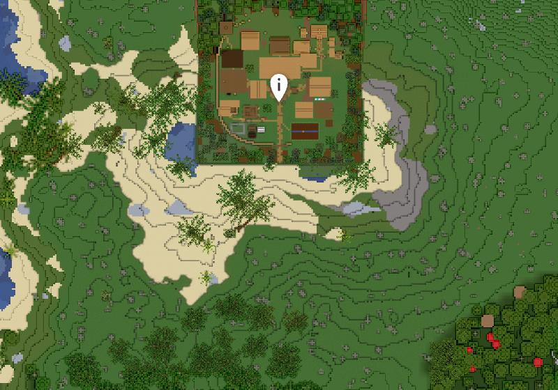
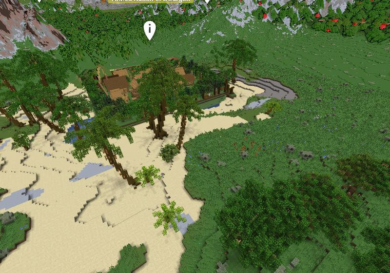

# The Outcast contact reservation near the early village

## Current own-world design — round36

Current pin(0,52),radius8 lies inside Tempest's radius148 parent reservation. The Outcast Society is project fiction. The empty contact-corner concept does not prescribe an initial NPC,canonical faction headquarters,river or remote mountain road. [Current map and era](../../../world/era.md).

The imported-map coordinate table and audit below are historical. Current terrain and source-qualified concept sheets supersede their geometry/era assumptions.

`id: outcast_road` · spot (NPC, boss or quest point) · region **J** (Jura-Tempest Federation)

| | |
|---|---|
| Anchor (Lerfing's map, x, z) | **1720, 952** (x grows east, z grows south) |
| Audit status (19/11/2026) | **OK** |
| Relative to | `tempest` + (0, 52) |
| Lore | [`design/lore/world.md`](../../../design/lore/world.md), section J |

## Source context and project role

The Outcast Society is the pack's own hidden faction: reincarnators rejected by every nation. Its contact NPC stands on the south road next to Tempest.

## What it should look like

The contact is a hooded figure in a deep-purple cloak with a broken pale-star clasp (see the `outcast` skin in `docs/art/npc-skin-prompts.md`), standing beside the road. No build.

Why it stands here (anchor table, Lerfing coordinates): Tempest-relative, unchanged offset.

## Current state: BlueMap audit of 19/11/2026

Map: Tensura by Lerfing (current, being replaced). The screenshots are from the public BlueMap; positions and terrain will change with the new world, the lore and the design intent above will not.

- **Status:** OK
- **Placed:** not applicable (no structure: spot)
- Next to Tempest, beach/grass; fine.

  
*Top-down, about 300 blocks across. Map: Tensura by Lerfing (current, being replaced).*

  
*3D perspective, about 100 blocks. Map: Tensura by Lerfing (current, being replaced).*

## What ChatGPT can deliver for this place

- Concept art: `docs/art/places/outcast_road.png` + `docs/art/places/outcast_road.md` (see [art.md](../art.md)).
- Lore and quest text in EN and NL for this place (see [tasks.md](../tasks.md)).

Back to the [world guide](../world.md) · [knowledge pack](../README.md)
