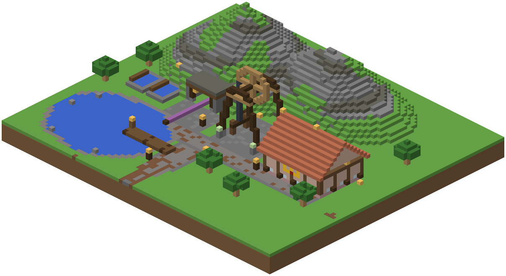
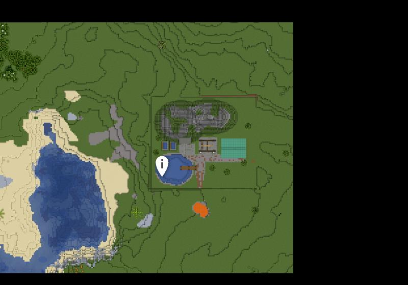
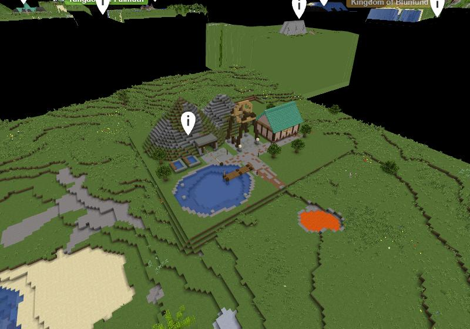

# Raja

`id: raja` · build (our blueprint) · region **A** (Raja)

| | |
|---|---|
| Anchor (Lerfing's map, x, z) | **-2050, 760** (x grows east, z grows south) |
| Audit status (19/11/2026) | **ISSUE, medium** |
| Blueprint | [`blueprints/raja.py`](../../../blueprints/raja.py), 80 x 37 x 70 blocks (x, y, z), anchor [36, 6, 49] |
| Preview (blueprint only) |  |
| Lore page | [`design/lore/raja.md`](../../../design/lore/raja.md) |

## Source context and initial-era limit

The [public Bandai Namco Filmworks release sheet](https://img.sunrise-inc.co.jp/images/news/20804_81jbgi5uz7f4_pdf.pdf),page2 Story,places Raja west of Tempest and describes its former gold prosperity and mine-poisoned lake during Scarlet Bond. Official notice7828 identifies miners under Towa. Exact conditions,royal roster and mine operation at the post-Kijin instant remain unverified; a film-era cure is not the initial state.

## What it should look like

A restrained old mine approach beside the current authored lake: timber-set portal,short rail,small sheave/drum and modest assay shed. Exact architecture and inlet are our interpretation. Neutral muted water does not certify a chemical state or a cure. Exclude crown tributes,healed-lake celebration,tiara ritual and named later visitors. The older after-crisis blueprint description needs era review before use.

Why it stands here (anchor table, Lerfing coordinates): On the belt's lake, as its lore asks (repair_keep_water).

## Current state: BlueMap audit of 19/11/2026

Map: Tensura by Lerfing (current, being replaced). The screenshots are from the public BlueMap; positions and terrain will change with the new world, the lore and the design intent above will not.

- **Status:** ISSUE, medium
- **Placed:** -2022 73 748 (corner -2058 67 699)
- A surface LAVA pool about 15 blocks south-east of the box, clearly visible on the map (the survey counted 171 lava spots within 48).
- verify 100 %, foundation solid, water inside the box is the build's own pond (repair_keep_water).
- Fix: Fill the lava pool (`fill ... stone replace minecraft:lava`, then grass on top) or raise `repair_margin`.

  
*Top-down, about 300 blocks across. Map: Tensura by Lerfing (current, being replaced).*

  
*3D perspective, about 100 blocks. Map: Tensura by Lerfing (current, being replaced).*

## What ChatGPT can deliver for this place

- Concept art: `docs/art/places/raja.png` + `docs/art/places/raja.md` (see [art.md](../art.md)).
- Blueprint design notes or a Python blueprint in the format of [builds.md](../builds.md) (never the placement data: that is Claude's).
- Lore and quest text in EN and NL for this place (see [tasks.md](../tasks.md)).

Back to the [world guide](../world.md) · [knowledge pack](../README.md)
