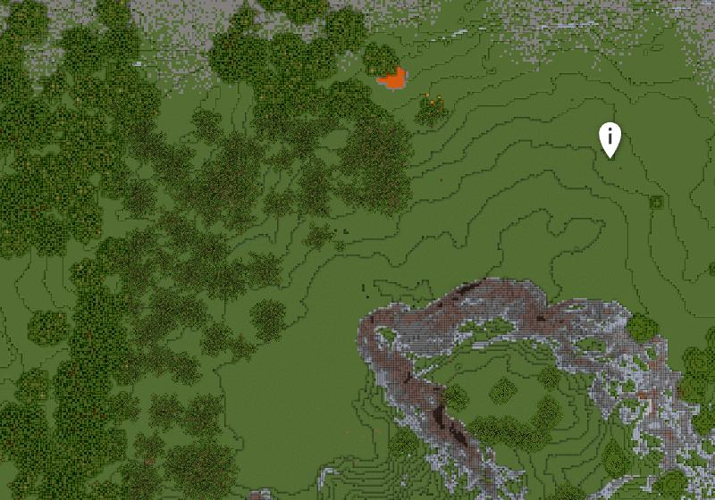
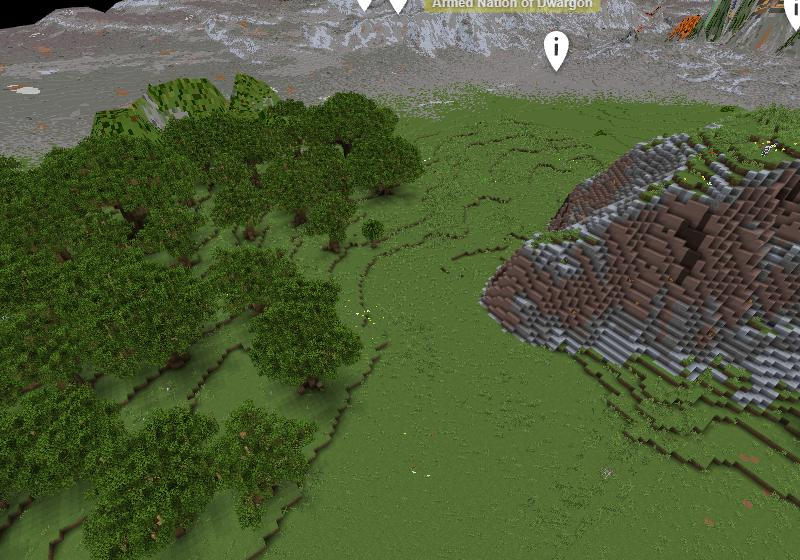

# The abandoned rookie camp (sidequests rookie_camp)

`id: rookie_camp` · spot (NPC, boss or quest point) · region **J** (Jura-Tempest Federation)

| | |
|---|---|
| Anchor (Lerfing's map, x, z) | **1550, -60** (x grows east, z grows south) |
| Audit status (19/11/2026) | **OK** |
| Lore | [`design/lore/world.md`](../../../design/lore/world.md), section J |

## Lore (canon)

Side-quest spot (`rookie_camp`): a Free Guild rookie party camped here and never came back.

## What it should look like

Nothing specified. Suggestion: a cold fire pit, torn tents, a dropped rank-F plate, a few arrows. No build yet; small build or concept art welcome.

Why it stands here (anchor table, Lerfing coordinates): On the rim between the arrival and Tempest, 230 blocks from the arrival, 960 from Tempest (safe rim).

## Current state: BlueMap audit of 19/11/2026

Map: Tensura by Lerfing (current, being replaced). The screenshots are from the public BlueMap; positions and terrain will change with the new world, the lore and the design intent above will not.

- **Status:** OK
- **Placed:** not applicable (no structure: spot)
- Plains; the same orange patch (probably lava) is about 75 blocks north-west.

  
*Top-down, about 300 blocks across. Map: Tensura by Lerfing (current, being replaced).*

  
*3D perspective, about 100 blocks. Map: Tensura by Lerfing (current, being replaced).*

## What ChatGPT can deliver for this place

- Concept art: `docs/art/places/rookie_camp.png` + `docs/art/places/rookie_camp.md` (see [art.md](../art.md)).
- Lore and quest text in EN and NL for this place (see [tasks.md](../tasks.md)).

Back to the [world guide](../world.md) · [knowledge pack](../README.md)
