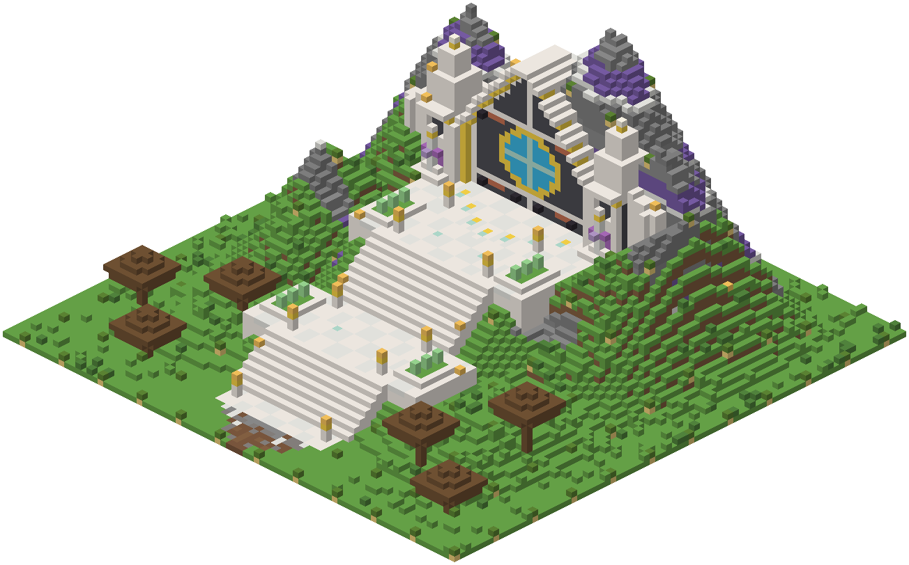
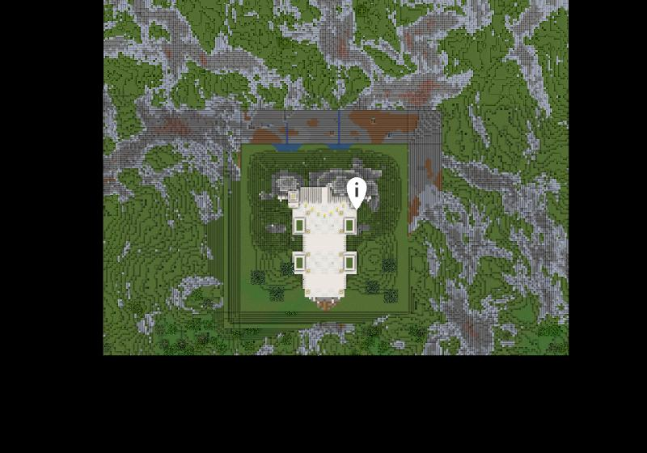
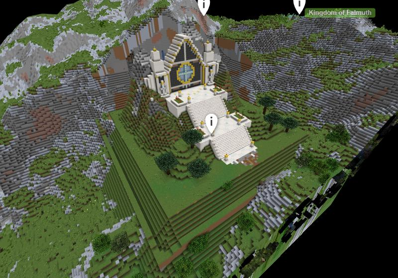

# Sacred Mountain (Inner Sanctum, Luminous)

`id: sacred_mountain` · build (our blueprint) · region **L** (Holy Empire of Lubelius)

| | |
|---|---|
| Anchor (Lerfing's map, x, z) | **-2980, -900** (x grows east, z grows south) |
| Audit status (19/11/2026) | **ISSUE, low** |
| Blueprint | [`blueprints/sacred_mountain.py`](../../../blueprints/sacred_mountain.py), 81 x 57 x 81 blocks (x, y, z), anchor [40, 4, 76] |
| Preview (blueprint only) |  |
| Lore page | [`design/lore/sacred_mountain.md`](../../../design/lore/sacred_mountain.md) |

## Lore (canon)

The holiest site of the Church; the Inner Sanctum on its summit guards the approach to the Holy Emperor's residence (web novel ch. 87, light novel vol. 6).

## What it should look like

A pilgrim approaching from the south sees a blue and gold seal between limestone peaks; two stair flights (7 and 8 blocks) to a rose court and the threshold: three courses of white stone and gold framing dark double leaves with a single gold ring across the seam. The timber line ends below the gate.

Why it stands here (anchor table, Lerfing coordinates): On the ridge (y 111/124/148, peak 187 at (-2976, -992)), the only real mountain in the west.

## Current state: BlueMap audit of 19/11/2026

Map: Tensura by Lerfing (current, being replaced). The screenshots are from the public BlueMap; positions and terrain will change with the new world, the lore and the design intent above will not.

- **Status:** ISSUE, low
- **Placed:** -2996 120 -856 (corner -3036 116 -932)
- Cosmetic: cut into a steep slope (mean deviation 7.5, spread 23): a stepped square terrace is visible round the box, with water pockets on its north edge (86 water cells in the box above ground, 16 in the ring; 1 moss_carpet -> water at -3012 120 -929).
- verify 100 %, foundation solid.
- Fix: Fill the water pockets at the north edge; consider a wider skirt so the terraces read as natural slope.

  
*Top-down, about 300 blocks across. Map: Tensura by Lerfing (current, being replaced).*

  
*3D perspective, about 100 blocks. Map: Tensura by Lerfing (current, being replaced).*

## What ChatGPT can deliver for this place

- Concept art: `docs/art/places/sacred_mountain.png` + `docs/art/places/sacred_mountain.md` (see [art.md](../art.md)).
- Blueprint design notes or a Python blueprint in the format of [builds.md](../builds.md) (never the placement data: that is Claude's).
- Lore and quest text in EN and NL for this place (see [tasks.md](../tasks.md)).

Back to the [world guide](../world.md) · [knowledge pack](../README.md)
