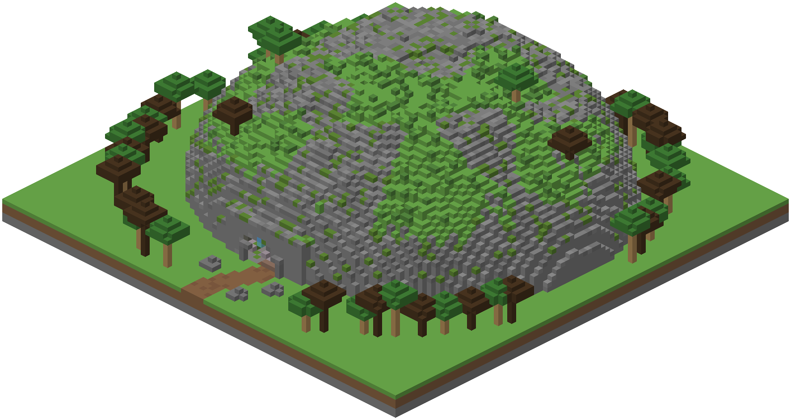
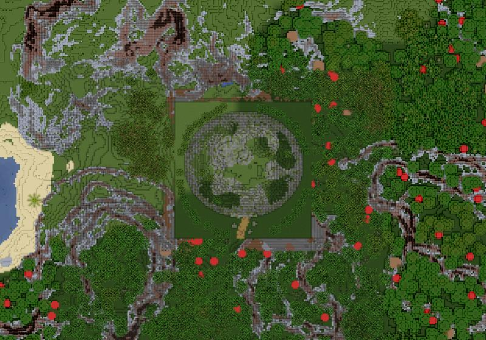
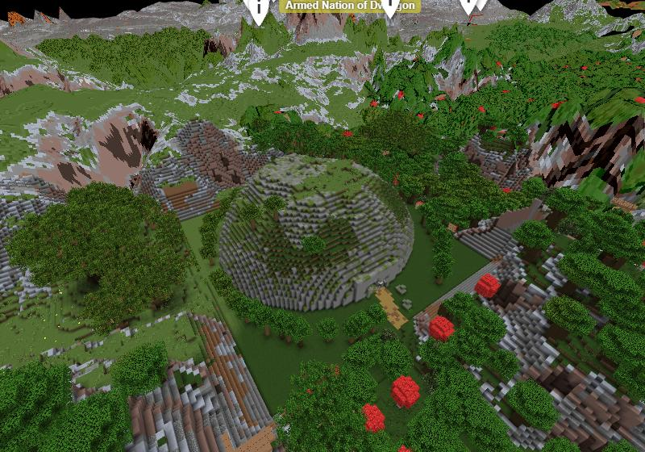

# Sealed Cave (Veldora's prison, Rimuru's birthplace)

`id: sealed_cave` · build (our blueprint) · region **J** (Jura-Tempest Federation)

| | |
|---|---|
| Anchor (Lerfing's map, x, z) | **1380, 560** (x grows east, z grows south) |
| Audit status (19/11/2026) | **ISSUE, low** |
| Blueprint | [`blueprints/sealed_cave.py`](../../../blueprints/sealed_cave.py), 88 x 50 x 88 blocks (x, y, z), anchor [44, 5, 82] |
| Preview (blueprint only) |  |
| Lore page | [`design/lore/sealed_cave.md`](../../../design/lore/sealed_cave.md) |

## Replacement-world source and era note — round47

The table/screenshots describe the legacy Lerfing world. The current SVG uses
`(-120,-400),r75` with a dry approach and a carve reservation. Selected public
[manga chapter1 panels](https://comic-days.com/episode/10834108156644708045) support
natural cave formations,plants and underground water,not this exterior's dimensions
or south-facing entrance. [Source/locator review](../../../docs/research/tensura-world-2026-11-19/licensed-manga-review-r47.md).
The double rune ring,hexagram,dais,snapped chains,standing stones and broken glass
armillary below are original server motifs,not a reconstructed canonical floor plan.
Their presence in the existing blueprint is not acceptance for the initial era.

## Lore (canon)

Veldora Tempest was sealed here about 300 years before the story by the Unlimited Imprisonment; Rimuru wakes in the same cave and meets him. Veldora's aura soaked the rock with magicules (magic ore, hipokute grass); later it becomes Tempest's hipokute farm. At the selected Life2 baseline Rimuru has already absorbed Veldora and left the cave. [Official episode2](https://www.ten-sura.com/anime/tensura/story/no2) supports that absence; it does not prove destroyed sealing magic or physical broken-prison remains.

## What it should look like

A rocky mossy hill (about 70 blocks across, 27 high) in a forest clearing, the mouth in its south face. Winding passage, antechamber with cave pond, magic ore in the walls, glow berries and a small hipokute plot; a narrow passage; then a round deepslate dome (28 x 26) with amethyst and ore, a double ring and hexagram of teal copper and sea lanterns in the floor (the dim, cracked seal), a black dais with snapped chains and claw gouges, six standing stones (two toppled) and an armillary of broken light-blue glass rings. A small basin marks where a slime woke up.

Why it stands here (anchor table, Lerfing coordinates): A mesa of the spire field (y 75/85/123), cave mouth in its south face; survey 128. In the dark band: Veldora's leak.

## Current state: BlueMap audit of 19/11/2026

Map: Tensura by Lerfing (current, being replaced). The screenshots are from the public BlueMap; positions and terrain will change with the new world, the lore and the design intent above will not.

- **Status:** ISSUE, low
- **Placed:** 1440 73 464 (corner 1396 68 382)
- Placed 113 blocks from the canon point (31 candidate spots fell in a keepout); the flat square pad round the dome is visible.
- verify 99.99 %: 32 log cells missing (oak_log/dark_oak_log -> air at y 73-74, e.g. 1424 73 387), a few cave vines.
- Foundation solid, 76 water cells in the box (small puddles).
- Fix: Set the missing logs again (or `/ttl build place sealed_cave force` once the repair handles it); acceptable otherwise.

  
*Top-down, about 300 blocks across. Map: Tensura by Lerfing (current, being replaced).*

  
*3D perspective, about 100 blocks. Map: Tensura by Lerfing (current, being replaced).*

## What ChatGPT can deliver for this place

- Concept art: `docs/art/places/sealed_cave.png` + `docs/art/places/sealed_cave.md` (see [art.md](../art.md)).
- Blueprint design notes or a Python blueprint in the format of [builds.md](../builds.md) (never the placement data: that is Claude's).
- Lore and quest text in EN and NL for this place (see [tasks.md](../tasks.md)).

Back to the [world guide](../world.md) · [knowledge pack](../README.md)
