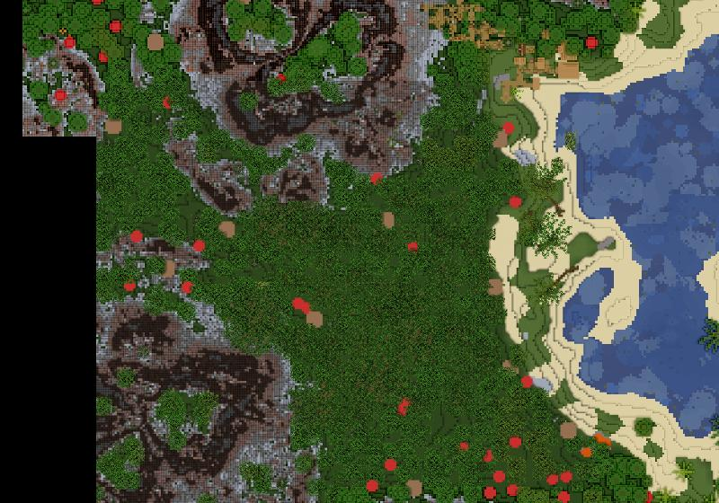
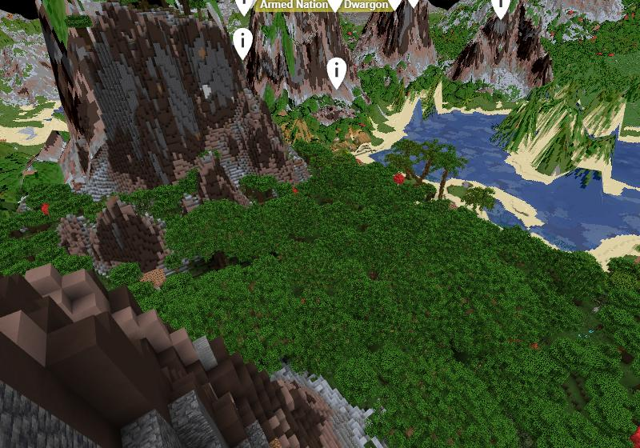

# Future encounter reservation (`shizu_spawn`)

## Current own-world design — round36

Current own-world pin(-420,-80),radius8; the legacy boss encounter radius48 is a separate gameplay parameter. This is an empty future server quest location,not a Shizu home or a measured canonical Hinata ambush parcel. No living Shizu/Hinata or later battle is placed at the S1E10 baseline. [Current map and era](../../../world/era.md).

The imported-map coordinate table and audit below are historical. Current terrain and source-qualified concept sheets supersede their geometry/era assumptions.

`id: shizu_spawn` · spot (NPC, boss or quest point) · region **J** (Jura; future Tempest gameplay region)

| | |
|---|---|
| Anchor (Lerfing's map, x, z) | **1300, 820** (x grows east, z grows south) |
| Audit status (19/11/2026) | **OK** |
| Relative to | `tempest` + (-420, -80) |
| Lore | [`design/lore/world.md`](../../../design/lore/world.md), section J |

## Source context and project role

Server quest spot (`bosses.toml`, boss `hinata_sakaguchi`, encounter radius48): a later Hinata-themed adaptation. The earlier one-hour-west claim is project travel design,not a verified canonical distance; the id retains its early design name.

## What it should look like

Dense Jura forest by the lake. Not a build; useful as a concept-art subject for 'the ambush clearing'.

Why it stands here (anchor table, Lerfing coordinates): West of the lake, as today's (-400, -60). The id is the design's (§3.2 'Shizu quest spawn'); the only user is Hinata's quest spawn (bosses.toml), Shizu fights at Tempest.

## Current state: BlueMap audit of 19/11/2026

Map: Tensura by Lerfing (current, being replaced). The screenshots are from the public BlueMap; positions and terrain will change with the new world, the lore and the design intent above will not.

- **Status:** OK
- **Placed:** not applicable (no structure: spot)
- Dense Jura forest by a lake; fine.

  
*Top-down, about 300 blocks across. Map: Tensura by Lerfing (current, being replaced).*

  
*3D perspective, about 100 blocks. Map: Tensura by Lerfing (current, being replaced).*

## What ChatGPT can deliver for this place

- Concept art: `docs/art/places/shizu_spawn.png` + `docs/art/places/shizu_spawn.md` (see [art.md](../art.md)).
- Lore and quest text in EN and NL for this place (see [tasks.md](../tasks.md)).

Back to the [world guide](../world.md) · [knowledge pack](../README.md)
