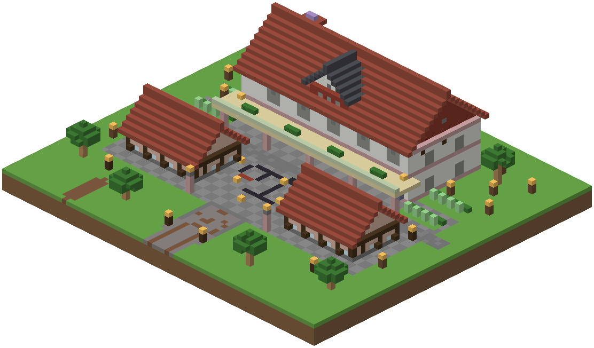
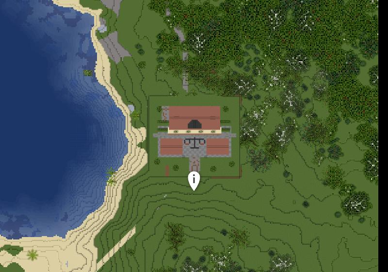
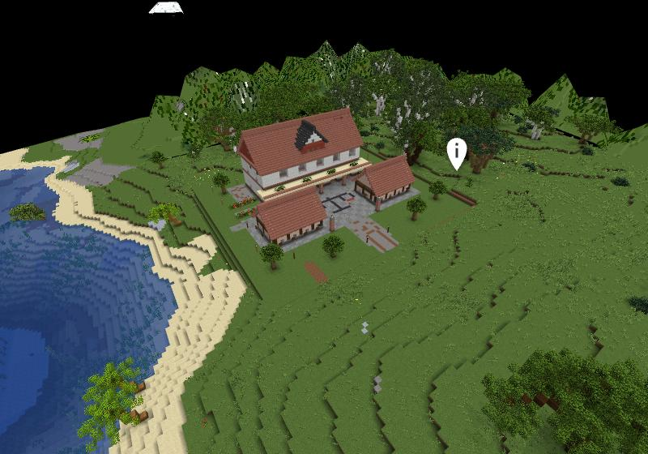

# Siltrosso

`id: siltrosso` · build (our blueprint) · region **F** (Kingdom of Falmuth)

| | |
|---|---|
| Anchor (Lerfing's map, x, z) | **-2450, -1650** (x grows east, z grows south) |
| Audit status (19/11/2026) | **OK** |
| Blueprint | [`blueprints/siltrosso.py`](../../../blueprints/siltrosso.py), 73 x 37 x 65 blocks (x, y, z), anchor [36, 5, 52] |
| Preview (blueprint only) |  |
| Lore page | [`design/lore/siltrosso.md`](../../../design/lore/siltrosso.md) |

## Lore (canon)

Granbell founded Siltrosso and headed the Rosso family which holds power behind the western nations; his granddaughter Mariabell is a precocious financier.

## What it should look like

The Rosso counting court: a stone balance set into the paving, two clerk's offices facing inward at the gate, a five-arched audience house with a roofed loggia and a book gallery, two chimneys and a slate dormer; rose walks flanking the court.

Why it stands here (anchor table, Lerfing coordinates): The arm's western tip, in Falmuth's neighbourhood.

## Current state: BlueMap audit of 19/11/2026

Map: Tensura by Lerfing (current, being replaced). The screenshots are from the public BlueMap; positions and terrain will change with the new world, the lore and the design intent above will not.

- **Status:** OK
- **Placed:** -2450 71 -1674 (corner -2486 66 -1726)
- On the coast; verify 100 %.

  
*Top-down, about 300 blocks across. Map: Tensura by Lerfing (current, being replaced).*

  
*3D perspective, about 100 blocks. Map: Tensura by Lerfing (current, being replaced).*

## What ChatGPT can deliver for this place

- Concept art: `docs/art/places/siltrosso.png` + `docs/art/places/siltrosso.md` (see [art.md](../art.md)).
- Blueprint design notes or a Python blueprint in the format of [builds.md](../builds.md) (never the placement data: that is Claude's).
- Lore and quest text in EN and NL for this place (see [tasks.md](../tasks.md)).

Back to the [world guide](../world.md) · [knowledge pack](../README.md)
