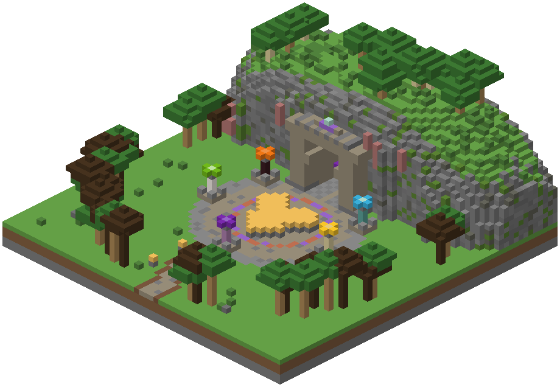
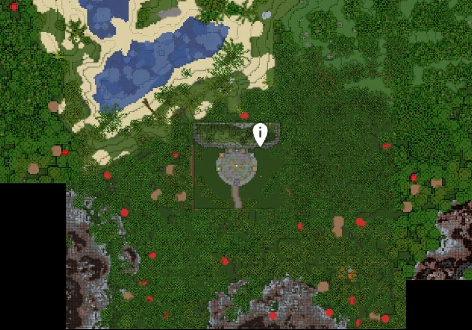
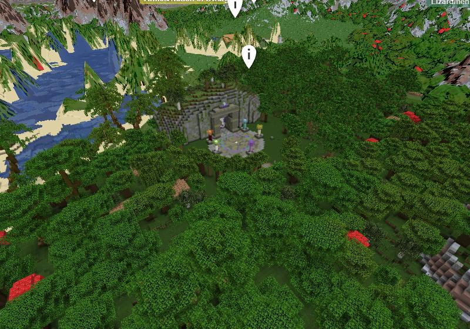

# Spirit Gate (Ramiris' doorway)

`id: spirit_gate` · build (our blueprint) · region **J** (Jura; future Tempest gameplay region)

| | |
|---|---|
| Anchor (Lerfing's map, x, z) | **1570, 1130** (x grows east, z grows south) |
| Audit status (19/11/2026) | **OK** |
| Blueprint | [`blueprints/spirit_gate.py`](../../../blueprints/spirit_gate.py), 57 x 40 x 57 blocks (x, y, z), anchor [28, 5, 24] |
| Preview (blueprint only) |  |
| Lore page | [`design/lore/spirit_domain.md`](../../../design/lore/spirit_domain.md) |

## Lore (canon)

In the series the entrance is in Ulgr Nature Park in far north Ulgracia; the pack puts the gate in Jura so that Life 2 players can reach it (decision log). Ramiris, the labyrinth fairy, later builds her dungeon in Tempest.

## What it should look like

A plaza of Tensura labyrinth stone ringed by five elemental plinths (fire red, water prismarine, wind green, earth sandstone, space purple) in front of a mossy cliff; in the cliff a tall doorway with a pentagon-of-elements seal on its back wall. Dense dark forest around it; the lake 60 blocks north-west. Behind the door lies `ttl:spirit_domain`: a floating glade with cherry trees, two ponds, a dais and a grotto with a summoning circle and a light pedestal.

Why it stands here (anchor table, Lerfing coordinates): 275 SSW of Tempest (WP-L4: moved from the design's (1540, 1080), whose 57 x 57 box is 18 % lake, 30 E / 50 S onto dry dark-forest ground: box water 0 %, ground y 69/71/72 on the imported world); the lake 60 blocks north-west.

## Current state: BlueMap audit of 19/11/2026

Map: Tensura by Lerfing (current, being replaced). The screenshots are from the public BlueMap; positions and terrain will change with the new world, the lore and the design intent above will not.

- **Status:** OK
- **Placed:** 1554 72 1138 (corner 1526 67 1114)
- Dense dark forest (stored biome dark_forest), verify 100 %; fits the lore.

  
*Top-down, about 300 blocks across. Map: Tensura by Lerfing (current, being replaced).*

  
*3D perspective, about 100 blocks. Map: Tensura by Lerfing (current, being replaced).*

## What ChatGPT can deliver for this place

- Concept art: `docs/art/places/spirit_gate.png` + `docs/art/places/spirit_gate.md` (see [art.md](../art.md)).
- Blueprint design notes or a Python blueprint in the format of [builds.md](../builds.md) (never the placement data: that is Claude's).
- Lore and quest text in EN and NL for this place (see [tasks.md](../tasks.md)).

Back to the [world guide](../world.md) · [knowledge pack](../README.md)
