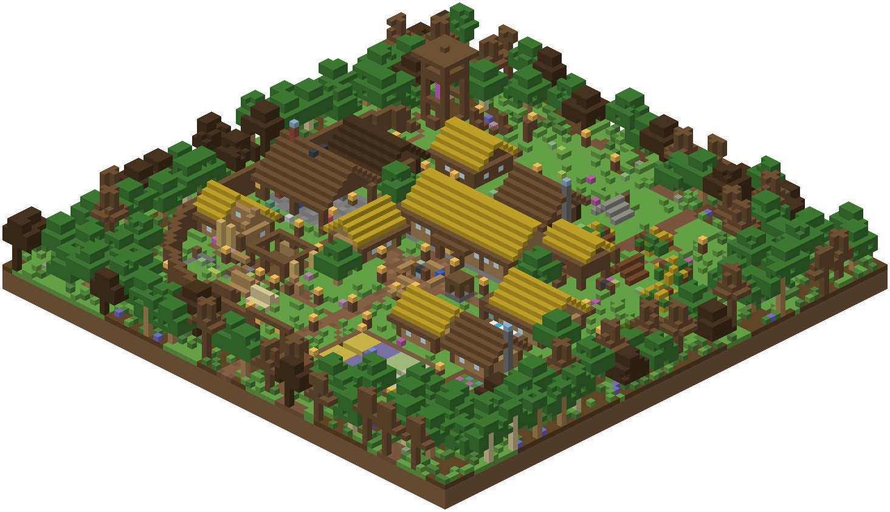
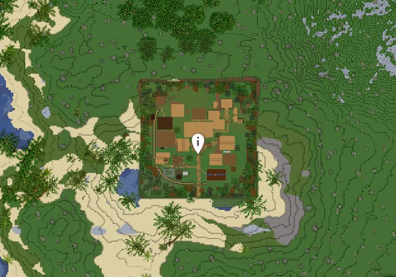
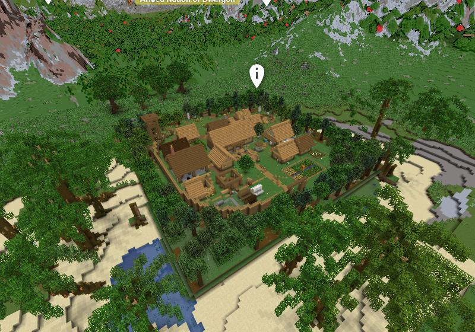

# Tempest (Rimuru, capital of the Federation)

`id: tempest` · settlement (own scripts) · region **J** (Jura-Tempest Federation)

| | |
|---|---|
| Anchor (Lerfing's map, x, z) | **1720, 900** (x grows east, z grows south) |
| Audit status (19/11/2026) | **ISSUE, medium** |
| Blueprint | [`blueprints/tempest.py`](../../../blueprints/tempest.py), 91 x 40 x 91 blocks (x, y, z) |
| Preview (blueprint only) |  |
| Later phases | [`blueprints/tempest_town.py`](../../../blueprints/tempest_town.py) (137 x 40 x 137, trade town), [`blueprints/tempest_city.py`](../../../blueprints/tempest_city.py) (191 x 40 x 191, festival capital); previews `tempest_town-iso.png`, `tempest_city-iso.png`, `tempest-growth.jpg` in [docs/previews](../../previews/) |
| Lore page | [`design/lore/tempest.md`](../../../design/lore/tempest.md), [`design/lore/tempest_growth.md`](../../../design/lore/tempest_growth.md) |

## Lore (canon)

Rimuru moves the goblin village to open ground with room to grow and running water nearby, and has the dwarf artisans from Dwargon (Kaijin and the brothers Garm, Dold and Mildo) lay out proper housing, roads and sanitation. Ogres turned kijin (Benimaru, Shuna, Shion, Souei, Hakurou, Kurobe), Rigurd's goblins, the Tempest Wolves and Rimuru himself live here. Later it becomes a trading city, the seat of the council and the entrance of Ramiris's dungeon.

## What it should look like

A construction site, not a city: hide tents ringing the build area, first log and plank houses with thatch or shingle roofs, some only framed and scaffolded; Kaijin's open forge with anvils and quench tubs; Shuna's weaving house with looms and dye vats; a covered council longhouse on the village green; Rimuru's modest house; a wolf pen; a palisade gate on the forest road. It stands in a cleared hollow of a dense old forest (oak, dark oak, giant ancient-forest trees; Jura is never jungle), with a lake to the west and a pond to the south. Our interpretation: the later rings (137 and 191 blocks wide) turn the green into a trade town with a west gate to Blumund and a north gate to Dwargon, then a festival capital with promenade, guild, inn, bath gardens and Ramiris's entrance court.

Why it stands here (anchor table, Lerfing coordinates): Middle of Jura (§3.2): y 63/65/68, relief 5, the lake at x 1500..1600 just west (running water nearby), plains.

## Current state: BlueMap audit of 19/11/2026

Map: Tensura by Lerfing (current, being replaced). The screenshots are from the public BlueMap; positions and terrain will change with the new world, the lore and the design intent above will not.

- **Status:** ISSUE, medium
- **Placed:** 1720 67 900 (corner 1675 62 843)
- Lore: Tempest stands in an open grass clearing with beach sand and a lake to the west; the forest only starts 100+ blocks away (the anchor's stored biome is tensura:ancient_forest, but the surface reads as plains). Known; fix in progress.
- Build itself is perfect: verify 100.00 %, 0 air under the footprint, 16 water cells in the box (the pond).
- Fix: Fix in progress (Claude, technical).
- **After the audit:** PR #56 (merged 19/11/2026, after these screenshots) plants an old forest round Tempest (r 60..250: 52 giant ancient-forest trees and about 1,300 ordinary trees) and round Treyni's shrine (r 25..180: 69 giants and about 1,070 trees) and lays the Dwarven Road from Tempest to Dwargon. It reaches staging with the next deploy; the audit text above describes the state before it.

  
*Top-down, about 300 blocks across. Map: Tensura by Lerfing (current, being replaced).*

  
*3D perspective, about 100 blocks. Map: Tensura by Lerfing (current, being replaced).*

## What ChatGPT can deliver for this place

- Concept art: `docs/art/places/tempest.png` + `docs/art/places/tempest.md` (see [art.md](../art.md)).
- Blueprint design notes or a Python blueprint in the format of [builds.md](../builds.md) (never the placement data: that is Claude's).
- Lore and quest text in EN and NL for this place (see [tasks.md](../tasks.md)).

Back to the [world guide](../world.md) · [knowledge pack](../README.md)
