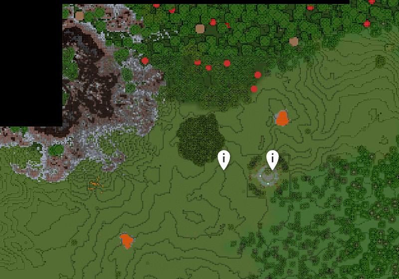
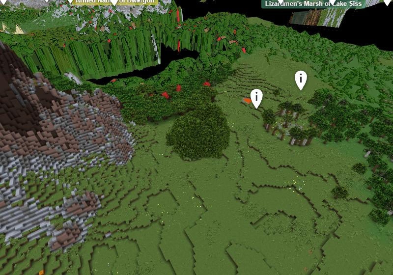

# Treyni-related ancient landmark tree

## Current own-world design — round36

Current natural-tree reservation(320,470),radius56,village kind. The separate shrine is(500,600); the imported +38 offset is retired. Giant tree/old-wood setting is a project interpretation; no verified canonical sanctuary border or complete treant settlement follows from this one mod tree. [Current map and era](../../../world/era.md).

The imported-map coordinate table and audit below are historical. Current terrain and source-qualified concept sheets supersede their geometry/era assumptions.

`id: treyni_grove` · landmark (a Tensura mod structure placed in game) · region **J** (Jura-Tempest Federation)

| | |
|---|---|
| Anchor (Lerfing's map, x, z) | **1920, 1540** (x grows east, z grows south) |
| Audit status (19/11/2026) | **ISSUE, medium** |
| Placed from | Tensura mod structure `tensura:ancient_forest/tree` (`design/data/landmarks.toml`) |
| Lore page | [`design/lore/treyni_shrine.md`](../../../design/lore/treyni_shrine.md) |

## Source context and project role

Treyni is the eldest of the three dryad sisters (Treyni, Trya, Doris), guardian and manager of the Great Jura Forest under Veldora. The old server design assigned a sanctuary east of an imported river; that is not a verified sovereign or canonical sanctuary boundary and does not locate the distinct treant settlement.

## What it should look like

Owner: Treyni belongs deep in old, dense forest. A single giant ancient-forest tree (up to 39 x 42 x 41 blocks, Tensura's own structure) in an old wood of giant trees and understory (planned canopy 76 % within 180 blocks), with an approach lane open towards Tempest.

Why it stands here (anchor table, Lerfing coordinates): 660 SE of Tempest, east of the river that drains Jura's lakes; y 73/74/76, flat.

## Current state: BlueMap audit of 19/11/2026

Map: Tensura by Lerfing (current, being replaced). The screenshots are from the public BlueMap; positions and terrain will change with the new world, the lore and the design intent above will not.

- **Status:** ISSUE, medium
- **Placed:** 1920 77 1540 (box 1883 54 1496 1920 95 1536)
- Lore: the 'ancient tree' is a single modest tree in open meadow, not a grove in forest. Known; fix in progress.
- Not captured (the audit stopped capturing at the lead's request); position matches the anchor exactly.
- Fix: Fix in progress (Claude, technical).
- **After the audit:** PR #56 (merged 19/11/2026, after these screenshots) plants an old forest round Tempest (r 60..250: 52 giant ancient-forest trees and about 1,300 ordinary trees) and round Treyni's shrine (r 25..180: 69 giants and about 1,070 trees) and lays the Dwarven Road from Tempest to Dwargon. It reaches staging with the next deploy; the audit text above describes the state before it.

  
*Top-down, about 300 blocks across. Map: Tensura by Lerfing (current, being replaced).*

  
*3D perspective, about 100 blocks. Map: Tensura by Lerfing (current, being replaced).*

## What ChatGPT can deliver for this place

- Concept art: `docs/art/places/treyni_grove.png` + `docs/art/places/treyni_grove.md` (see [art.md](../art.md)).
- Blueprint design notes or a Python blueprint in the format of [builds.md](../builds.md) (never the placement data: that is Claude's).
- Lore and quest text in EN and NL for this place (see [tasks.md](../tasks.md)).

Back to the [world guide](../world.md) · [knowledge pack](../README.md)
