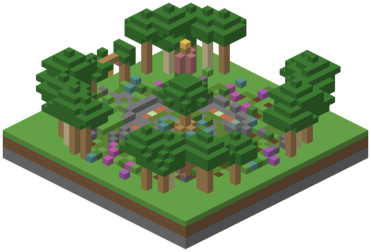
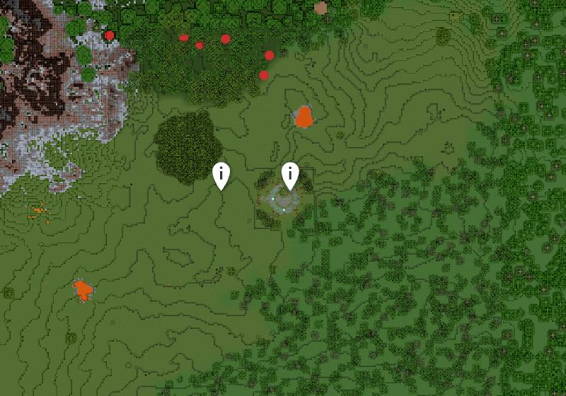
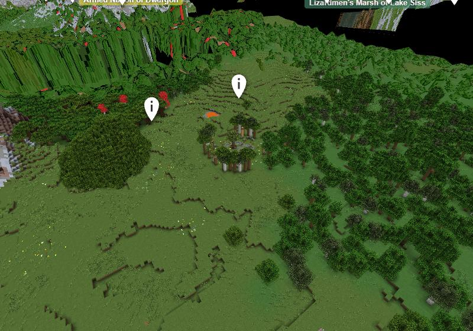

# Treyni's shrine (authored old-forest site)

Round57 [source/route review](../../research/tensura-world-2026-11-19/treant-route-context-r57.md): current grove(320,470),r56,and shrine(500,600),r36,are project reservations. The treant settlement remains distinct and unlocated. Do not turn the WN wetland relief estimate into a Tempest cart-road distance,an east-of-Ameld sovereign boundary or an initial-era supply event. WN43 qualifies treant movement as within their sanctuary. Imported coordinates and +38 offset below are historical.

`id: treyni_shrine` · build (our blueprint) · region **J** (Jura-Tempest Federation)

| | |
|---|---|
| Anchor (Lerfing's map, x, z) | **1958, 1540** (x grows east, z grows south) |
| Audit status (19/11/2026) | **ISSUE, medium** |
| Blueprint | [`blueprints/treyni_shrine.py`](../../../blueprints/treyni_shrine.py), 33 x 22 x 33 blocks (x, y, z), anchor [16, 5, 16] |
| Preview (blueprint only) |  |
| Lore page | [`design/lore/treyni_shrine.md`](../../../design/lore/treyni_shrine.md) |

## Lore (canon)

See Treyni's grove. The sources describe no altar; the shrine is our interpretation.

## What it should look like

A round mossy dais with a ring of green runes; a young azalea tree (seedling of the ancient tree) four blocks north of the arrival stone; three seats for the three sisters, each with a potted sapling; four log posts with lanterns and vines; a living gate of two bent oak logs on the west side. Lit with lanterns, froglight and a shroomlight in the crown. Surrounded by old forest.

Why it stands here (anchor table, Lerfing coordinates): Grove + 38 east, beside = treyni_grove as today.

## Current state: BlueMap audit of 19/11/2026

Map: Tensura by Lerfing (current, being replaced). The screenshots are from the public BlueMap; positions and terrain will change with the new world, the lore and the design intent above will not.

- **Status:** ISSUE, medium
- **Placed:** 1954 76 1544 (corner 1938 71 1528)
- Lore: shrine stands in an open meadow (stored biome plains), with the forest starting just east. Known; fix in progress.
- verify 99.99 % (3 vines), foundation solid, no fluids.
- Fix: Fix in progress (Claude, technical).
- **After the audit:** PR #56 (merged 19/11/2026, after these screenshots) plants an old forest round Tempest (r 60..250: 52 giant ancient-forest trees and about 1,300 ordinary trees) and round Treyni's shrine (r 25..180: 69 giants and about 1,070 trees) and lays the Dwarven Road from Tempest to Dwargon. It reaches staging with the next deploy; the audit text above describes the state before it.

  
*Top-down, about 300 blocks across. Map: Tensura by Lerfing (current, being replaced).*

  
*3D perspective, about 100 blocks. Map: Tensura by Lerfing (current, being replaced).*

## What ChatGPT can deliver for this place

- Concept art: `docs/art/places/treyni_shrine.png` + `docs/art/places/treyni_shrine.md` (see [art.md](../art.md)).
- Blueprint design notes or a Python blueprint in the format of [builds.md](../builds.md) (never the placement data: that is Claude's).
- Lore and quest text in EN and NL for this place (see [tasks.md](../tasks.md)).

Back to the [world guide](../world.md) · [knowledge pack](../README.md)
