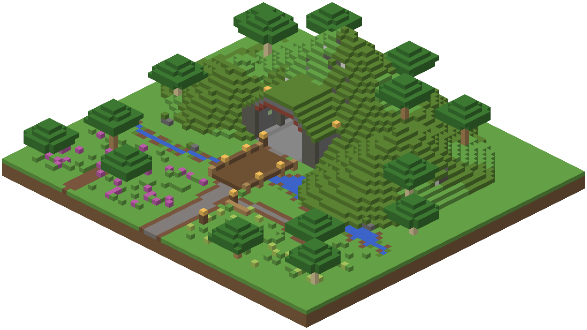
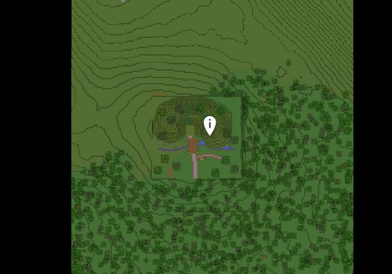
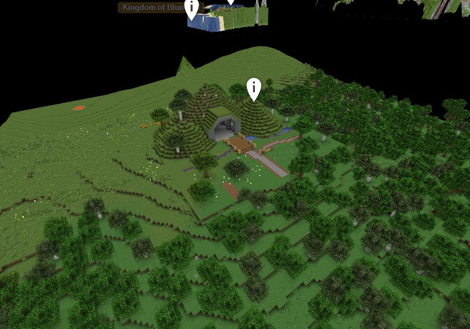

# Galut / Ulgr Nature Park (Ulgracia)

`id: ulgr_nature_park` · build (our blueprint) · region **U** (Republic of Ulgracia)

| | |
|---|---|
| Anchor (Lerfing's map, x, z) | **-1040, 1060** (x grows east, z grows south) |
| Audit status (19/11/2026) | **OK** |
| Blueprint | [`blueprints/ulgr_nature_park.py`](../../../blueprints/ulgr_nature_park.py), 71 x 28 x 65 blocks (x, y, z), anchor [30, 4, 31] |
| Preview (blueprint only) |  |
| Lore page | [`design/lore/ulgr_nature_park.md`](../../../design/lore/ulgr_nature_park.md) |

## Lore (canon)

The republic of elemental magic users lives from trade with Sarion and from farming; its capital is Galut. In the children's story the entrance to Ramiris's spirit dwelling is in Ulgr Nature Park (anime episodes 22-23).

## What it should look like

A gravel trail crosses a spring on a spruce footbridge and enters a wooded chalk bluff; three interior ribs lead from the vault mouth to a pair of dark stone leaves trimmed with aged copper; warm lights flank the passage; a bank path skirts a shallow pool with a bench at the fork.

Why it stands here (anchor table, Lerfing coordinates): Ulgracia's woodland south of Blumund, y 80/83/86.

## Current state: BlueMap audit of 19/11/2026

Map: Tensura by Lerfing (current, being replaced). The screenshots are from the public BlueMap; positions and terrain will change with the new world, the lore and the design intent above will not.

- **Status:** OK
- **Placed:** -1056 86 1060 (corner -1086 82 1029)
- Edge of a forest; verify 100 %.

  
*Top-down, about 300 blocks across. Map: Tensura by Lerfing (current, being replaced).*

  
*3D perspective, about 100 blocks. Map: Tensura by Lerfing (current, being replaced).*

## What ChatGPT can deliver for this place

- Concept art: `docs/art/places/ulgr_nature_park.png` + `docs/art/places/ulgr_nature_park.md` (see [art.md](../art.md)).
- Blueprint design notes or a Python blueprint in the format of [builds.md](../builds.md) (never the placement data: that is Claude's).
- Lore and quest text in EN and NL for this place (see [tasks.md](../tasks.md)).

Back to the [world guide](../world.md) · [knowledge pack](../README.md)
