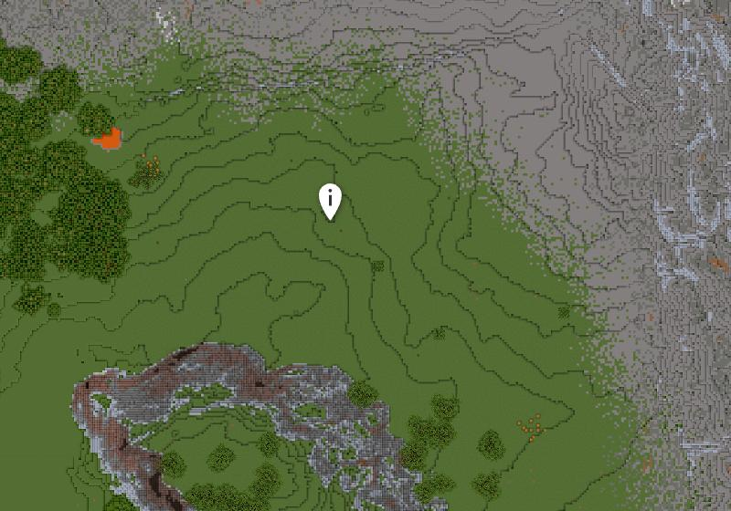
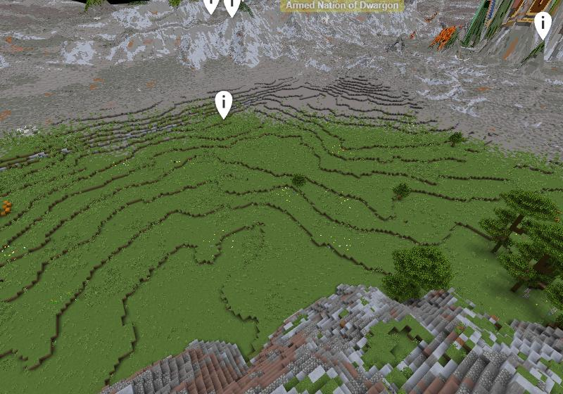

# Wayfarers' camp on Jura's rim (sidequests rim_camp)

`id: wayfarers_camp` · spot (NPC, boss or quest point) · region **J** (Jura-Tempest Federation)

| | |
|---|---|
| Anchor (Lerfing's map, x, z) | **1675, -85** (x grows east, z grows south) |
| Audit status (19/11/2026) | **OK** |
| Relative to | `arrival` + (15, 15) |
| Lore | [`design/lore/world.md`](../../../design/lore/world.md), section J |

## Lore (canon)

Pack invention for the side quests (`rim_camp` in `design/data/sidequests.toml`): the first human-sized shelter a newly reborn soul meets.

## What it should look like

Nothing is specified beyond the NPCs: adventurers (Easy NPCs) stroll round it, 15 blocks south-east of the arrival. Suggestion: a few tents, a fire, a bench and a signpost. No blueprint yet; a good first small build for the new world.

Why it stands here (anchor table, Lerfing coordinates): Arrival-relative.

## Current state: BlueMap audit of 19/11/2026

Map: Tensura by Lerfing (current, being replaced). The screenshots are from the public BlueMap; positions and terrain will change with the new world, the lore and the design intent above will not.

- **Status:** OK
- **Placed:** not applicable (no structure: spot)
- Plains next to the arrival; fine.

  
*Top-down, about 300 blocks across. Map: Tensura by Lerfing (current, being replaced).*

  
*3D perspective, about 100 blocks. Map: Tensura by Lerfing (current, being replaced).*

## What ChatGPT can deliver for this place

- Concept art: `docs/art/places/wayfarers_camp.png` + `docs/art/places/wayfarers_camp.md` (see [art.md](../art.md)).
- Lore and quest text in EN and NL for this place (see [tasks.md](../tasks.md)).

Back to the [world guide](../world.md) · [knowledge pack](../README.md)
