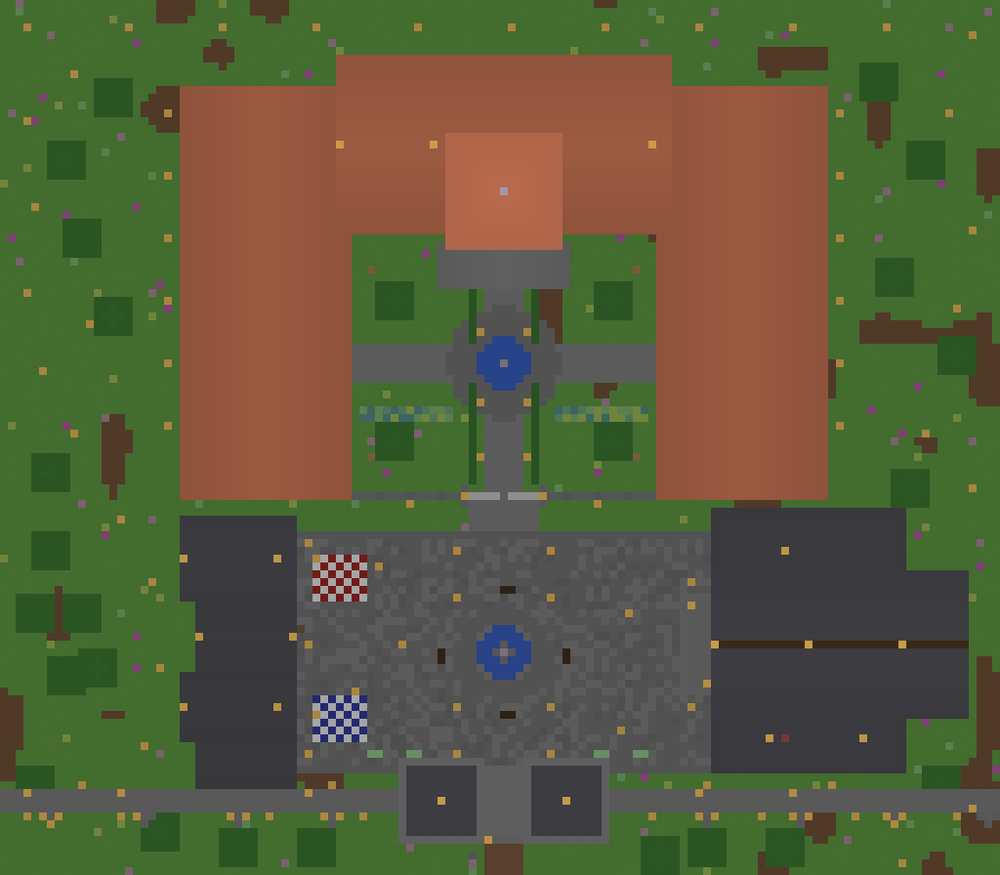
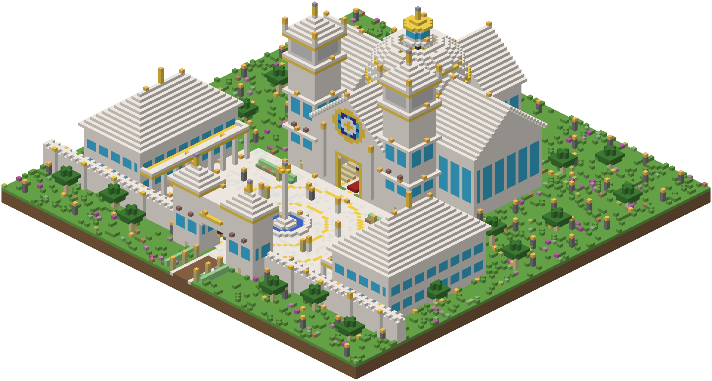
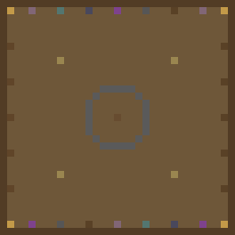
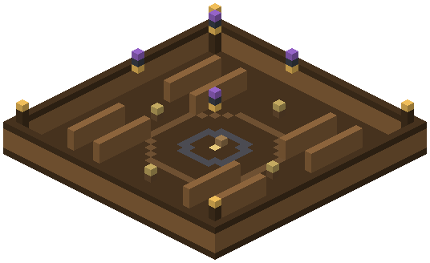
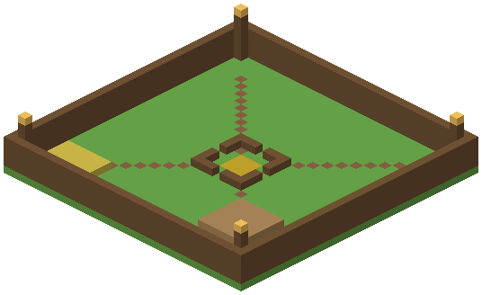
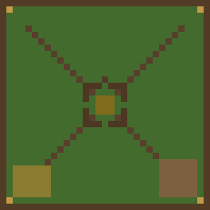
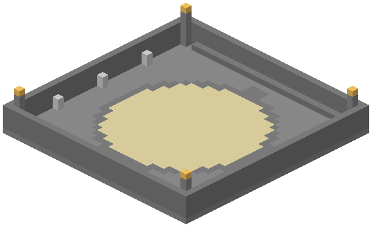
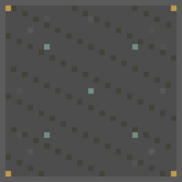

# Build gallery

Generated by `python tools/build_structures.py` from `blueprints/`; do not edit by hand.
Place any of these in game with `/ttl build <name>` (corner at your feet).

## dwargon

The Armed Nation of Dwargon: the dwarf kingdom in a great cavern inside a pale sandstone mountain. Lore notes and sources: design/lore/dwargon.md. SIZE (148, 92, 168), saved as three z slabs dwargon_0..2 (z 0-55, 56-111, 112-167; PARTS) placed side by side by life/dwargon.js. The gate faces south (+z). The mountain is part of the build (stepped sandstone/terracotta massif, grass on its lower terraces, two spurs flanking the gate); outside the mountain and the approach the corners are left empty and terrain stays. Grounding: outputs() writes generated/dwargon_footprint.js (lowest block per column, open-sky columns), which dwargon.js uses to fill the ground under the build and clear hills off the road (see there). Outer road: from the south edge (z 167) past a checkpoint arch (z 160) and a road tower with a banner (z 148-152, west), then fenced queue lanes for the gate inspection (z 114-125) between two guard booths, to the white gate wall (back z 104, front face z 107, towers out to z 111 and up to y 29, yellow banners with the red emblem). Gate opening x 71-77, y 4-11 (arch to y 13). Arrival point: blueprint (74, 4, 120) on the road, facing north. A tunnel (z 94-106) leads into the cavern city: floor blocks at y 3 (you walk at y 4), cavern z 14-100, about 44 wide on the streets and 63 at the plaza, vault up to y 53 with a canyon-like skylight crack over the main street. Levels: the street (y 4), the royal terrace (y 8), wall homes on balconies at y 18, 24 and 32 reached by ladders up stone props from the back alleys behind the houses, and plank bridges hung on chains across the canyon street at y 24 linking facing homes. South street (z 68-94) of stone and timber houses (2-4 storeys, lit windows, shop signs) including the Night Butterflies cabaret (pink, west, z 83), lamps strung across the street; a round plaza (centre 74, 54, radius 17) with a cogwheel fountain and twelve market stalls, a forge hall (west) and a Create workshop (east); the forge street (z 34-43) with Kaijin's smithy (west, z 34); then a great stair (z 30-33) to the royal terrace (floor y 7, landing z 28-29) and King Gazel's throne room: Tensura's own Gazel Dwargo boss arena (blueprints/assets/gazel_throne.nbt, the dwarf_arena structure), its dais half (arena x 42-68) turned a quarter so the throne faces south, at x 49-99, y 1-27, z 0-26 behind a tuff facade with a great door (z 27, x 71-77). The arena's black glass shell became deepslate/tuff/stone (sandstone strata where it meets the open slope), the boss pit and its warp pads were left out, the bulbs' redstone blocks became rock (bulbs stay lit). Throne seat (74, 9, 11); dwargon.js seats Gazel there and restores the canon banner patterns. Chimneys smoke (campfires on hay). Every spawnable spot inside has block light (checked when this builds).

 

## englassia

Englassia, the royal capital Lura: the Freedom Academy and the Free Guild headquarters inside the city wall. Lore notes and sources: design/lore/englassia.md. SIZE (128, 60, 112), saved as three z slabs englassia_0..2 (PARTS). Ground layer y 4 (grass and paving, dirt below), you walk at y 5; everything above is air, so the placer clears forest and hills in the box (clear_above). The city wall runs across the south (z 100-106); the road arrives from the south (z 107-111) and the arrival point is blueprint (64, 5, 109), facing north at the gate. Landmark scale, not a whole city: the walled gate (two towers, banners, a 7 wide passage x 61-67), Lura Square (z 68-98, paved, fountain, market stalls, a townhouse row on the west side), the Free Guild headquarters on the east side of the square (a 31 x 17 hall with a gable facade to the west, columned portico, golden emblem, red banners, two wings; reception counter, quest wall, tables and chandeliers inside), and north of the square the Freedom Academy: a long main hall (x 44-84, z 8-28) with a clock tower over the entrance (x 58-70, spire to y 56), two classroom wings (x 24-43 and 85-104, z 12-62) round a walled lawn courtyard with a fountain and four trees (x 44-84, z 29-62), cloister wall with a gate (z 63-65). Styles: stone brick walls, dark oak timber, oxidised-copper roofs on the Academy, slate roofs on the gate and the Guild. Refined academic city; the Guild is the sturdy working half. Every spawnable spot inside the plot has block light (checked when this builds). The exact architecture is our interpretation (canon gives a walled capital with two gates).

 

## lubelius

Holy City Lubelius (Lune): the cathedral of the Western Holy Church and its square, white stone and gold. Lore notes and sources: design/lore/lubelius.md. SIZE (120, 64, 120), saved as three z slabs lubelius_0..2 (PARTS). Ground layer y 4 (grass and white paving, dirt below), you walk at y 5; everything above is air, so the placer clears forest and hills in the box (clear_above). The city arrives from the south: the road runs up to the Holy Gate (white wall z 103-105, two gold-capped pylons, a 9 wide passage x 56-64), arrival point blueprint (60, 5, 114) facing north. Beyond the gate the Holy Square (z 64-102, a paved disc with gold rings, a fountain and a golden-crowned pillar at (60, 84)) is closed by two colonnaded halls: the Hall of the Holy Knights on the east side (Hinata Sakaguchi's Temple Knights, banners, long tables) and the Pilgrims' Hall on the west. The cathedral fills the north (z 8-62): a cross-shaped church of white quartz, the nave x 49-71 (z 16-62) with the transept x 30-90 (z 28-50), a dome over the crossing (drum and hemisphere, radius 11, gold bands, lantern turret and rod to y 55), twin facade towers (x 40-48 and 72-80, spires and rods to y 58), a rose window and a seven wide portal in the facade (z 62). Inside: marble floor with gold inlay, a red carpet, pews in the south arm, a raised choir with a gold altar in the north arm, chandeliers hung from the ridge. The Sacred Mountain approach (separate landmark) is not built here. Palette: quartz, quartz bricks, pillars, smooth quartz, calcite, gold blocks, light blue stained glass. Our interpretation: canon says the capital is a rich city with high-end magic and technology, seat of the Western Holy Church (the real-world Vatican analogy); the cathedral's form is ours. Every spawnable spot inside the plot has block light (checked when this builds).

 

## mortal_spawn

Wayfarer's Rest: where every new soul starts Life 1 in the Mortal Realm (a humble human hamlet square). Placed by life/mortal_spawn.js centred on the surface at 0, 0. Layers 0-5 are a foundation (retaining wall around an earth core) so it sits on any terrain; layer 6 is the plaza; layers 7-21 are cleared so hills don't bury it. Players arrive south of the shrine, at blueprint (14, 7, 19).

 

## spirit_corridor_hall

The Spirit Corridor hall: where a soul waits between lives (master plan §1). A round floating hall in the void. Ten pedestals stand for the ten Last Wishes; a halo hangs above the centre, where souls arrive (structure centre = corridor 0 64 0, so the arrival point (15, 1, 15) stays free). Placed by life/corridor.js at -15 64 -15.

 

## tempest

Tempest (early): the hobgoblin village in a clearing of the Forest of Jura, just after the ogres joined. SIZE (91, 40, 91), centre column (45, 45). Ground layer y 4 (grass, dirt paths; dirt below), you walk at y 5; everything above is air so placement clears the forest and hills in the box. Arrival point: blueprint (45, 5, 57) on the south edge of the village green, with a signpost east of it; placed at world 0, 0 (the Life 2 world spawn) by life/tempest.js, which grounds it with generated/tempest_footprint.js. Village (a rough rounded-square clearing, radius about 38, ringed by our own persistent-leaf forest edge): the meeting longhouse (north of the green) where Rimuru holds council, Rimuru's small house behind it, the cooking fire and well on the green, Kaijin's open forge and workshop (west road), Shuna's weaving hut (east road), a raised food store, the goblins' old quarter (north-east: Tensura's own goblin village pieces, blueprints/assets/goblin_village/, round their campfire behind a skull arch), finished hobgoblin houses, a building site (south-west: half-roofed house, timber frame, foundation, scaffolding, log piles, sawhorse), a fenced field and herb patch (south-east), a lookout tower (north-west) and a palisade begun on the west side with a south gate. Roofs and trim borrow the goblin village palette (Tensura thatch, oak logs and fences). Every spawnable spot in the clearing has block light (checked when this builds). Visual references and sources: design/lore/tempest.md.

 

## trial_creation

Trial of Creation: a workshop. The crafting table at (0, 0); parts are dropped around (+-10..13); start (0, -6). No anvils or fire here: the trial cleanup clears those.

 

## trial_deceit

Trial of Deceit: a dark gallery watched by nine Watchers (rows z = -4, 3, 10; x = -8, 0, 8). Start (0, -14); the emerald exit at (0, 13..15). Only distance decides whether you are seen, so the decor here is mood, not cover.

 

## trial_dominion

Trial of Dominion: a ranch. The herd starts in the north-west; the pen is x, z 8..14 with its gate at (8, 11) facing east (trial_defs.js counts cows inside x, z 9..14). Bring three cows inside.

 

## trial_freedom

Trial of Freedom: a jump course over a pit. The course is at y=PIT (the trial's floor level); the pit floor at y=0 is 6 blocks lower. Start pad (0, -13), COURSE blocks, gold goal (0, 12..14). Falling below the course sends the player back to the start (trial_defs.js).

 

## trial_hunger

Trial of Hunger: a ruined storehouse. Food lies around the edges (+-10..13); start (0, 0).

 

## trial_knowledge

Trial of Knowledge: a library. The lectern at (0, 0) is where the Voice asks; start (0, 0) beside it.

 

## trial_protection

Trial of Protection: a farmyard. The ward (villager) stands on the hay at (0, 0); start (0, -4). Attackers come from the corners (+-12, +-12): keep those open.

 

## trial_strength

Trial of Strength: a colosseum. Four waves spawn at (+-10, 10), (+-10, -2), (0, 12); start (0, -12).

 

## trial_survival

Trial of Survival: a ruin. No weapons; poison, falling anvils and fire come at random. Start (0, 0). Keep the floor flat and free of anvils and fire: the cleanup clears those.

 

## trial_vengeance

Trial of Vengeance: a dark duelling ground. The nemesis spawns at (0, 4); start (0, -12).

 
