# Build gallery

Generated by `python tools/build_structures.py` from `blueprints/`; do not edit by hand.
Place any of these in game with `/ttl build <name>` (corner at your feet).

## amrita

Amrita, buried gallery of Jistav's ancient capital. SIZE (69, 32, 75), three z slabs. South walking anchor (34, 16, 68). A sunken stair enters a vaulted underground gallery between two inert ward-golems. Light novel volume 10, pp. 15–16 (Japanese edition), official Jistav glossary, source map and adaptations in design/lore/amrita.md. Tuff, deepslate, moss, copper, calcite and glass.

 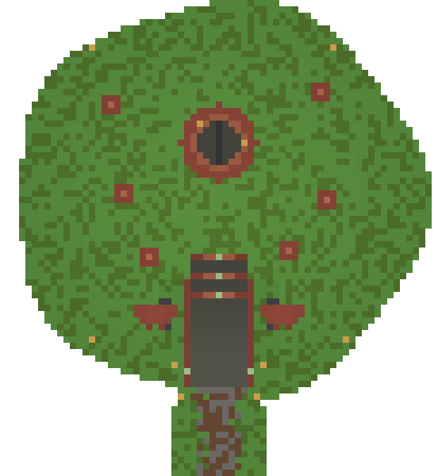

## ballachia

Ballachia, the former Orthrus exchange and the road the freed elves take east. SIZE (76, 38, 66), two z slabs at 0 and 33. Anchor (38, 4, 41) on the forecourt. Three ribbed blue domes, an arched porch and a tracery window rise over a south-facing arcade. The form and illuminated windows follow the episode 65 Ballachia establishing shot. A broken chain in the yard paving connects the hall, lodging house and cart shed. Materials include blue terracotta, deepslate, brick, spruce, dark oak, calcite, stone bricks, warm lantern glass and iron. Manga chapter 108 gives the rescue and escort. The three road ends narrow to cart ruts between low meadow banks. The use of this facade for the yard is our interpretation (design/lore/ballachia.md).

 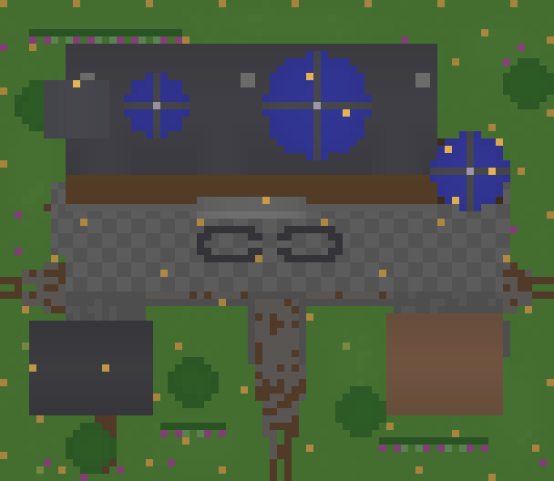

## blumund

Blumund: the small trading kingdom's walled capital (Londo on the fan map) with the Free Guild branch hall. Lore, canon notes and our interpretation: design/lore/blumund.md. SIZE (124, 52, 116), saved as three z slabs blumund_0..2 (z 0-39, 40-79, 80-115; PARTS). Ground layer y 4 (grass, paved streets; dirt below), you walk at y 5; everything above is air so placement clears trees and hills inside the box. The gate faces south (+z). Arrival point: blueprint (62, 5, 108) on the king's road, 15 blocks south of the gate, facing north. Layout, from the south: approach road (z 93-115, x 59-65) between wheat fields and a farmstead; town wall z 90-92 (plastered timber is for houses, the wall is stone) with the south gate, opening x 59-65, y 5-9, flanked by two gate towers; the main street (x 58-66) runs north through the gate; a few houses and a well at the gate; the market square (x 34-90, z 54-80: checker paving, fountain at 62,67, twelve striped market stalls); the Free Guild branch hall on the square's east side (x 93-112, z 56-80, door on the west side at z 67-68, double-height hall with the reception counter, two notice boards, tavern tables, and a mezzanine office for the branch master); the merchant cross street (z 50-52) with shops on both flanks; west district (two rows of houses facing the square and a rear lane); south rows (z 82-88) between the gate and the square; at the north end the royal castle on the main axis: ward wall z 46-48 with a gatehouse, courtyard z 32-45 (well, barracks, stable), the keep (x 50-74, z 10-28; throne hall on the ground floor, council chamber above, battlemented roof) with four corner towers up to y 32, and the side walls running north to the town's north wall (z 4-6). Orchards flank the castle. Guild points (blueprint coordinates): reception counter x 102, z 60-76 (customers stand west of it, staff at x 103); main quest board x 94, z 58-64, y 6-8 (a framed 7x3 panel on the west wall's inside); second (bounty) board x 94, z 72-78; branch master's desk on the mezzanine at (109, 11, 61); stairs up at x 98-103, z 57. Throne seat (62, 6, 12). Style: plastered timber-frame houses (calcite / cream plaster, dark oak frame, red tile roofs), stone walls and gates, slate roofs on civic buildings, red and cream banners (our interpretation, canon gives no heraldry). Block light is checked for every spawnable spot inside the walls and the approach.

 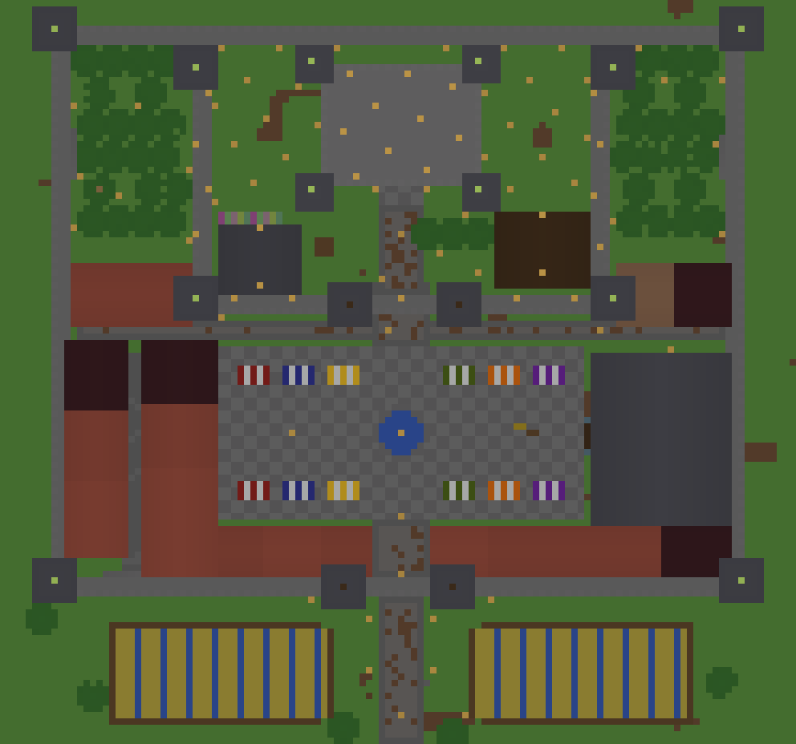

## clayman_castle

Clayman's Castle: the dark fortress of the Demon Lord Clayman, "Crazy Pierrot", in the Puppet Nation of Jistav. Lore notes and sources: design/lore/clayman_castle.md. SIZE (109, 66, 109), centre column (54, 54), saved as four z slabs clayman_castle_0..3 (PARTS). Ground layer y 5 (outside: podzol and coarse dirt, you walk at y 6); the castle stands on a deepslate platform (top y 7, you walk at y 8) ringed by a moat (square ring, 37-41 blocks from the centre, water y 2-5) and an outer bank. The gate faces south (+z). Arrival point: blueprint (54, 6, 102) on the approach road, facing north. From the south: road, a stone bridge (z 90-97, deck y 7, walk y 8) over the moat, the gatehouse in the curtain wall (wall 3 thick, y 8-17, wall walk y 18, crenellated; opening x 51-57, y 8-16, raised portcullis, two round towers with spires at x 45 and 63), the courtyard (paved in deepslate tiles, lamp posts, "puppet" stands of skulls on posts and two gallows frames hung with chains and soul lanterns, the marionette motif), and the keep (x 40-68, z 34-62, walls to y 32, four corner turrets r 4 with spires, a great central spire to y 62, gothic windows of purple glass, buttresses, a giant pierrot mask over the great door). Inside the keep: the entrance hall (south, z 49-60) with a stair along its west wall up to a gallery (floor y 19) that overlooks the throne hall through the partition (z 47-48), and the 22-block-high throne hall (z 36-46): purple carpet, two rows of pillars, a three-step dais with the throne, the pierrot mask on the north wall and marionette controllers (chains and soul lanterns) hung from the vault. The curtain wall has four corner towers (r 5), three mid towers (r 4) and wall-walk stairs inside the gate. The moat, the platform and the bank are part of the build; dead trees stand on the outer bank. Every spawnable spot inside the moat ring (and on the bridge and bank) has block light (checked when this builds).

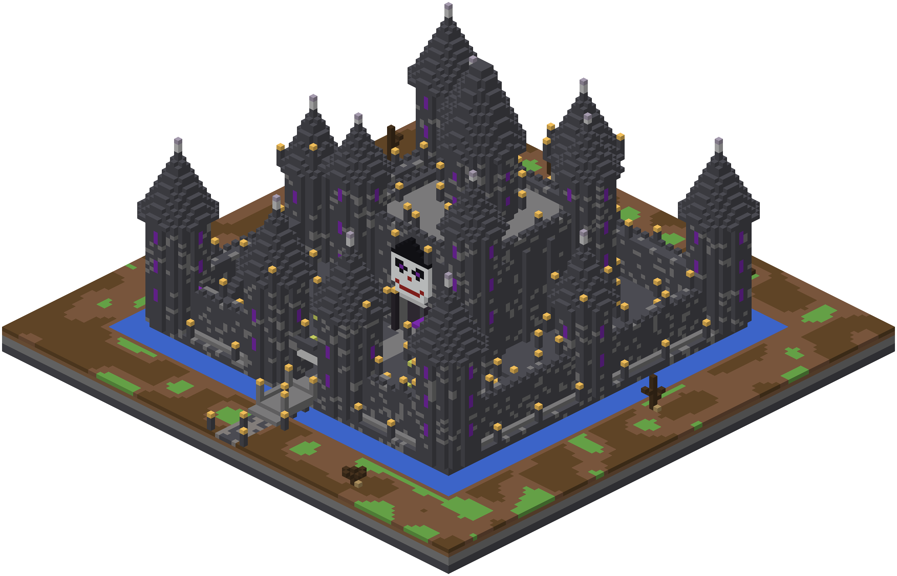 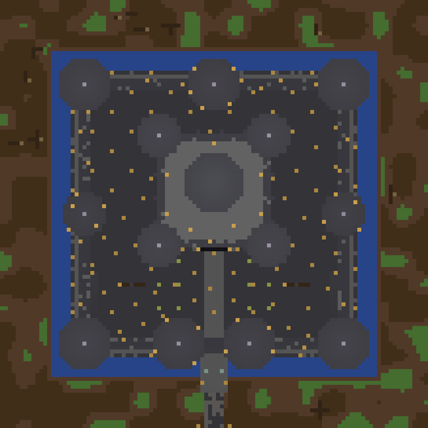

## coleus

Coleus, the palace ascent above the oasis of Herbaria. SIZE (85, 47, 79), three z slabs. Anchor (42, 4, 72) at the foot of the stair. INEI's official Coleus panorama (ten-sura.com/anime/coleus/introduction) shows a long inclined approach to an ochre hilltop drum, turquoise domes and an oasis. Sandstone, terracotta, gold, cyan concrete and waxed oxidized copper model these surfaces. The rose pavilion and audience chamber interpret the succession story.

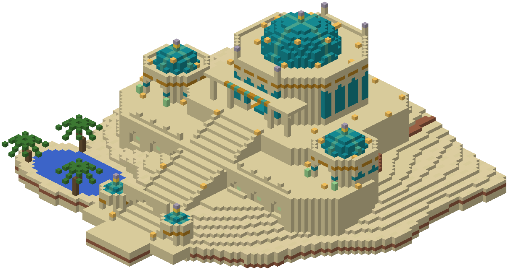 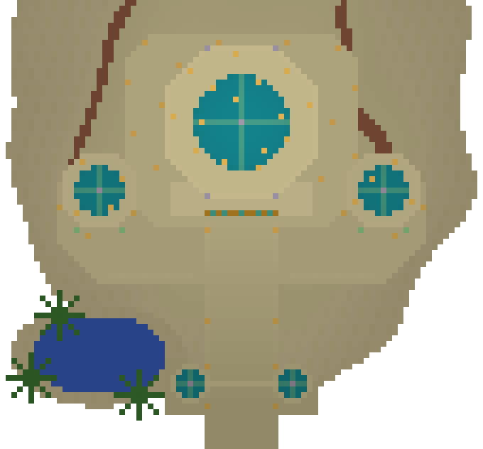

## dragons_nest

The Dragon's Nest: the stronghold of the dragons on the highest peak of the Great Canaat Mountains. SIZE (73, 46, 73). Ground layer y 8 (stone, snow on top; stone and ice below), you walk at y 9; everything above is air, so placement shaves the summit inside the box and the terrain skirt does the rest. Arrival and anchor point: blueprint (36, 9, 62), at the south entrance gap of the nest wall, facing north. Canon gives only: the Dragon's Nest is a stronghold at the very top of the tallest peak of the Great Canaat Mountains, which the dragon lords hold, and dragons grow stronger the higher up the range they live (Tensura wiki: Great Canaat Mountains, Central World). Everything about how it looks is our interpretation: a wide roosting bowl woven of spruce and dark-oak trunks lined with hay, ringed by a jagged wall of blackstone, stone and bone-white calcite with a south gap, eight broken spires, three smaller roosts for the lords' young, scattered bones and scorch marks, a low hoard of gold and amethyst, and a central perch of stacked rock with a sea lantern. Snow lies on everything. Every spawnable spot inside the wall has block light (checked when this builds). Sources and what was and was not found: design/lore/dragons_nest.md.

 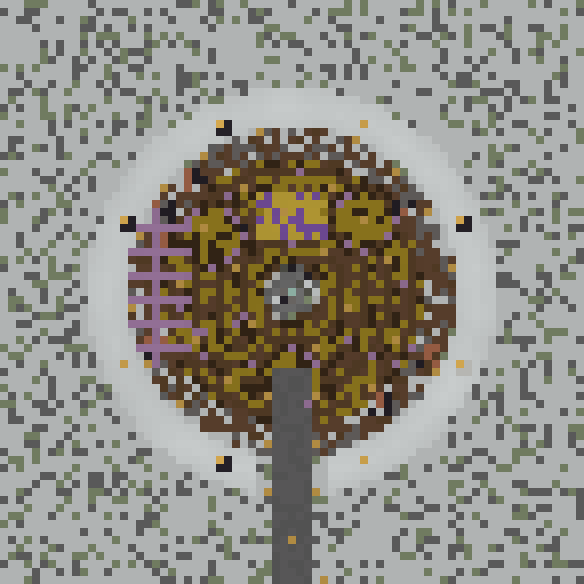

## dwargon

The Armed Nation of Dwargon: the dwarf kingdom in a great cavern inside a pale sandstone mountain. Lore notes and sources: design/lore/dwargon.md. SIZE (148, 92, 168), saved as three z slabs dwargon_0..2 (z 0-55, 56-111, 112-167; PARTS) placed side by side by life/dwargon.js. The gate faces south (+z). The mountain is part of the build (stepped sandstone/terracotta massif, grass on its lower terraces, two spurs flanking the gate); outside the mountain and the approach the corners are left empty and terrain stays. Grounding: outputs() writes generated/dwargon_footprint.js (lowest block per column, open-sky columns), which dwargon.js uses to fill the ground under the build and clear hills off the road (see there). Outer road: from the south edge (z 167) past a checkpoint arch (z 160) and a road tower with a banner (z 148-152, west), then fenced queue lanes for the gate inspection (z 114-125) between two guard booths, to the white gate wall (back z 104, front face z 107, towers out to z 111 and up to y 29, yellow banners with the red emblem). Gate opening x 71-77, y 4-11 (arch to y 13). Arrival point: blueprint (74, 4, 120) on the road, facing north. A tunnel (z 94-106) leads into the cavern city: floor blocks at y 3 (you walk at y 4), cavern z 14-100, about 44 wide on the streets and 63 at the plaza, vault up to y 53 with a canyon-like skylight crack over the main street. Levels: the street (y 4), the royal terrace (y 8), wall homes on balconies at y 18, 24 and 32 reached by ladders up stone props from the back alleys behind the houses, and plank bridges hung on chains across the canyon street at y 24 linking facing homes. South street (z 68-94) of stone and timber houses (2-4 storeys, lit windows, shop signs) including the Night Butterflies cabaret (pink, west, z 83), lamps strung across the street; a round plaza (centre 74, 54, radius 17) with a cogwheel fountain and twelve market stalls, a forge hall (west) and a Create workshop (east); the forge street (z 34-43) with Kaijin's smithy (west, z 34); then a great stair (z 30-33) to the royal terrace (floor y 7, landing z 28-29) and King Gazel's throne room: Tensura's own Gazel Dwargo boss arena (blueprints/assets/gazel_throne.nbt, the dwarf_arena structure), its dais half (arena x 42-68) turned a quarter so the throne faces south, at x 49-99, y 1-27, z 0-26 behind a tuff facade with a great door (z 27, x 71-77). The arena's black glass shell became deepslate/tuff/stone (sandstone strata where it meets the open slope), the boss pit and its warp pads were left out, the bulbs' redstone blocks became rock (bulbs stay lit). Throne seat (74, 9, 11); dwargon.js seats Gazel there and restores the canon banner patterns. Chimneys smoke (campfires on hay). Every spawnable spot inside has block light (checked when this builds).

 

## dwarven_arena

The Dwarven Arena: Yasuke's `dwarf_arena` export (Tensura's Gazel Dwargo fight hall, 69x27x51), as a venue for duels. Source: blueprints/assets/gazel_throne.nbt (byte for byte Tensura 2.0.1.5 `dwarf_village/building/dwarf_arena.nbt`, the same file blueprints/dwargon.py cuts the throne room from). Owner request (#5): the arena without the royal warp pad, the Dwargo boss and the black stained glass layers on the outside. What this blueprint does with the export: - the black stained glass shell (30,666 blocks, the void-facing envelope the mod's boss dimension needs) is dropped: the hall's stone, tuff and deepslate walls stand on their own and the placer fits them into the terrain; - the nine `royal_dwarven_warp_pad` blocks (the entry pad of the boss pit, x 1-3 z 24-26) and the four `stone_warp_pad` exit pads are gone. They are real teleporters (to the spawn point): no warp pad stays in the build; - the export holds no entity, so there is no Dwargo to strip here: the boss only ever came from LabyrinthHandler's code, and nothing in this build summons it (a challenge in arenas.toml uses waves only, no boss); - the developers' hidden nook (player heads with real account names, a sign, the second set of pads, at x 5-10 y 20-24 z 31-36) is filled with tuff; its glass walls become tuff too, so the hall's shell stays closed; - the boss dimension never spawns monsters, the Tensura world does: every floor spot a monster could spawn on (about 185 dark ones, mostly along the pit walls and on the dais) gets a glowstone tile instead of its floor block; - an entrance: the pad alcove at the west end of the pit gets a door (3 wide, 3 tall) and a small forecourt, because the hall had no way in other than the pads. Block entity data does not survive a structure file (the pack's loader), so the yellow Dwargon banners are plain. Layout (blueprint coordinates, the export shifted by +6 x and -1 y; the floor of the pit is the ground layer y 0, you walk at y 1): forecourt x 0-5, door x 6, pad alcove x 7-10, the pit x 11-46 (pillars in rows, the boss pit; fighters stand here), the stairs up at x 47-49, the throne dais x 48-68 at y 5-6 (red runner, Gazel's red nether brick throne without Gazel: the spectators' gallery) and the rock behind it. SIZE (75, 26, 51). Anchor: the forecourt, blueprint (3, 1, 25), facing east into the hall.

 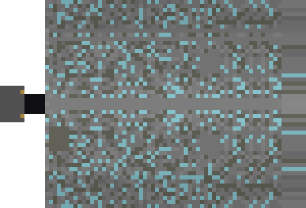

## el_dorado

Golden City of El Dorado — Leon Cromwell's audience court. SIZE (81, 39, 83), south approach anchor (40, 4, 74), PARTS split at z 28 and 56. Episode 87 (design/lore/el_dorado.md) shows a high gilded throne and a red runner up broad pale steps. The light novel's white central castle and six-pointed city plan inform the quartz walls and paving motif. A glazed arcade bay holds the rose garden’s silver-framed mirror from episode 87. The amber lantern roof, court layout and reflecting canals are our interpretation. Materials: quartz, sandstone, polished blackstone, gold, waxed copper, coloured glass and wool.

 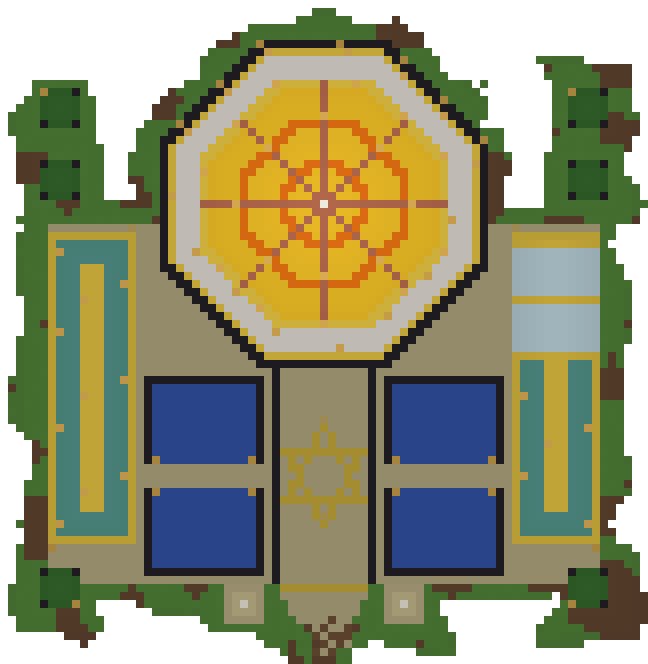

## elmine

Elmine, the Divine Tree's lower embassy terrace. SIZE (75, 60, 75), three z slabs. South walking anchor (37, 4, 67). Sarion's capital in the Divine Tree is represented by its root gate, a raised annular promenade and two open diplomatic pavilions. Oak, pale quartz, birch, weathered copper and persistent leaves. Sources and scale interpretation in design/lore/elmine.md.

 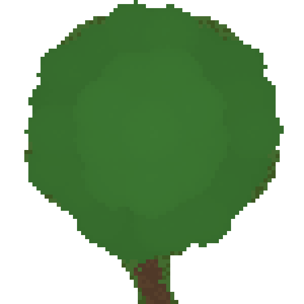

## englassia

Englassia, the royal capital Lura: the Freedom Academy and the Free Guild headquarters inside the city wall. Lore notes and sources: design/lore/englassia.md. SIZE (128, 60, 112), saved as three z slabs englassia_0..2 (PARTS). Ground layer y 4 (grass and paving, dirt below), you walk at y 5; everything above is air, so the placer clears forest and hills in the box (clear_above). The city wall runs across the south (z 100-106); the road arrives from the south (z 107-111) and the arrival point is blueprint (64, 5, 109), facing north at the gate. Landmark scale, not a whole city: the walled gate (two towers, banners, a 7 wide passage x 61-67), Lura Square (z 68-98, paved, fountain, market stalls, a townhouse row on the west side), the Free Guild headquarters on the east side of the square (a 31 x 17 hall with a gable facade to the west, columned portico, golden emblem, red banners, two wings; reception counter, quest wall, tables and chandeliers inside), and north of the square the Freedom Academy: a long main hall (x 44-84, z 8-28) with a clock tower over the entrance (x 58-70, spire to y 56), two classroom wings (x 24-43 and 85-104, z 12-62) round a walled lawn courtyard with a fountain and four trees (x 44-84, z 29-62), cloister wall with a gate (z 63-65). Styles: stone brick walls, dark oak timber, oxidised-copper roofs on the Academy, slate roofs on the gate and the Guild. Refined academic city; the Guild is the sturdy working half. Every spawnable spot inside the plot has block light (checked when this builds). The exact architecture is our interpretation (canon gives a walled capital with two gates).

 

## forgotten_dragon_city

City of the Forgotten Dragon: Milim Nava's capital, a poor dragon-worshipping town round an ancient temple. Lore notes and sources: design/lore/forgotten_dragon_city.md. SIZE (121, 44, 125), centre column x 60, saved as four z slabs forgotten_dragon_city_0..3 (PARTS). Ground layer y 4 (coarse dirt, grass, packed mud; you walk at y 5); everything above is air so placing clears trees and hills in the box. The temple faces south (+z). Arrival point: blueprint (60, 5, 118) at the south end of the processional avenue, facing north. Our interpretation of a place canon barely describes (a commune of Dragon Faithful and dragonewts round a Central Temple that hands out goods): the city grew inside the bones of a dead ancient dragon. From the south: the avenue (x 56-64, smooth sandstone) under six rib arches of bone blocks (z 72-112, 20 wide, 13 high), two open granaries with thatch gables either side (z 74-94; the Central Temple distributes goods from them), a bone-fire plaza, and the Central Temple: a five-tier stepped pyramid of sandstone and terracotta (base x 40-80, z 14-54, 3 high per tier, top 17 wide at y 20) fronted by a colossal dragon skull (cranium with glowing eye sockets, horns to y 30, fanged snout) whose open mouth (x 56-64) is the temple gate. A tunnel leads to the distribution hall inside (x 49-71, z 22-46): pillars, stacks of barrels and hay, a counter, and the throne of the Demon Lord Milim (bone, pink terracotta) on a dais at the back. Stairs cut into the east and west faces climb to a pavilion on the summit with a bonfire. Round mud-brick huts with Tensura thatch cone roofs (lit inside, a bed and a barrel in each) lie either side, with campfires, dry fields and a pond for the nearby lake. Every spawnable spot below y 30 has block light (checked when this builds).

 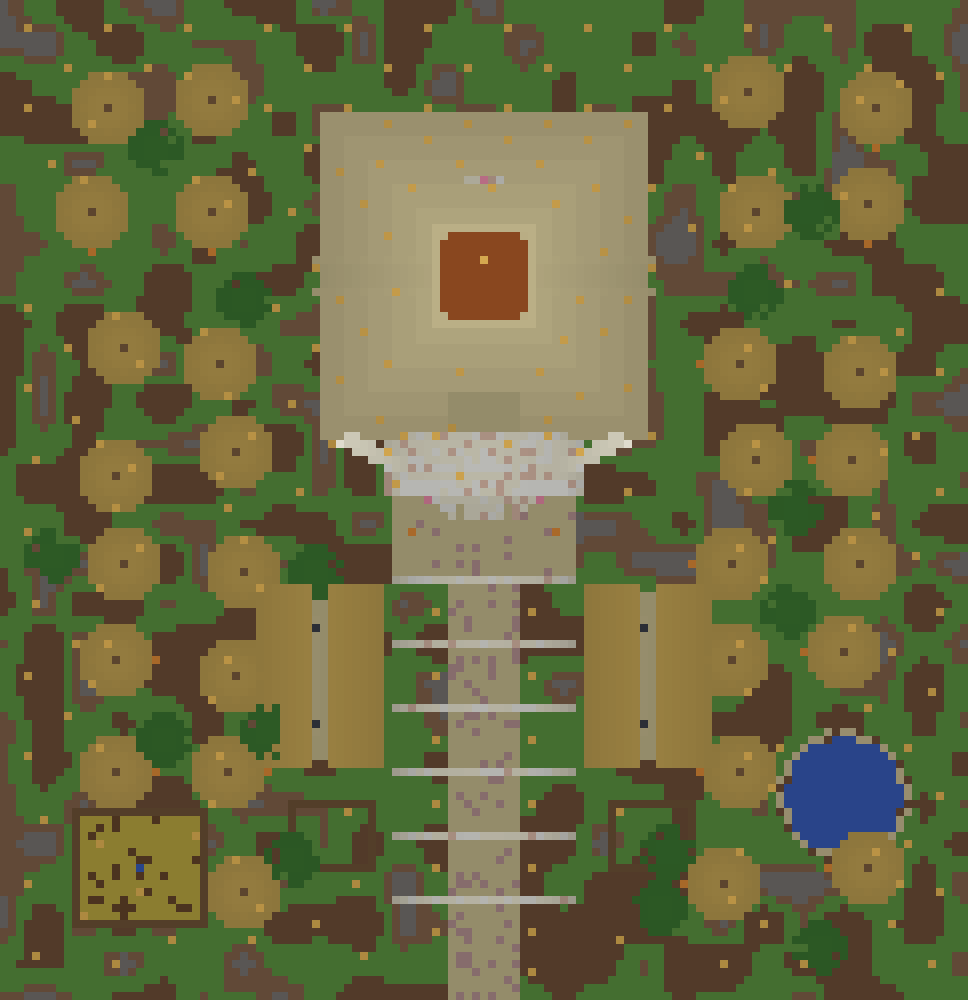

## frost_palace

Guy Crimson's Frost Palace entrance, seen from the Ice Continent. SIZE (85, 51, 69); anchor (42, 4, 65) on the south approach, looking north. Three z slabs. The white masonry shows through Velzard's ice. A causeway crosses a frozen cleft to a pointed gate, guarded by two faceted towers and sweeping ice horns. Open, carved audience doors stand at the end of its lamp-lit passage. Packed ice, blue ice, quartz, snow, violet glass, deepslate and sea lanterns. References: anime episode 42 "The Demon Lords" (Leon's walk through the palace); Fuse, web novel ch. 78 and light novels vols. 6 and 16; Tensura Wiki, Frost Palace and Ice Continent; the pack's political map. Sources and architectural interpretation in design/lore/frost_palace.md.

 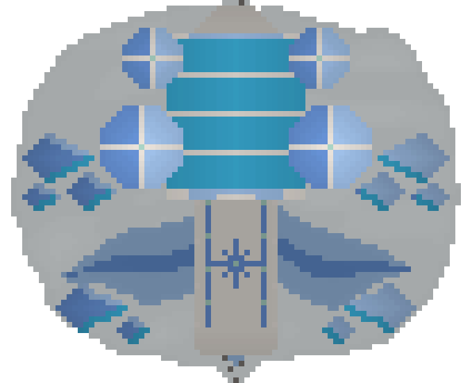

## great_holy_mountain

Velgrynd's Great Holy Mountain: an imperial approach to Scorching God Mountain. SIZE (89, 52, 85), south trail anchor (44, 5, 78). Several dark basalt ridges enclose a copper-coloured summit vent. A five-wide stair leads into a lit votive gallery carved into its southern shoulder. Basalt, andesite, tuff, oxidised copper and red sandstone. References: Fuse, LN 14 ch. 2, and the location references in design/lore/great_holy_mountain.md.

 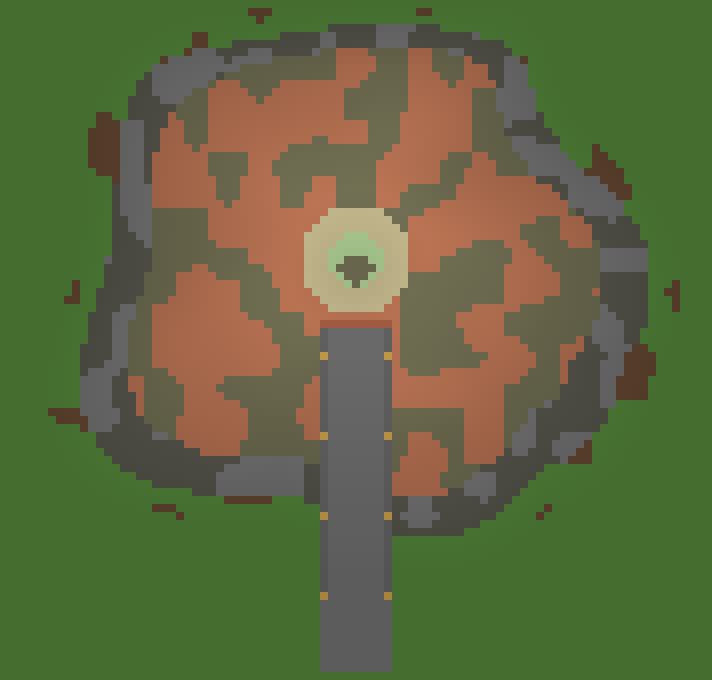

## heaven_tower

Heaven Tower, Dagruel's seat above the Desert of Death. SIZE (81, 60, 91), anchor (40, 4, 83) on the south processional road facing north. Three z slabs place a giant-scale threshold, an open shaft with internal galleries, and a freestanding crown. The tower and its protected surroundings follow Fuse, light novel vol. 18 ch. 2 and vol. 19 interlude/ch. 2. See design/lore/heaven_tower.md for publisher sources. Our interpretation uses cut sandstone, rust-orange terracotta, polished deepslate and ochre lamps. A paved boundary marks the refuge in the sand.

 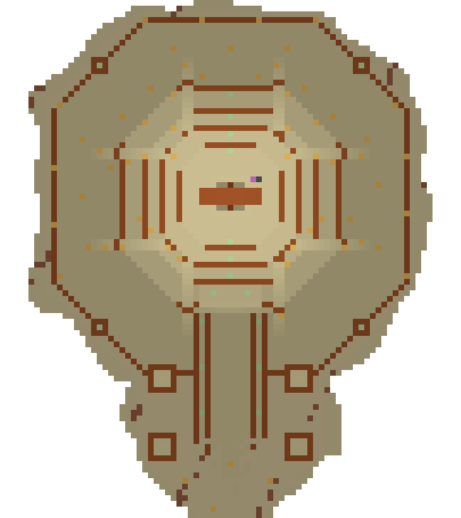

## jia

Jia, Frey's mountain landing court in Fulbrosia. SIZE (73, 40, 69), anchor (36, 4, 64) on the southern mountain trail. Two z slabs. The official map describes a cold highland harpy country; Tinseluwu's plate locates Jia. Our interpretation gives the audience roost paired feather-shaped roofs, open flight balconies and a pedestrian ascent. Andesite, tuff, pale quartz, spruce and oxidised copper. See design/lore/jia.md for geography and sources.

 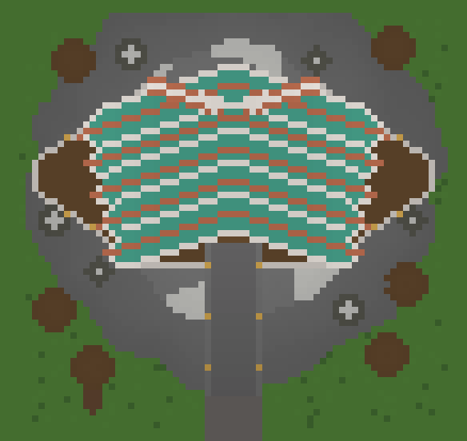

## laura

Laura: the rebuilt capital of the Beast Kingdom of Eurazania, Carrion's jungle city. Lore notes and sources: design/lore/laura.md. SIZE (113, 46, 113), centre column (56, 56), saved as four z slabs laura_0..3 (PARTS). Ground layer y 4 (grass, moss, patches of coarse dirt; you walk at y 5); everything above is air so placing clears the jungle in the box. The gate faces south (+z). Arrival point: blueprint (56, 5, 108) outside the south gate, facing north. Our interpretation of a place canon only says that Milim destroyed the old capital and Tempest helped build the new one: a tropical timber-and-stone town inside a young stone wall (the lesson of the attack; Tempest blue banners on the gate). From the south: the gate (opening x 52-60, two round towers with thatch cones, four corner towers), a stone avenue (x 52-60) north to the fruit market plaza (centre 56, 66, radius 13: a fountain, eight canopied stalls of melons and berries), then the Beast King's palace on a stone terrace (x 28-84, z 4-48, top y 7): a great gabled hall of stripped jungle timber and bamboo with a thatch roof to y 32 (hall x 44-68, z 10-44, walls to y 14), a lion's head (Carrion is a lion beastman) in the south gable, a colonnade of totem pillars, and inside a long hall with two rows of tables, hanging lanterns and the lion throne on a dais with a hide rug. Stilt houses (jungle planks, bamboo, thatch gables, ladders) line the side streets, with orchards of jungle fruit trees (cocoa on the trunks, melon and berry rows) in the four corners. Every spawnable spot below y 30 has block light (checked when this builds).

 

## lubelius

Holy City Lubelius (Lune): the cathedral of the Western Holy Church and its square, white stone and gold. Lore notes and sources: design/lore/lubelius.md. SIZE (120, 64, 120), saved as three z slabs lubelius_0..2 (PARTS). Ground layer y 4 (grass and white paving, dirt below), you walk at y 5; everything above is air, so the placer clears forest and hills in the box (clear_above). The city arrives from the south: the road runs up to the Holy Gate (white wall z 103-105, two gold-capped pylons, a 9 wide passage x 56-64), arrival point blueprint (60, 5, 114) facing north. Beyond the gate the Holy Square (z 64-102, a paved disc with gold rings, a fountain and a golden-crowned pillar at (60, 84)) is closed by two colonnaded halls: the Hall of the Holy Knights on the east side (Hinata Sakaguchi's Temple Knights, banners, long tables) and the Pilgrims' Hall on the west. The cathedral fills the north (z 8-62): a cross-shaped church of white quartz, the nave x 49-71 (z 16-62) with the transept x 30-90 (z 28-50), a dome over the crossing (drum and hemisphere, radius 11, gold bands, lantern turret and rod to y 55), twin facade towers (x 40-48 and 72-80, spires and rods to y 58), a rose window and a seven wide portal in the facade (z 62). Inside: marble floor with gold inlay, a red carpet, pews in the south arm, a raised choir with a gold altar in the north arm, chandeliers hung from the ridge. The Sacred Mountain approach (separate landmark) is not built here. Palette: quartz, quartz bricks, pillars, smooth quartz, calcite, gold blocks, light blue stained glass. Our interpretation: canon says the capital is a rich city with high-end magic and technology, seat of the Western Holy Church (the real-world Vatican analogy); the cathedral's form is ours. Every spawnable spot inside the plot has block light (checked when this builds).

 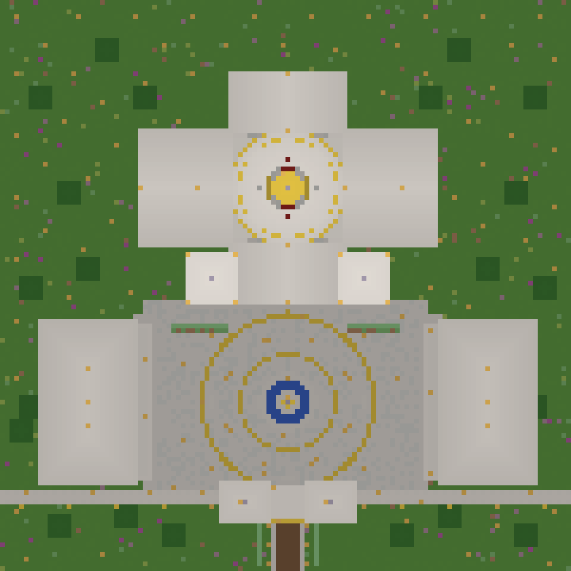

## marris

Marris: capital of the Kingdom of Falmuth (later Farmenas) with the royal castle and the Western Holy Church. Lore, canon notes and our interpretation: design/lore/marris.md. SIZE (136, 64, 112), three z slabs marris_0..2 (z 0-37, 38-75, 76-111; PARTS). Ground layer y 4 (you walk at y 5), air above. The great gate faces south (+z). Arrival point: blueprint (68, 5, 106) on the royal road, facing north. Layout, from the south: royal road (x 63-73) -> great gate in the city wall (z 92-96; opening x 63-73, y 5-12, two tall gate towers with copper roofs and blue-and-white banners) -> the King's Avenue (x 62-74, z 78-91) lined with tall townhouses -> the Royal Plaza (x 24-112, z 38-76, checker paving, a fountain monument at 68,57, banner poles) with, on its west side, the Western Holy Church (x 24-46, z 50-68: white quartz nave with buttresses, blue glass windows and a rose window over the doors, door on the east face at z 58-60, pews, aisle, altar at the west end, a bell tower with a copper spire at x 46-52, z 44-50) and, on its east side, the Falmuth guard and customs house -> at the north end the royal castle (curtain wall z 34-36 with a gatehouse at x 64-72, courtyard z 22-33, the palace x 40-96, z 6-21 with a throne hall on the ground floor behind a grand portal and four copper-roofed corner towers). City walls run north along both sides to the castle's flanks. Points (blueprint coordinates): church door (46, 5, 59), altar (27, 6, 59), throne seat (68, 6, 9), plaza centre (68, 5, 57). Style (our interpretation): pale stone and white quartz, verdigris copper roofs, blue and white heraldry, gold trim on the church; richer and taller than Blumund's plastered timber town. Block light is checked for every spawnable spot inside the walls and on the approach.

 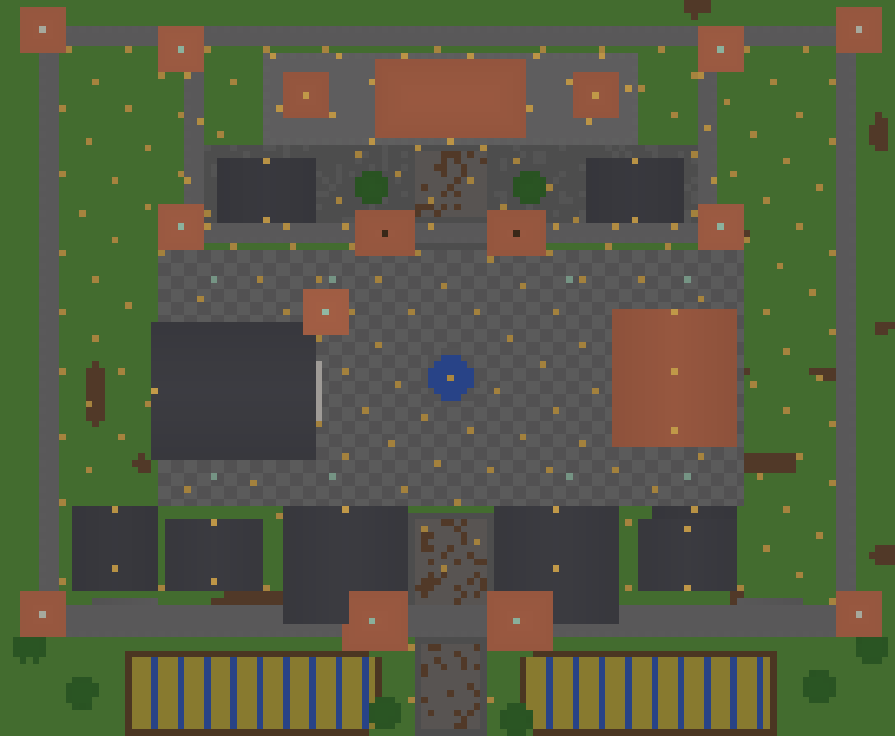

## morgdahl

Morgdahl, a timber landing and water-powered mill yard in the western realm. SIZE (69, 31, 61), anchor (50, 5, 51) on the south cart road, z slabs 0 and 31. The western Council map and fan political plate locate Morgdahl. Its sawmill, contained millpond and crane are our interpretation of the pack's river-mouth realm. Oak, spruce, pale plaster, brick, slate, iron and weathered copper. Sources and the distinction between mapped name and invented industry are in design/lore/morgdahl.md.

 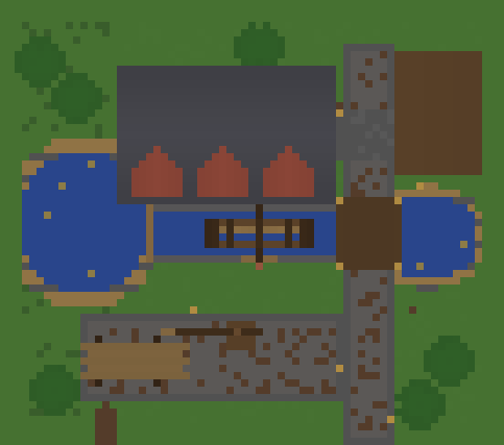

## mortal_ferry

Ferry and Toll House. SIZE 79 x 16 x 77; anchor (10, 5, 35) on the western towpath. A lined water cut links two reed beds. Oak, spruce, gravel, clay and fieldstone. Reedham's chain ferry supplies the crossing principle; arrangements and banks are original. See design/lore/mortal_ferry.md for the references and survey contract.

 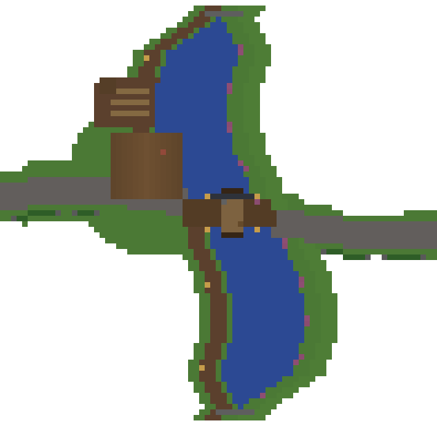

## mortal_keep

Ruined Border Keep. SIZE 75 x 22 x 73; anchor (36, 4, 63) on the southern approach. Fieldstone and cracked brick curtain, oak repairs and a roofless watch block. Norham Castle's surviving keep and inner ward are the historical reference. See design/lore/mortal_keep.md for the jar inventory and placement notes.

 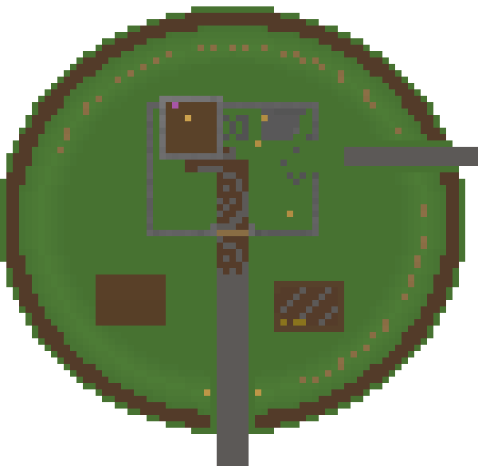

## mortal_market

Mortal market square for Folk of the Realm. SIZE (73, 25, 69), anchor (24, 4, 36) on the southern approach. Two timber houses, a tiled bell arcade and cloth stalls enclose a cobbled square. A loom, composter, grindstone and lectern are present. A weigh house, cattle yard and orchard extend along the east and south lanes. PARTS start at z 0 and 35. Original plan inspired by vanilla village meetings. See design/lore/mortal_market.md.

 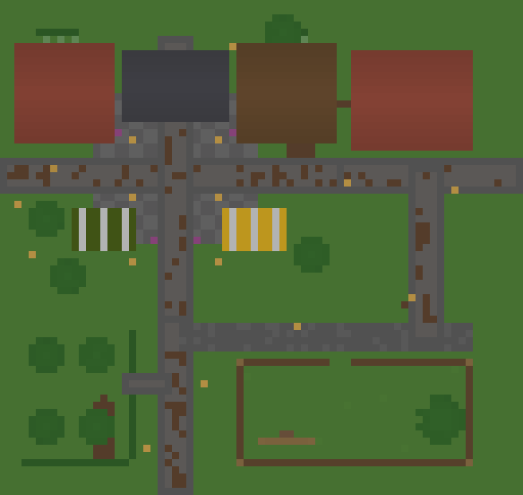

## mortal_mine

An abandoned hillside adit in the Mortal Realm. SIZE (73, 24, 68), anchor (23, 4, 35) at the south yard. The single-level rail enters a stone slope and ends at a deliberate collapse. Oak pit props, a tool recess and a winding wheel survive. A siding leads east to a stepped quarry and the sorting shed. PARTS start at z 0 and 35. Original layout, references in design/lore/mortal_mine.md.

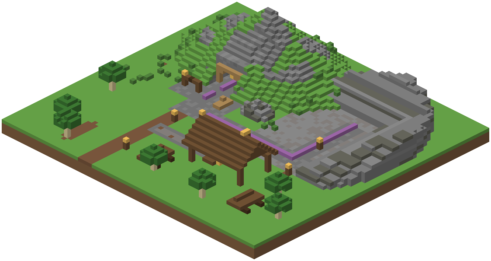 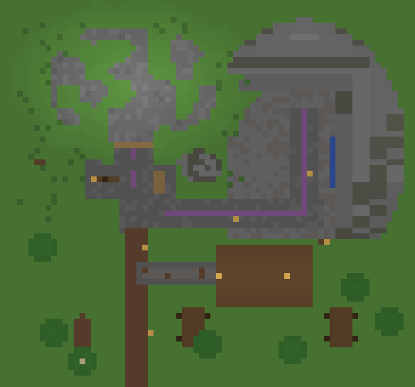

## mortal_pilgrim_shrine

Pilgrims' Hill, an original roadside shrine in the Mortal Realm. SIZE (69, 26, 70). Anchor (19, 4, 37) on the south approach. Cobblestone steps rise through grass and exposed andesite to an oak shelter with a steep spruce roof, benches and a small bell. The lower track passes a roofed rest bench, three wayside stations and a walled orchard. PARTS start at z 0 and 35. References and local setting in design/lore/mortal_pilgrim_shrine.md.

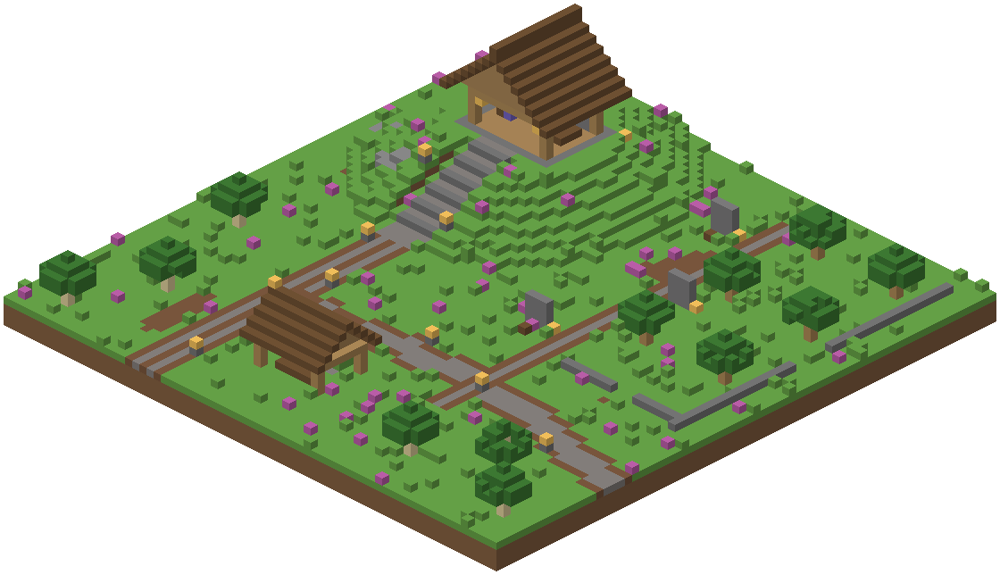 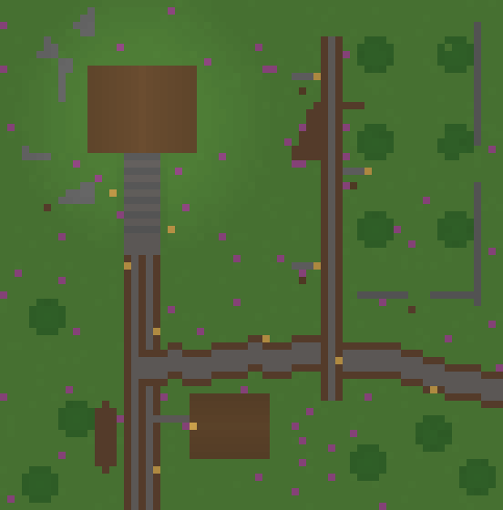

## mortal_spawn

Wayfarer's Rest, a human coaching yard in the Mortal Realm, SIZE 39 x 22 x 39. The anchor at local (14, 6, 14) is the ground under the shrine at world x/z 0/0. Arrival is local (14, 7, 19), world (0.5, stored walking Y, 5.5), facing north. Spruce and oak framing, plaster, fieldstone, packed earth and planted verges. Sources and the inventory of visual references are in design/lore/mortal_spawn.md.

 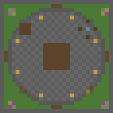

## mortal_tower

Hermit's Tower. SIZE 71 x 34 x 73; anchor (37, 4, 67) on the garden path. A tapered stone tower with a timber reading room and a steep four-sided slate roof. Border peel towers inspired the stacked, compact plan. Our interpretation and the reference inventory are in design/lore/mortal_tower.md.

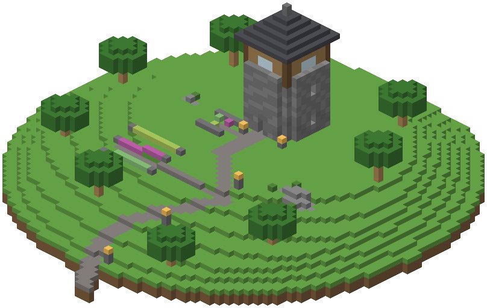 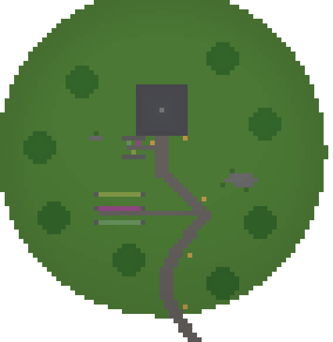

## nasca

Nasca, the imperial guard's audience court. SIZE (85, 42, 79), PARTS along z. The south processional entrance is on axis with the raised audience pavilion. Anchor (42, 5, 66) faces the pavilion from the approach. Pale sandstone, polished andesite, dark prismarine, crimson terracotta and waxed copper distinguish the imperial quarter. References: the official Eastern Empire map entry, the novel's imperial guard and the pack's political plate. This court is our interpretation. See design/lore/nasca.md.

 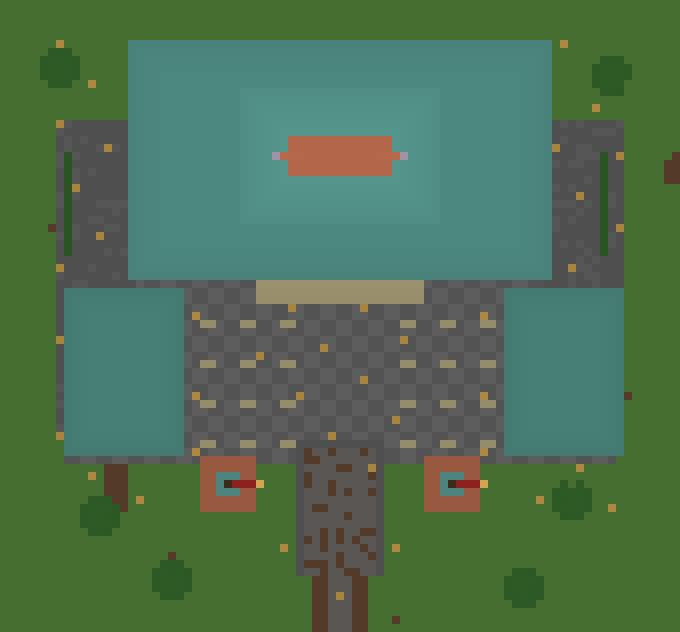

## nostraille

Nostraille's wool market, SIZE (72, 33, 64), anchor (36, 5, 43) in the southern market street. The Western Council map is a geographical reference. The market is our interpretation of the pack's hill kingdom. Chipping Campden's open arcades and repeated gables inform the hall. See design/lore/nostraille.md. Sandstone, granite, stone-brick roofing, oak, wool and glass form the yard.

 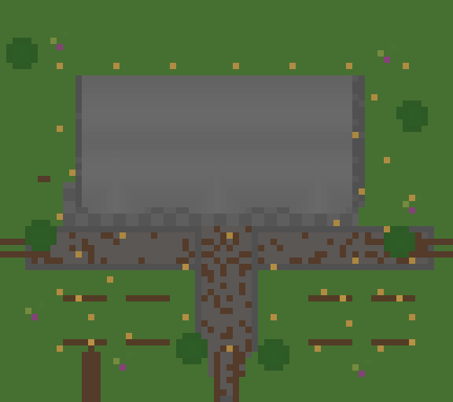

## raja

Raja's old lakeside gold workings, SIZE (80, 37, 70), anchor (36, 6, 49) on the haul road. Scarlet Bond connects the fortunes of Queen Towa, Raja's gold mines and its lake. Our interpretation is one exhausted adit beside a small inlet, with a wooden winding frame and a shore assay house. Stone, tuff, granite, oak, dark oak, copper, sandstone and water. Sources in design/lore/raja.md.

 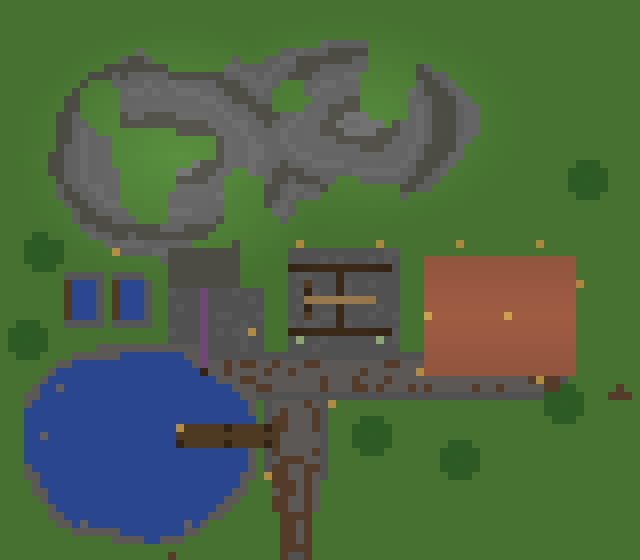

## sacred_mountain

Sacred Mountain of Lubelius, the last ascent to Luminous's sealed Inner Sanctum. SIZE (81, 57, 81), three PARTS along z. Anchor (40, 4, 76) on the southern pilgrim road, facing north. Two flights climb to a pointed, gold-bound double seal cut into a limestone ridge. Veiled reliefs face seven flush votive lights on the upper court. Quartz, calcite, gold and light blue glass continue Lune's palette. Sources: design/lore/sacred_mountain.md (the Holy Empire of Lubelius, Fuse's volume 7, the project's political fan map and Minecraft Middle-earth's Minas Tirith).

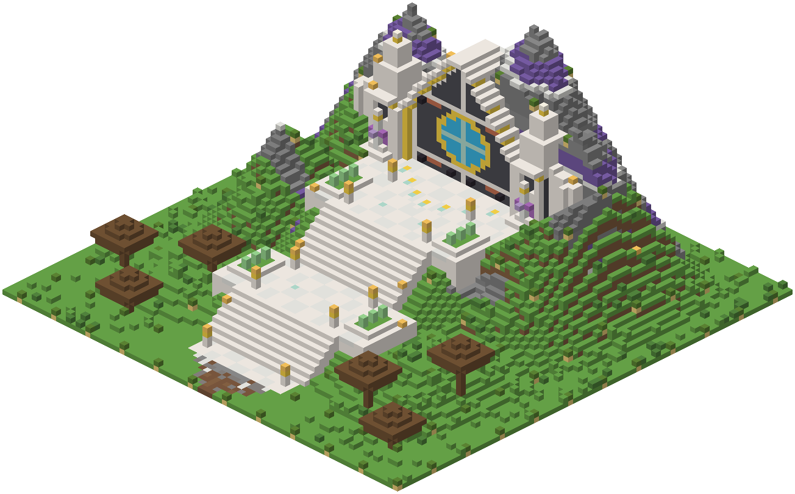 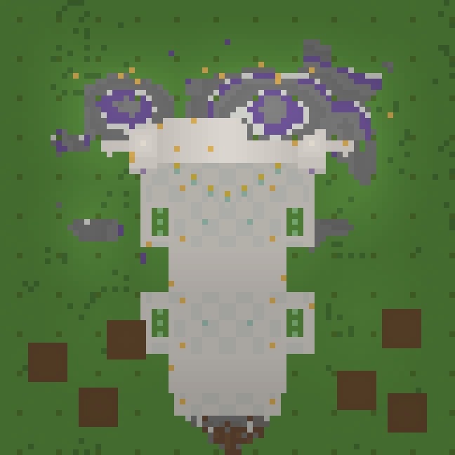

## sealed_cave

The Sealed Cave: Veldora's prison and Rimuru's birthplace, in the Great Jura Forest (Life 2 canon landmark). SIZE (88, 50, 88). Ground layer y 4 (grass, dirt and stone below), you walk at y 5. A rocky, mossy hill (about 70 blocks across, up to 28 above the ground) rises from a forest clearing with the cave mouth in its south face; everything above the ground layer that is not rock is air, so placement clears trees and hills inside the box. Arrival point: blueprint (44, 5, 82), the path outside the mouth. Inside, south to north (our interpretation of canon's "a big cave"): a winding mouth passage, the antechamber with a cave pond, magic ore in the walls and a small hipokute plot (the cave later became Tempest's hipokute farm under Gabiru; the magicules Veldora's aura soaked into the rock made the grass and the ore grow), a narrow dark passage, and the sealed chamber: a round dome with the spent Unlimited Imprisonment seal. Veldora is already gone (Life 2 starts after Rimuru swallowed him), so the dais is empty: snapped chains, claw gouges in the floor, the circle's runes dim and cracked, the armillary rings of the barrier broken into arcs, six standing stones (two toppled). A small basin by the south wall marks where a slime woke up. The cave is where the magicule of the Jura forest comes from: the chamber is ringed with magic ore and amethyst, and a column of sea lanterns glows in its ceiling. Every spawnable spot inside has block light (checked when this builds). Visual references and sources: design/lore/sealed_cave.md.

 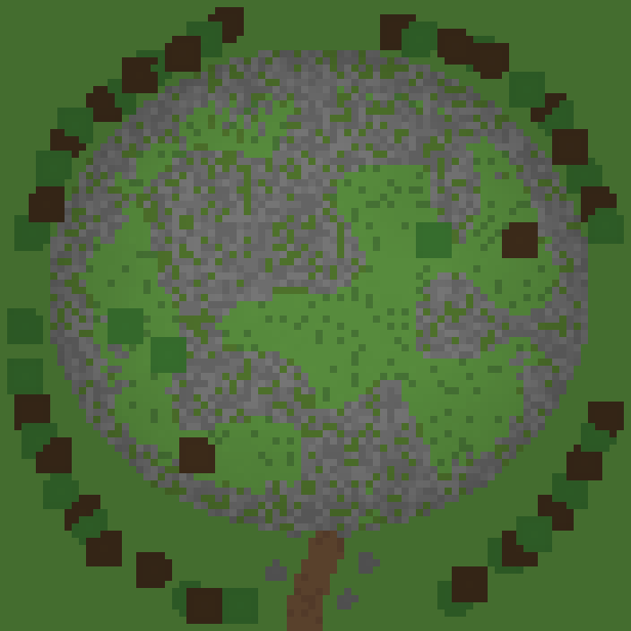

## siltrosso

Siltrosso, a Rosso audience house and enclosed counting court. SIZE (73, 37, 65). Anchor (36, 5, 52) looks north from the public entrance. Three template slabs cut across z. Materials: brick tile, pink granite, calcite plaster, dark oak, red terracotta and stone. Granbell's influence and Mariabell's financial plans are canon. The house, its rose court and its figures of account are our interpretation. References in design/lore/siltrosso.md.

 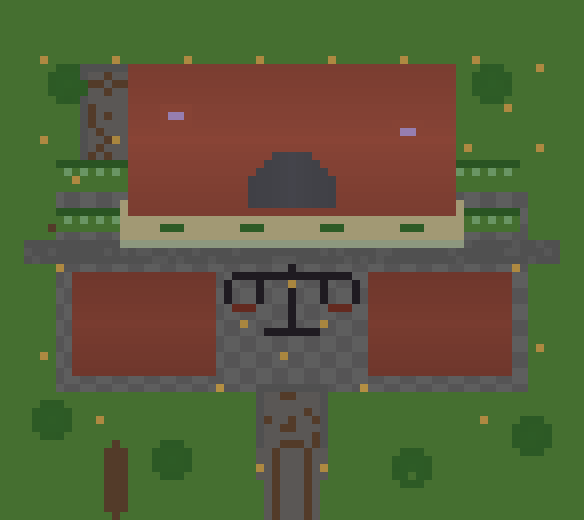

## spirit_corridor_hall

The Spirit Corridor hall: where a soul waits between lives (master plan §1). A round floating hall in the void. Ten pedestals stand for the ten Last Wishes; a halo hangs above the centre, where souls arrive (structure centre = corridor 0 64 0, so the arrival point (15, 1, 15) stays free). Placed by life/corridor.js at -15 64 -15.

 

## spirit_dwelling

The Dwelling of the Spirits (Home of the Elementals): a floating glade of the spirit domain (ttl:spirit_domain). SIZE (89, 64, 89). Built in a void dimension at ground = "fixed": the glade's top layer is y 40 (grass), you walk at y 41, the island hangs below it (about 29 blocks of rock, roots and amethyst), everything above is air. An invisible barrier runs round the island's rim so nobody walks off into the void. Arrival and anchor point: blueprint (44, 41, 66), on the south side of the glade, facing north. The return gate is an arch to the south (PORTAL, anchor-relative, exported to generated/spirit_dwelling.js); the Dwelling itself is in the middle. Glade: white-blossom (cherry) trees and birches, meadow flowers, two ponds, five elemental plinths round the rim (fire, water, wind, earth, space). In the middle a round dais of Tensura labyrinth stone ringed by a broken colonnade, with a glass lid over a shaft; a stair on the south side goes down into the grotto, the "cavern like Veldora's cave": a dome with a summoning circle inlaid in the floor and, at its centre, a pedestal (a beacon on an iron base) whose light rises through the shaft and the lid to the sky: where Rimuru stood the children on a pedestal bathed in light to call the spirits. Every spawnable spot in the grotto and stair has block light (checked when this builds); the glade is daylit (dimension fixed_time) and the biome has no spawners. Nothing here is a Tensura warp pad or labyrinth portal; the way in and out is life/spirit_domain.js. Canon sources and what is our interpretation: design/lore/spirit_domain.md.

 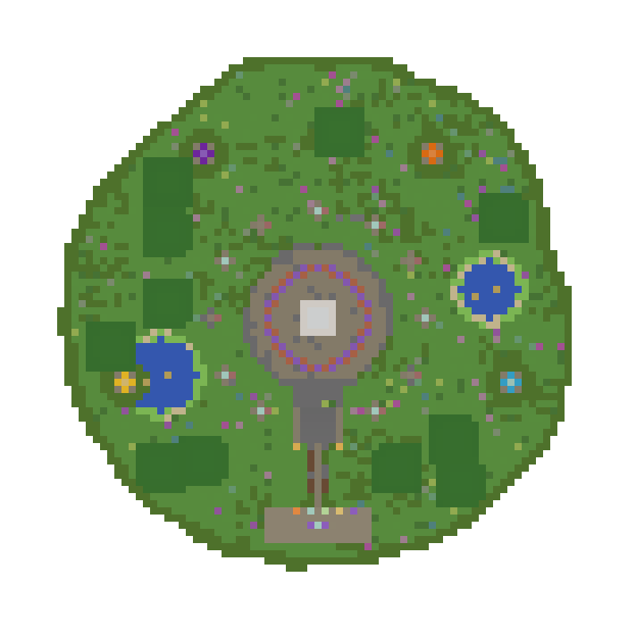

## spirit_gate

The gate to the Dwelling of the Spirits: the sealed entrance in the Great Jura Forest (owner request, Life 2). SIZE (57, 40, 57). Ground layer y 4 (grass, dirt and stone below), you walk at y 5; everything above the ground layer that is not built is air (placement clears the forest in the box). Arrival and anchor point: blueprint (28, 5, 24) on the plaza, 9 blocks in front of the doorway, facing north; a soul coming back from the Dwelling arrives here. A paved plaza of Tensura labyrinth stone (a praying path runs in from the south) is ringed by five elemental plinths (fire, water, wind, earth, space: the elements of the spirits Rimuru called with the children) in front of a mossy cliff. In the cliff a tall doorway with a pentagon-of-elements seal on its back wall. The doorway is the portal: stepping into PORTAL (anchor-relative box, exported to generated/spirit_gate.js) sends a Life 2 soul to the Dwelling (life/spirit_domain.js); the blueprint only holds the open doorway and the seal. Nothing here is a Tensura warp pad or labyrinth portal block, so no mod logic fires. Every spawnable spot has block light (checked when this builds). Canon: Rimuru and the children enter Ramiris's labyrinth through Ulg Nature Park in Ulgracia (anime episodes 22–23). This Jura gateway is the pack's Life 2 access point. References and sources: design/lore/spirit_domain.md.

 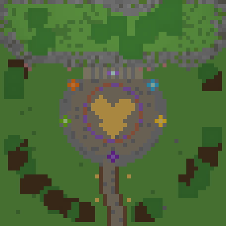

## tempest

Tempest (early): the hobgoblin village in a clearing of the Forest of Jura, just after the ogres joined. SIZE (91, 40, 91), centre column (45, 45). Ground layer y 4 (grass, dirt paths; dirt below), you walk at y 5; everything above is air so placement clears the forest and hills in the box. Arrival point: blueprint (45, 5, 57) on the south edge of the village green, with a signpost east of it; placed at world 0, 0 (the Life 2 world spawn) by life/tempest.js, which grounds it with generated/tempest_footprint.js. Village (a rough rounded-square clearing, radius about 38, ringed by our own persistent-leaf forest edge): the meeting longhouse (north of the green) where Rimuru holds council, Rimuru's small house behind it, the cooking fire and well on the green, Kaijin's open forge and workshop (west road), Shuna's weaving hut (east road), a raised food store, the goblins' old quarter (north-east: Tensura's own goblin village pieces, blueprints/assets/goblin_village/, round their campfire behind a skull arch), finished hobgoblin houses, a building site (south-west: half-roofed house, timber frame, foundation, scaffolding, log piles, sawhorse), a fenced field and herb patch (south-east), a lookout tower (north-west) and a palisade begun on the west side with a south gate. Roofs and trim borrow the goblin village palette (Tensura thatch, oak logs and fences). Every spawnable spot in the clearing has block light (checked when this builds). Visual references and sources: design/lore/tempest.md.

 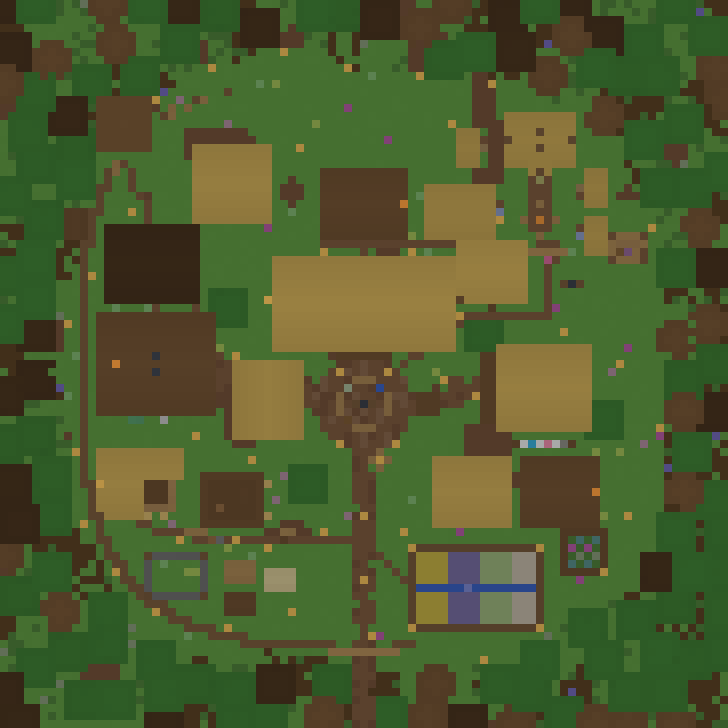

## tempest_city

The City of Rimuru after the Founder's Festival. SIZE 191 x 40 x 191; arrival (95,5,95). Every inherited district and quest anchor keeps its world position. Four radial roads lead onto a new promenade around the town. The northern audience palace, screened baths, eastern guild, southern festival theatre and Ramiris's tournament-and-dungeon entrance are accessible on foot. The entrance is architectural, without a teleport. White plaster, dark beams, sea-green tile and slate. Ramiris's gate incorporates the three shades of Tensura labyrinth brick, verified in the pinned jar. All new architecture is original geometry. References: official anime episode 61 (ten-sura.com/anime/tensura/story/no65, hot springs), 62 (no66, dungeon beneath the arena), 63 (no67, Rimuru's audience), and 71 (no76, public dungeon trial). Crunchyroll's Festival Eve depicts the reception. The district plan, small guild and theatre are our interpretation. The runtime template is just the new ring. draw_phase() also draws the town for full-city review.

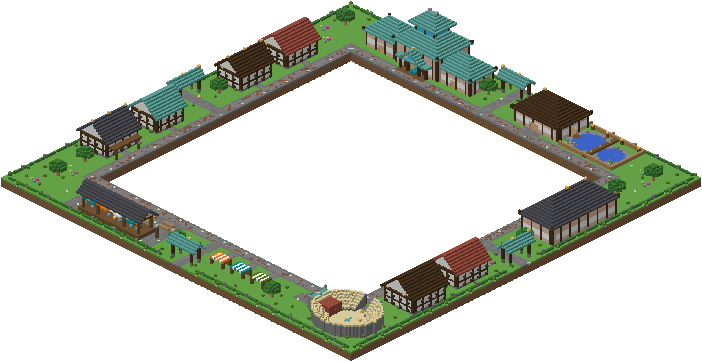 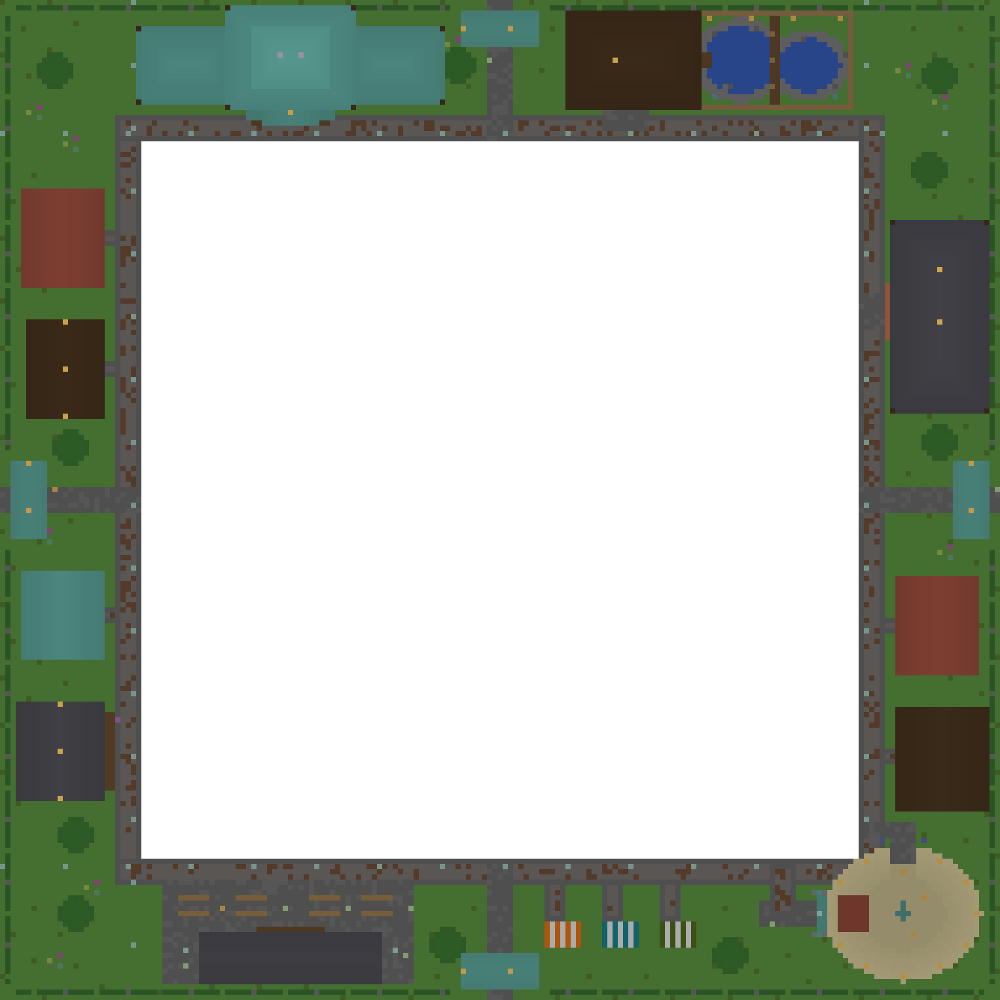

## tempest_town

Phase two of Tempest, the trade town in Jura. SIZE 137 × 40 × 137; ARRIVAL (68,5,68) at world 0,0. A five-block road leaves the old village's south gate and branches to Blumund (west) and Dwargon (north). Stone aprons, timber yards, shared kitchens, a working dye house and a council court ring the established village. Ochre froglights, furnace fires and lanterns light the ring at night. Original geometry using vanilla timber, Tensura thatch and a working Tensura woodcutter; the already-placed 91-square village is never written. The optional draw_phase overview composes the existing village and the new cloth-and-iron town. References: https://www.ten-sura.com/map/#A-112 and https://www.ten-sura.com/anime/tensura/story/no16 (regional settlement after the Orc Disaster); the street plan and building designs are our interpretation.

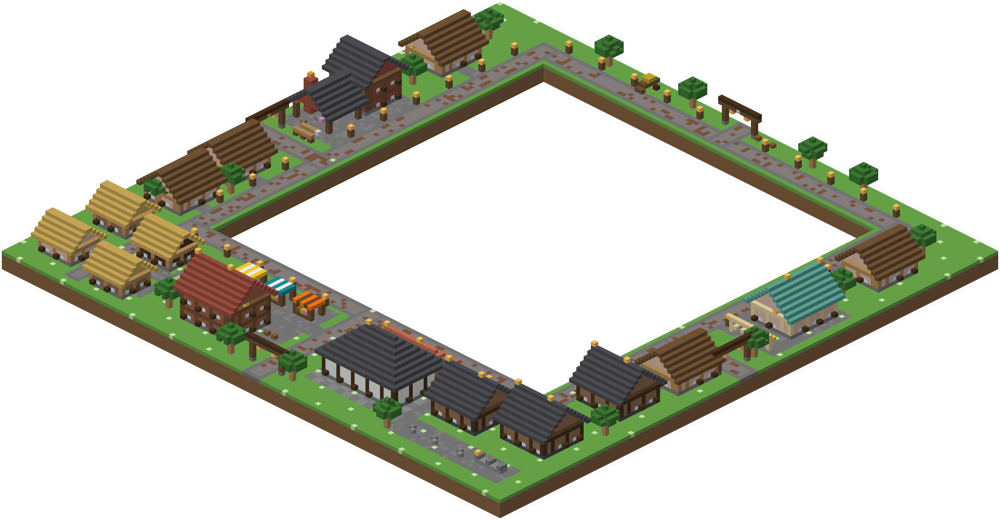 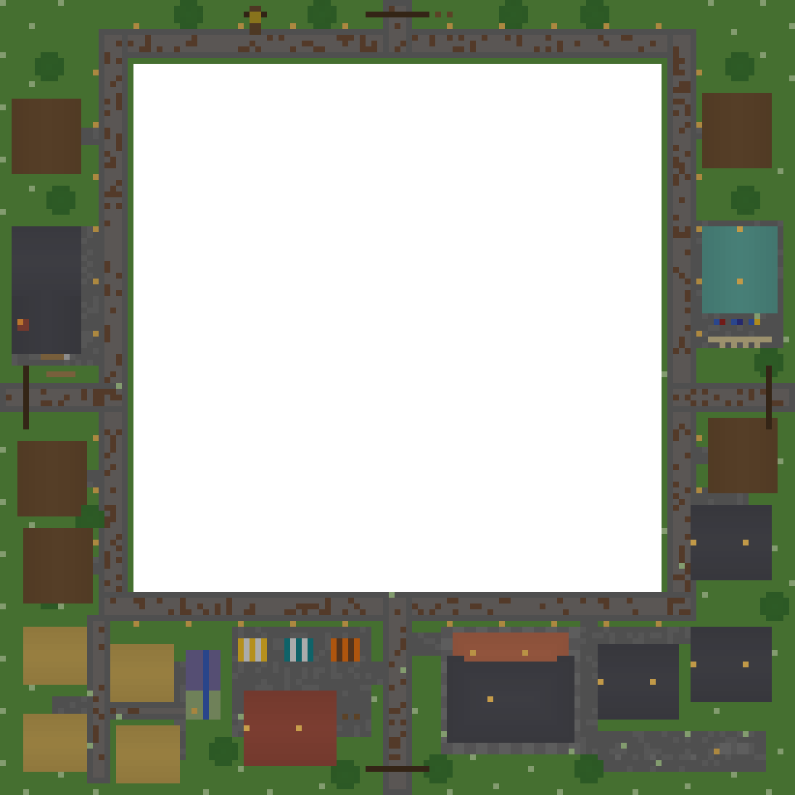

## test_hut

Test hut: a 5x5 stone hut for the generic build placer (life/builds.js, tests/ingame/builds.rcon). Placed by design/builds/test_hut.toml in the Spirit Corridor dimension far from the trial arenas (flat void, ground = "fixed"), so the test needs no terrain. Layer 0 is the floor (ground layer), layers 1-3 the walls with a door gap in the south wall, layer 4 the roof. Anchor (the doorstep inside): blueprint (2, 1, 2). Not a canon location: delete design/builds/test_hut.toml (and this file) once the placer is trusted.

 

## treyni_shrine

Treyni's shrine: the dryad altar beside the ancient tree of the dryad sanctuary (east of the Great Ameld, Jura forest). SIZE (33, 22, 33). Ground layer y 4 (moss, grass, podzol; dirt and stone below), you walk at y 5; everything above is air so placement clears the forest in the box. Arrival and anchor point: blueprint (16, 5, 16), the centre of the dais. Canon: the dryads (Treyni and her younger sisters Trya and Doris) are spirits that live in the trees of the Great Jura Forest and keep it; Treyni became the forest's guardian under Veldora (and later moved with Ramiris to the labyrinth, taking a body made from the Great Spirit Tree). The grove's ancient tree is Tensura's own `tensura:ancient_forest/tree` (placed by life/landmarks.js, landmark treyni_grove, about 40 x 42 blocks across); this small shrine stands beside it, outside its keepout (design/builds/treyni_shrine.toml starts the survey 38 blocks east of the landmark). Our interpretation, nothing here is canon detail: a round mossy dais with a young azalea tree just north of its arrival stone (a seedling of the ancient one), three seats for the three sisters, each with a potted sapling, four log posts with lanterns, and a living gate of two bent oak logs on the west side. Every spawnable spot on the dais has block light (checked when this builds). Sources: design/lore/treyni_shrine.md.

 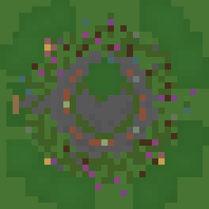

## trial_creation

Trial of Creation: a workshop. The crafting table at (0, 0); parts are dropped around (+-10..13); start (0, -6). No anvils or fire here: the trial cleanup clears those.

 

## trial_deceit

Trial of Deceit: a dark gallery watched by nine Watchers (rows z = -4, 3, 10; x = -8, 0, 8). Start (0, -14); the emerald exit at (0, 13..15). Only distance decides whether you are seen, so the decor here is mood, not cover.

 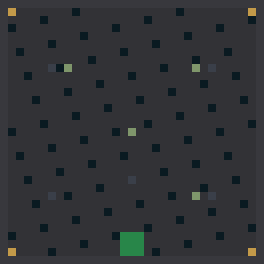

## trial_dominion

Trial of Dominion: a ranch. The herd starts in the north-west; the pen is x, z 8..14 with its gate at (8, 11) facing east (trial_defs.js counts cows inside x, z 9..14). Bring three cows inside.

 

## trial_freedom

Trial of Freedom: a jump course over a pit. The course is at y=PIT (the trial's floor level); the pit floor at y=0 is 6 blocks lower. Start pad (0, -13), COURSE blocks, gold goal (0, 12..14). Falling below the course sends the player back to the start (trial_defs.js).

 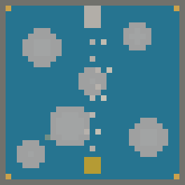

## trial_hunger

Trial of Hunger: a ruined storehouse. Food lies around the edges (+-10..13); start (0, 0).

 

## trial_knowledge

Trial of Knowledge: a library. The lectern at (0, 0) is where the Voice asks; start (0, 0) beside it.

 

## trial_protection

Trial of Protection: a farmyard. The ward (villager) stands on the hay at (0, 0); start (0, -4). Attackers come from the corners (+-12, +-12): keep those open.

 

## trial_strength

Trial of Strength: a colosseum. Four waves spawn at (+-10, 10), (+-10, -2), (0, 12); start (0, -12).

 

## trial_survival

Trial of Survival: a ruin. No weapons; poison, falling anvils and fire come at random. Start (0, 0). Keep the floor flat and free of anvils and fire: the cleanup clears those.

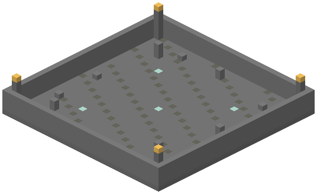 

## trial_vengeance

Trial of Vengeance: a dark duelling ground. The nemesis spawns at (0, 4); start (0, -12).

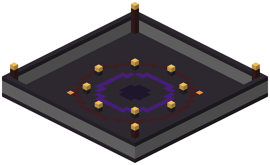 

## ulgr_nature_park

Ulgr Nature Park, the woodland approach to the Dwelling of Spirits. SIZE (71, 28, 65), anchor (30, 4, 31), two slabs at z 0 and 33. Episode 22's dark masonry and warm lights inform the chamber. The official map places the entrance in northern Ulgracia. Our interpretation sets its stone vault under a wooded chalk bluff and leads a walking trail across a spring on a timber footbridge. Birch, oak, moss, calcite, tuff, stone bricks and warm frog lights. Sources and the distinction from the pack's Jura gateway are in design/lore/ulgr_nature_park.md.

 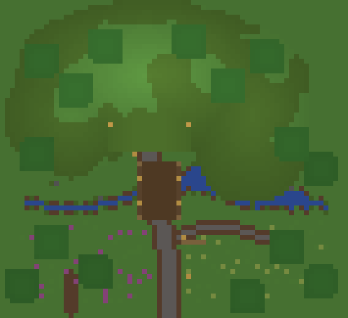

## walpurgis_hall

The Walpurgis Hall: where the Demon Lords hold council, in its own dimension (ttl:walpurgis), with the Banquet Floor for organised combat beside it. SIZE (123, 44, 97). Built in a void dimension at ground = "fixed" (like the Dwelling of the Spirits): a floating island of blackstone and deepslate under a fixed midnight sky; the top layer is y 14, you walk at y 15. Arrival and anchor point: blueprint (40, 15, 79) on the south plaza, facing north; the return arch (PORTAL, anchor-relative, exported to generated/walpurgis_hall.js) stands just south of it. North of the plaza, the council chamber: a round hall (wall radius 18, centre 40 36) under a stepped dome with an oculus of purple glass, doors to the south and east. Inside, ten thrones at radius 10.5 face a round table (radius 6.5-8.5) set round a ten-pointed star inlaid in the floor and a beacon whose beam rises through the oculus: ten seats for the Ten Great Demon Lords (the pack's ten Legendary places; canon's council is ten Demon Lords until the Octagram makes it eight), each with its own coloured crest; ten pillars with soul lanterns between the seats. East of the chamber, the Banquet Floor (centre 92 40): a round pit of polished blackstone (floor radius 17, you fight at y 12) inside three terrace steps where onlookers stand (radius 17.5-22), a balustrade at radius 23 open to the west path, and eight braziers on pillars round the rim. The pit is the arena box of design/data/arenas.toml (round, radius 17). An invisible barrier runs round the island's rim so nobody walks off into the void; the biome has no spawners and the floors are lit (soul lanterns, shroomlight in the floors). Nothing here comes from a mod; Walpurgis has no venue in any mod. Canon and our interpretation: design/lore/arenas.md.

 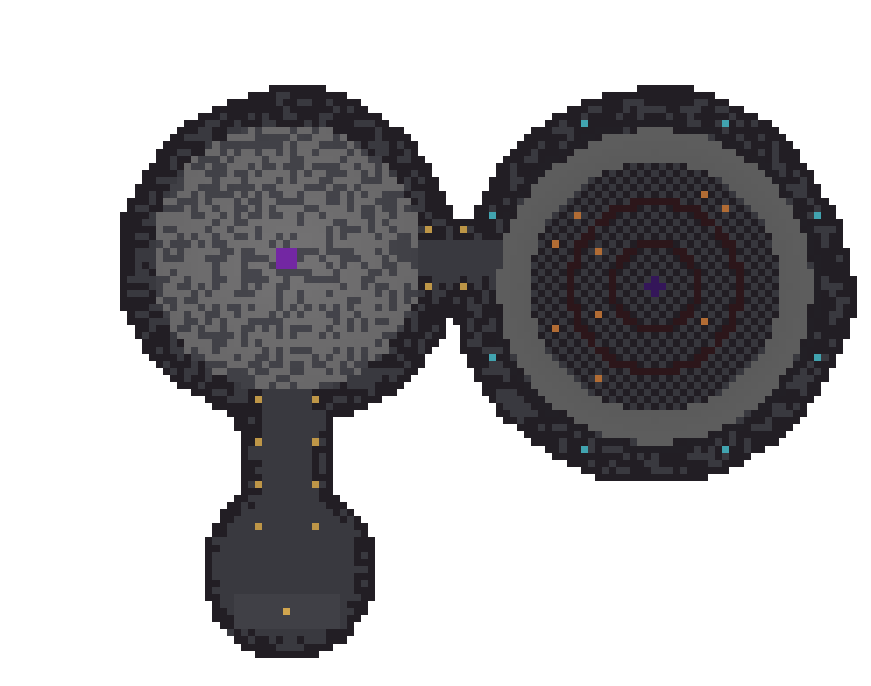
