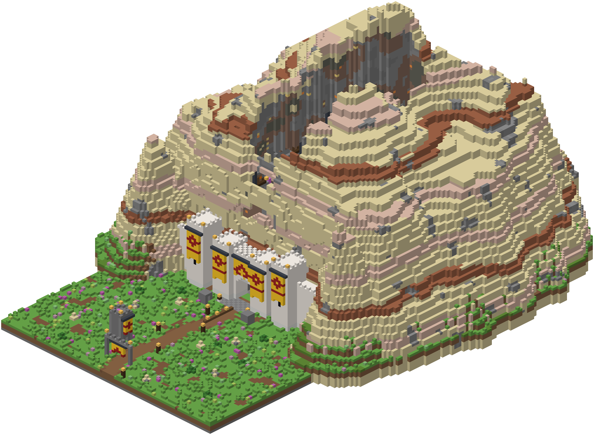
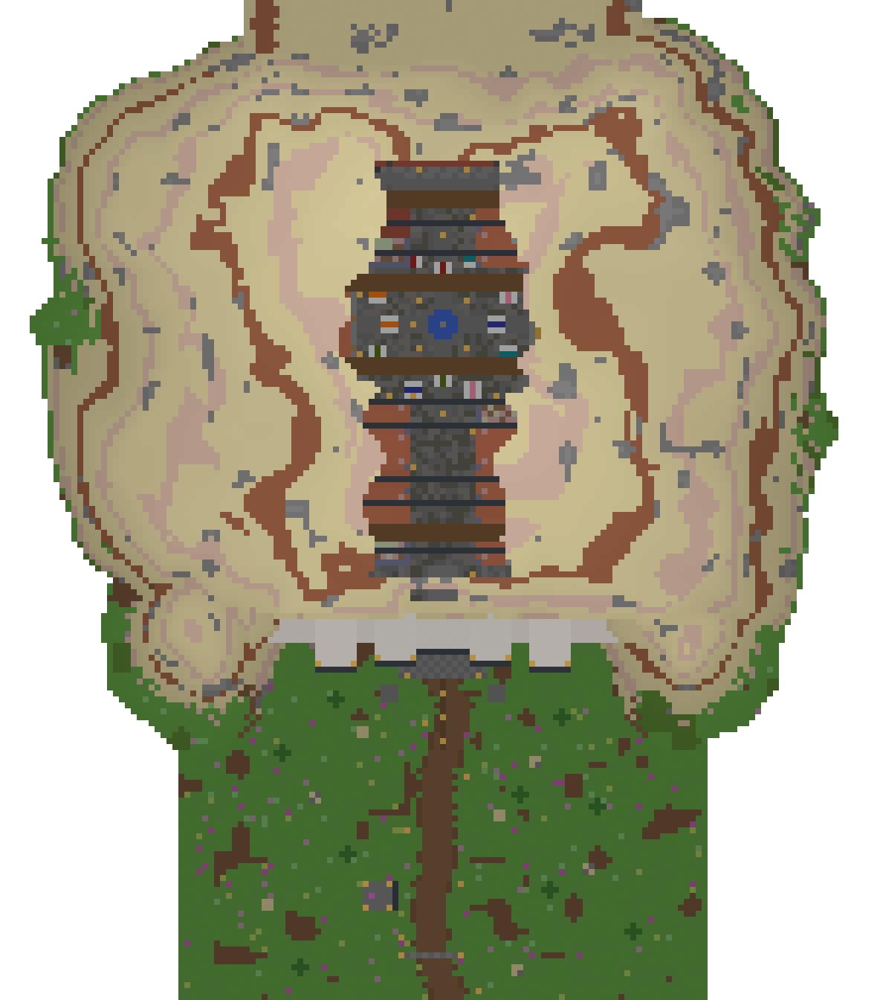
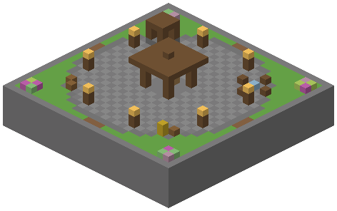
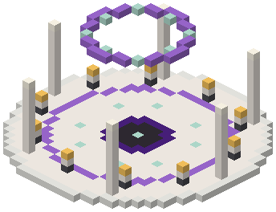
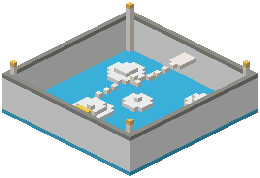
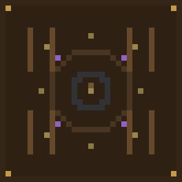
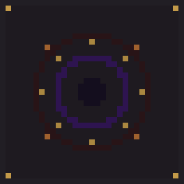

# Build gallery

Generated by `python tools/build_structures.py` from `blueprints/`; do not edit by hand.
Place any of these in game with `/ttl build <name>` (corner at your feet).

## blumund

Blumund: the small trading kingdom's walled capital (Londo on the fan map) with the Free Guild branch hall. Lore, canon notes and our interpretation: design/lore/blumund.md. SIZE (124, 52, 116), saved as three z slabs blumund_0..2 (z 0-39, 40-79, 80-115; PARTS). Ground layer y 4 (grass, paved streets; dirt below), you walk at y 5; everything above is air so placement clears trees and hills inside the box. The gate faces south (+z). Arrival point: blueprint (62, 5, 108) on the king's road, 15 blocks south of the gate, facing north. Layout, from the south: approach road (z 93-115, x 59-65) between wheat fields and a farmstead; town wall z 90-92 (plastered timber is for houses, the wall is stone) with the south gate, opening x 59-65, y 5-9, flanked by two gate towers; the main street (x 58-66) runs north through the gate; a few houses and a well at the gate; the market square (x 34-90, z 54-80: checker paving, fountain at 62,67, twelve striped market stalls); the Free Guild branch hall on the square's east side (x 93-112, z 56-80, door on the west side at z 67-68, double-height hall with the reception counter, two notice boards, tavern tables, and a mezzanine office for the branch master); the merchant cross street (z 50-52) with shops on both flanks; west district (two rows of houses facing the square and a rear lane); south rows (z 82-88) between the gate and the square; at the north end the royal castle on the main axis: ward wall z 46-48 with a gatehouse, courtyard z 32-45 (well, barracks, stable), the keep (x 50-74, z 10-28; throne hall on the ground floor, council chamber above, battlemented roof) with four corner towers up to y 32, and the side walls running north to the town's north wall (z 4-6). Orchards flank the castle. Guild points (blueprint coordinates): reception counter x 102, z 60-76 (customers stand west of it, staff at x 103); main quest board x 94, z 58-64, y 6-8 (a framed 7x3 panel on the west wall's inside); second (bounty) board x 94, z 72-78; branch master's desk on the mezzanine at (109, 11, 61); stairs up at x 98-103, z 57. Throne seat (62, 6, 12). Style: plastered timber-frame houses (calcite / cream plaster, dark oak frame, red tile roofs), stone walls and gates, slate roofs on civic buildings, red and cream banners (our interpretation, canon gives no heraldry). Block light is checked for every spawnable spot inside the walls and the approach.

 

## dwargon

The Armed Nation of Dwargon: the dwarf kingdom in a great cavern inside a pale sandstone mountain. Lore notes and sources: design/lore/dwargon.md. SIZE (148, 92, 168), saved as three z slabs dwargon_0..2 (z 0-55, 56-111, 112-167; PARTS) placed side by side by life/dwargon.js. The gate faces south (+z). The mountain is part of the build (stepped sandstone/terracotta massif, grass on its lower terraces, two spurs flanking the gate); outside the mountain and the approach the corners are left empty and terrain stays. Grounding: outputs() writes generated/dwargon_footprint.js (lowest block per column, open-sky columns), which dwargon.js uses to fill the ground under the build and clear hills off the road (see there). Outer road: from the south edge (z 167) past a checkpoint arch (z 160) and a road tower with a banner (z 148-152, west), then fenced queue lanes for the gate inspection (z 114-125) between two guard booths, to the white gate wall (back z 104, front face z 107, towers out to z 111 and up to y 29, yellow banners with the red emblem). Gate opening x 71-77, y 4-11 (arch to y 13). Arrival point: blueprint (74, 4, 120) on the road, facing north. A tunnel (z 94-106) leads into the cavern city: floor blocks at y 3 (you walk at y 4), cavern z 14-100, about 44 wide on the streets and 63 at the plaza, vault up to y 53 with a canyon-like skylight crack over the main street. Levels: the street (y 4), the royal terrace (y 8), wall homes on balconies at y 18, 24 and 32 reached by ladders up stone props from the back alleys behind the houses, and plank bridges hung on chains across the canyon street at y 24 linking facing homes. South street (z 68-94) of stone and timber houses (2-4 storeys, lit windows, shop signs) including the Night Butterflies cabaret (pink, west, z 83), lamps strung across the street; a round plaza (centre 74, 54, radius 17) with a cogwheel fountain and twelve market stalls, a forge hall (west) and a Create workshop (east); the forge street (z 34-43) with Kaijin's smithy (west, z 34); then a great stair (z 30-33) to the royal terrace (floor y 7, landing z 28-29) and King Gazel's throne room: Tensura's own Gazel Dwargo boss arena (blueprints/assets/gazel_throne.nbt, the dwarf_arena structure), its dais half (arena x 42-68) turned a quarter so the throne faces south, at x 49-99, y 1-27, z 0-26 behind a tuff facade with a great door (z 27, x 71-77). The arena's black glass shell became deepslate/tuff/stone (sandstone strata where it meets the open slope), the boss pit and its warp pads were left out, the bulbs' redstone blocks became rock (bulbs stay lit). Throne seat (74, 9, 11); dwargon.js seats Gazel there and restores the canon banner patterns. Chimneys smoke (campfires on hay). Every spawnable spot inside has block light (checked when this builds).

 

## marris

Marris: capital of the Kingdom of Falmuth (later Farmenas) with the royal castle and the Western Holy Church. Lore, canon notes and our interpretation: design/lore/marris.md. SIZE (136, 64, 112), three z slabs marris_0..2 (z 0-37, 38-75, 76-111; PARTS). Ground layer y 4 (you walk at y 5), air above. The great gate faces south (+z). Arrival point: blueprint (68, 5, 106) on the royal road, facing north. Layout, from the south: royal road (x 63-73) -> great gate in the city wall (z 92-96; opening x 63-73, y 5-12, two tall gate towers with copper roofs and blue-and-white banners) -> the King's Avenue (x 62-74, z 78-91) lined with tall townhouses -> the Royal Plaza (x 24-112, z 38-76, checker paving, a fountain monument at 68,57, banner poles) with, on its west side, the Western Holy Church (x 24-46, z 50-68: white quartz nave with buttresses, blue glass windows and a rose window over the doors, door on the east face at z 58-60, pews, aisle, altar at the west end, a bell tower with a copper spire at x 46-52, z 44-50) and, on its east side, the Falmuth guard and customs house -> at the north end the royal castle (curtain wall z 34-36 with a gatehouse at x 64-72, courtyard z 22-33, the palace x 40-96, z 6-21 with a throne hall on the ground floor behind a grand portal and four copper-roofed corner towers). City walls run north along both sides to the castle's flanks. Points (blueprint coordinates): church door (46, 5, 59), altar (27, 6, 59), throne seat (68, 6, 9), plaza centre (68, 5, 57). Style (our interpretation): pale stone and white quartz, verdigris copper roofs, blue and white heraldry, gold trim on the church; richer and taller than Blumund's plastered timber town. Block light is checked for every spawnable spot inside the walls and on the approach.

 

## mortal_spawn

Wayfarer's Rest: where every new soul starts Life 1 in the Mortal Realm (a humble human hamlet square). Placed by life/mortal_spawn.js centred on the surface at 0, 0. Layers 0-5 are a foundation (retaining wall around an earth core) so it sits on any terrain; layer 6 is the plaza; layers 7-21 are cleared so hills don't bury it. Players arrive south of the shrine, at blueprint (14, 7, 19).

 

## spirit_corridor_hall

The Spirit Corridor hall: where a soul waits between lives (master plan §1). A round floating hall in the void. Ten pedestals stand for the ten Last Wishes; a halo hangs above the centre, where souls arrive (structure centre = corridor 0 64 0, so the arrival point (15, 1, 15) stays free). Placed by life/corridor.js at -15 64 -15.

 

## tempest

Tempest (early): the hobgoblin village in a clearing of the Forest of Jura, just after the ogres joined. SIZE (91, 40, 91), centre column (45, 45). Ground layer y 4 (grass, dirt paths; dirt below), you walk at y 5; everything above is air so placement clears the forest and hills in the box. Arrival point: blueprint (45, 5, 57) on the south edge of the village green, with a signpost east of it; placed at world 0, 0 (the Life 2 world spawn) by life/tempest.js, which grounds it with generated/tempest_footprint.js. Village (a rough rounded-square clearing, radius about 38, ringed by our own persistent-leaf forest edge): the meeting longhouse (north of the green) where Rimuru holds council, Rimuru's small house behind it, the cooking fire and well on the green, Kaijin's open forge and workshop (west road), Shuna's weaving hut (east road), a raised food store, the goblins' old quarter (north-east: Tensura's own goblin village pieces, blueprints/assets/goblin_village/, round their campfire behind a skull arch), finished hobgoblin houses, a building site (south-west: half-roofed house, timber frame, foundation, scaffolding, log piles, sawhorse), a fenced field and herb patch (south-east), a lookout tower (north-west) and a palisade begun on the west side with a south gate. Roofs and trim borrow the goblin village palette (Tensura thatch, oak logs and fences). Every spawnable spot in the clearing has block light (checked when this builds). Visual references and sources: design/lore/tempest.md.

 

## test_hut

Test hut: a 5x5 stone hut for the generic build placer (life/builds.js, tests/ingame/builds.rcon). Placed by design/builds/test_hut.toml in the Spirit Corridor dimension far from the trial arenas (flat void, ground = "fixed"), so the test needs no terrain. Layer 0 is the floor (ground layer), layers 1-3 the walls with a door gap in the south wall, layer 4 the roof. Anchor (the doorstep inside): blueprint (2, 1, 2). Not a canon location: delete design/builds/test_hut.toml (and this file) once the placer is trusted.

 

## trial_creation

Trial of Creation: a workshop. The crafting table at (0, 0); parts are dropped around (+-10..13); start (0, -6). No anvils or fire here: the trial cleanup clears those.

 

## trial_deceit

Trial of Deceit: a dark gallery watched by nine Watchers (rows z = -4, 3, 10; x = -8, 0, 8). Start (0, -14); the emerald exit at (0, 13..15). Only distance decides whether you are seen, so the decor here is mood, not cover.

 

## trial_dominion

Trial of Dominion: a ranch. The herd starts in the north-west; the pen is x, z 8..14 with its gate at (8, 11) facing east (trial_defs.js counts cows inside x, z 9..14). Bring three cows inside.

 

## trial_freedom

Trial of Freedom: a jump course over a pit. The course is at y=PIT (the trial's floor level); the pit floor at y=0 is 6 blocks lower. Start pad (0, -13), COURSE blocks, gold goal (0, 12..14). Falling below the course sends the player back to the start (trial_defs.js).

 

## trial_hunger

Trial of Hunger: a ruined storehouse. Food lies around the edges (+-10..13); start (0, 0).

 

## trial_knowledge

Trial of Knowledge: a library. The lectern at (0, 0) is where the Voice asks; start (0, 0) beside it.

 

## trial_protection

Trial of Protection: a farmyard. The ward (villager) stands on the hay at (0, 0); start (0, -4). Attackers come from the corners (+-12, +-12): keep those open.

 

## trial_strength

Trial of Strength: a colosseum. Four waves spawn at (+-10, 10), (+-10, -2), (0, 12); start (0, -12).

 

## trial_survival

Trial of Survival: a ruin. No weapons; poison, falling anvils and fire come at random. Start (0, 0). Keep the floor flat and free of anvils and fire: the cleanup clears those.

 

## trial_vengeance

Trial of Vengeance: a dark duelling ground. The nemesis spawns at (0, 4); start (0, -12).

 
