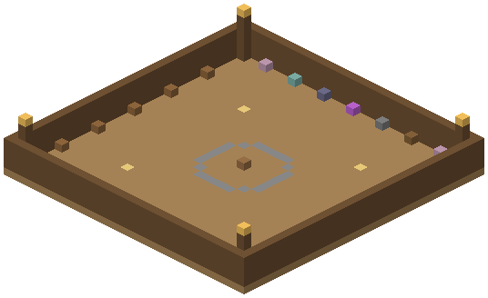
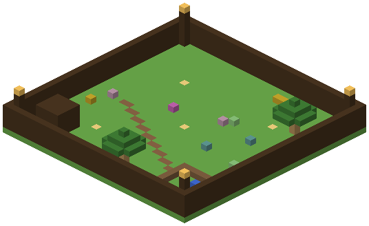
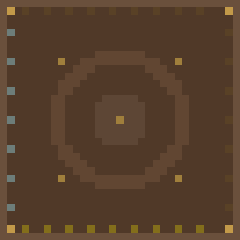

# Build gallery

Generated by `python tools/build_structures.py` from `blueprints/`; do not edit by hand.
Place any of these in game with `/ttl build <name>` (corner at your feet).

## dwargon

The Armed Nation of Dwargon: the dwarf kingdom inside a pale sandstone mountain. SIZE (112, 76, 124); the gate faces south (+z). The mountain is part of the build (a rough, stepped sandstone and terracotta massif with grass on its lower terraces and two spurs flanking the gate), so it sits on any hill; outside the mountain and the approach the corners are left empty and terrain stays. A dirt road runs north from the south edge (z 123) into a ravine to the white gate wall (back z 88, front face z 91, towers out to z 95 and up to y 29, yellow banners with the red emblem). Gate opening: x 53-59, y 4-11 (arch to y 13). Arrival point: blueprint (56, 4, 104) on the road, facing north. A tunnel (z 78-90) leads into the cavern city: floor blocks at y 3 (you walk at y 4), cavern z 14-84, vault up to y 43 with a canyon-like skylight crack over the main street. South street (z 68-82) of stone and timber houses (2-4 storeys, lit windows, shop signs), lamps strung across the street, homes with balconies carved into the cavern walls, a round plaza (centre 56, 54) with a cogwheel fountain and market stalls, a forge hall (west) and a Create workshop (east), the forge street (z 34-43), then a great stair to the royal terrace (floor y 7) and King Gazel's hall (z 16-27) with the throne. Chimneys smoke (campfires on hay). Every spawnable spot inside has block light (checked when this builds).

 

## mortal_spawn

Wayfarer's Rest: where every new soul starts Life 1 in the Mortal Realm (a humble human hamlet square). Placed by life/mortal_spawn.js centred on the surface at 0, 0. Layers 0-5 are a foundation (retaining wall around an earth core) so it sits on any terrain; layer 6 is the plaza; layers 7-21 are cleared so hills don't bury it. Players arrive south of the shrine, at blueprint (14, 7, 19).

 

## spirit_corridor_hall

The Spirit Corridor hall: where a soul waits between lives (master plan §1). A round floating hall in the void. Ten pedestals stand for the ten Last Wishes; a halo hangs above the centre, where souls arrive (structure centre = corridor 0 64 0, so the arrival point (15, 1, 15) stays free). Placed by life/corridor.js at -15 64 -15.

 

## trial_creation

Trial of Creation: a workshop. The crafting table at (0, 0); parts are dropped around (+-10..13); start (0, -6). No anvils or fire here: the trial cleanup clears those.

 

## trial_deceit

Trial of Deceit: a dark gallery watched by nine Watchers (rows z = -4, 3, 10; x = -8, 0, 8). Start (0, -14); the emerald exit at (0, 13..15). Only distance decides whether you are seen, so the decor here is mood, not cover.

 

## trial_dominion

Trial of Dominion: a ranch. The herd starts in the north-west; the pen is x, z 8..14 with its gate at (8, 11) facing east (trial_defs.js counts cows inside x, z 9..14). Bring three cows inside.

 

## trial_freedom

Trial of Freedom: a jump course over a pit. The course is at y=PIT (the trial's floor level); the pit floor at y=0 is 6 blocks lower. Start pad (0, -13), COURSE blocks, gold goal (0, 12..14). Falling below the course sends the player back to the start (trial_defs.js).

 

## trial_hunger

Trial of Hunger: a ruined storehouse. Food lies around the edges (+-10..13); start (0, 0).

 

## trial_knowledge

Trial of Knowledge: a library. The lectern at (0, 0) is where the Voice asks; start (0, 0) beside it.

 

## trial_protection

Trial of Protection: a farmyard. The ward (villager) stands on the hay at (0, 0); start (0, -4). Attackers come from the corners (+-12, +-12): keep those open.

 

## trial_strength

Trial of Strength: a colosseum. Four waves spawn at (+-10, 10), (+-10, -2), (0, 12); start (0, -12).

 

## trial_survival

Trial of Survival: a ruin. No weapons; poison, falling anvils and fire come at random. Start (0, 0). Keep the floor flat and free of anvils and fire: the cleanup clears those.

 

## trial_vengeance

Trial of Vengeance: a dark duelling ground. The nemesis spawns at (0, 4); start (0, -12).

 
