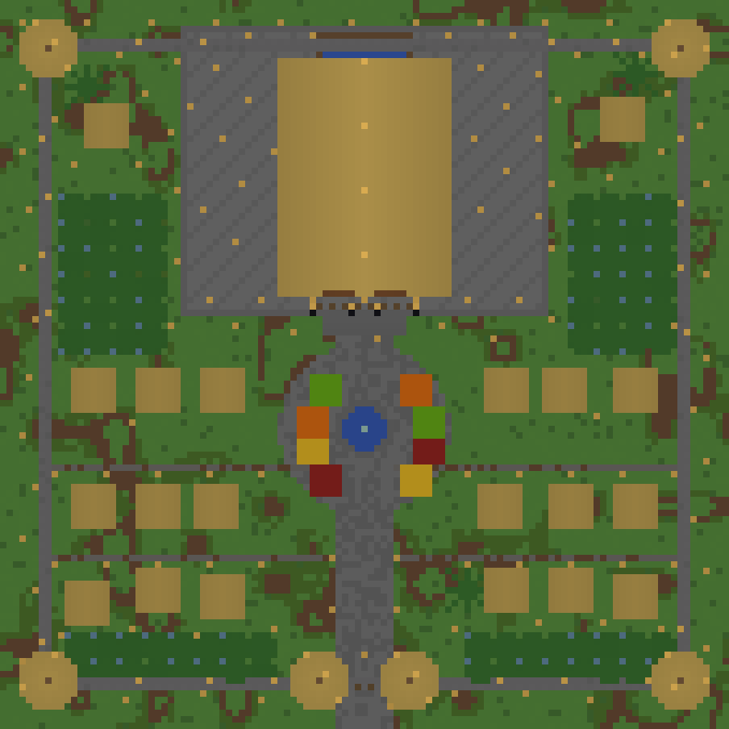
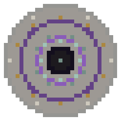
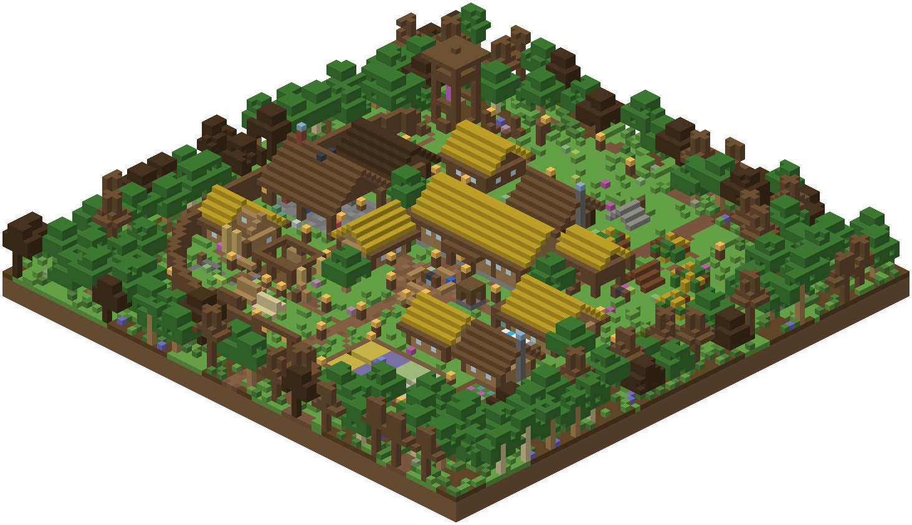
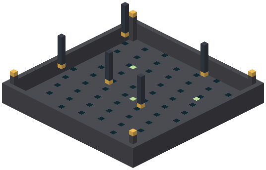
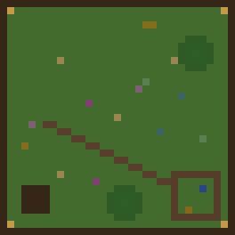
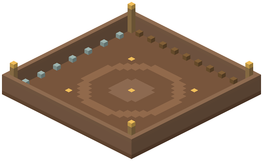
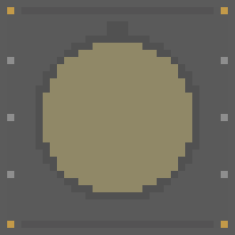

# Build gallery

Generated by `python tools/build_structures.py` from `blueprints/`; do not edit by hand.
Place any of these in game with `/ttl build <name>` (corner at your feet).

## clayman_castle

Clayman's Castle: the dark fortress of the Demon Lord Clayman, "Crazy Pierrot", in the Puppet Nation of Jistav. Lore notes and sources: design/lore/clayman_castle.md. SIZE (109, 66, 109), centre column (54, 54), saved as four z slabs clayman_castle_0..3 (PARTS). Ground layer y 5 (outside: podzol and coarse dirt, you walk at y 6); the castle stands on a deepslate platform (top y 7, you walk at y 8) ringed by a moat (square ring, 37-41 blocks from the centre, water y 2-5) and an outer bank. The gate faces south (+z). Arrival point: blueprint (54, 6, 102) on the approach road, facing north. From the south: road, a stone bridge (z 90-97, deck y 7, walk y 8) over the moat, the gatehouse in the curtain wall (wall 3 thick, y 8-17, wall walk y 18, crenellated; opening x 51-57, y 8-16, raised portcullis, two round towers with spires at x 45 and 63), the courtyard (paved in deepslate tiles, lamp posts, "puppet" stands of skulls on posts and two gallows frames hung with chains and soul lanterns, the marionette motif), and the keep (x 40-68, z 34-62, walls to y 32, four corner turrets r 4 with spires, a great central spire to y 62, gothic windows of purple glass, buttresses, a giant pierrot mask over the great door). Inside the keep: the entrance hall (south, z 49-60) with a stair along its west wall up to a gallery (floor y 19) that overlooks the throne hall through the partition (z 47-48), and the 22-block-high throne hall (z 36-46): purple carpet, two rows of pillars, a three-step dais with the throne, the pierrot mask on the north wall and marionette controllers (chains and soul lanterns) hung from the vault. The curtain wall has four corner towers (r 5), three mid towers (r 4) and wall-walk stairs inside the gate. The moat, the platform and the bank are part of the build; dead trees stand on the outer bank. Every spawnable spot inside the moat ring (and on the bridge and bank) has block light (checked when this builds).

 

## dwargon

The Armed Nation of Dwargon: the dwarf kingdom in a great cavern inside a pale sandstone mountain. Lore notes and sources: design/lore/dwargon.md. SIZE (148, 92, 168), saved as three z slabs dwargon_0..2 (z 0-55, 56-111, 112-167; PARTS) placed side by side by life/dwargon.js. The gate faces south (+z). The mountain is part of the build (stepped sandstone/terracotta massif, grass on its lower terraces, two spurs flanking the gate); outside the mountain and the approach the corners are left empty and terrain stays. Grounding: outputs() writes generated/dwargon_footprint.js (lowest block per column, open-sky columns), which dwargon.js uses to fill the ground under the build and clear hills off the road (see there). Outer road: from the south edge (z 167) past a checkpoint arch (z 160) and a road tower with a banner (z 148-152, west), then fenced queue lanes for the gate inspection (z 114-125) between two guard booths, to the white gate wall (back z 104, front face z 107, towers out to z 111 and up to y 29, yellow banners with the red emblem). Gate opening x 71-77, y 4-11 (arch to y 13). Arrival point: blueprint (74, 4, 120) on the road, facing north. A tunnel (z 94-106) leads into the cavern city: floor blocks at y 3 (you walk at y 4), cavern z 14-100, about 44 wide on the streets and 63 at the plaza, vault up to y 53 with a canyon-like skylight crack over the main street. Levels: the street (y 4), the royal terrace (y 8), wall homes on balconies at y 18, 24 and 32 reached by ladders up stone props from the back alleys behind the houses, and plank bridges hung on chains across the canyon street at y 24 linking facing homes. South street (z 68-94) of stone and timber houses (2-4 storeys, lit windows, shop signs) including the Night Butterflies cabaret (pink, west, z 83), lamps strung across the street; a round plaza (centre 74, 54, radius 17) with a cogwheel fountain and twelve market stalls, a forge hall (west) and a Create workshop (east); the forge street (z 34-43) with Kaijin's smithy (west, z 34); then a great stair (z 30-33) to the royal terrace (floor y 7, landing z 28-29) and King Gazel's throne room: Tensura's own Gazel Dwargo boss arena (blueprints/assets/gazel_throne.nbt, the dwarf_arena structure), its dais half (arena x 42-68) turned a quarter so the throne faces south, at x 49-99, y 1-27, z 0-26 behind a tuff facade with a great door (z 27, x 71-77). The arena's black glass shell became deepslate/tuff/stone (sandstone strata where it meets the open slope), the boss pit and its warp pads were left out, the bulbs' redstone blocks became rock (bulbs stay lit). Throne seat (74, 9, 11); dwargon.js seats Gazel there and restores the canon banner patterns. Chimneys smoke (campfires on hay). Every spawnable spot inside has block light (checked when this builds).

 

## forgotten_dragon_city

City of the Forgotten Dragon: Milim Nava's capital, a poor dragon-worshipping town round an ancient temple. Lore notes and sources: design/lore/forgotten_dragon_city.md. SIZE (121, 44, 125), centre column x 60, saved as four z slabs forgotten_dragon_city_0..3 (PARTS). Ground layer y 4 (coarse dirt, grass, packed mud; you walk at y 5); everything above is air so placing clears trees and hills in the box. The temple faces south (+z). Arrival point: blueprint (60, 5, 118) at the south end of the processional avenue, facing north. Our interpretation of a place canon barely describes (a commune of Dragon Faithful and dragonewts round a Central Temple that hands out goods): the city grew inside the bones of a dead ancient dragon. From the south: the avenue (x 56-64, smooth sandstone) under six rib arches of bone blocks (z 72-112, 20 wide, 13 high), two open granaries with thatch gables either side (z 74-94; the Central Temple distributes goods from them), a bone-fire plaza, and the Central Temple: a five-tier stepped pyramid of sandstone and terracotta (base x 40-80, z 14-54, 3 high per tier, top 17 wide at y 20) fronted by a colossal dragon skull (cranium with glowing eye sockets, horns to y 30, fanged snout) whose open mouth (x 56-64) is the temple gate. A tunnel leads to the distribution hall inside (x 49-71, z 22-46): pillars, stacks of barrels and hay, a counter, and the throne of the Demon Lord Milim (bone, pink terracotta) on a dais at the back. Stairs cut into the east and west faces climb to a pavilion on the summit with a bonfire. Round mud-brick huts with Tensura thatch cone roofs (lit inside, a bed and a barrel in each) lie either side, with campfires, dry fields and a pond for the nearby lake. Every spawnable spot below y 30 has block light (checked when this builds).

 

## laura

Laura: the rebuilt capital of the Beast Kingdom of Eurazania, Carrion's jungle city. Lore notes and sources: design/lore/laura.md. SIZE (113, 46, 113), centre column (56, 56), saved as four z slabs laura_0..3 (PARTS). Ground layer y 4 (grass, moss, patches of coarse dirt; you walk at y 5); everything above is air so placing clears the jungle in the box. The gate faces south (+z). Arrival point: blueprint (56, 5, 108) outside the south gate, facing north. Our interpretation of a place canon only says that Milim destroyed the old capital and Tempest helped build the new one: a tropical timber-and-stone town inside a young stone wall (the lesson of the attack; Tempest blue banners on the gate). From the south: the gate (opening x 52-60, two round towers with thatch cones, four corner towers), a stone avenue (x 52-60) north to the fruit market plaza (centre 56, 66, radius 13: a fountain, twelve canopied stalls of melons and berries), then the Beast King's palace on a stone terrace (x 28-84, z 4-48, top y 7): a great gabled hall of stripped jungle timber and bamboo with a thatch roof to y 32 (hall x 44-68, z 10-44, walls to y 14), a lion's head (Carrion is a lion beastman) in the south gable, a colonnade of totem pillars, and inside a long hall with two rows of tables, hanging lanterns and the lion throne on a dais with a hide rug. Stilt houses (jungle planks, bamboo, thatch gables, ladders) line the side streets, with orchards of jungle fruit trees (cocoa on the trunks, melon and berry rows) in the four corners. Every spawnable spot below y 30 has block light (checked when this builds).

 

## mortal_spawn

Wayfarer's Rest: where every new soul starts Life 1 in the Mortal Realm (a humble human hamlet square). Placed by life/mortal_spawn.js centred on the surface at 0, 0. Layers 0-5 are a foundation (retaining wall around an earth core) so it sits on any terrain; layer 6 is the plaza; layers 7-21 are cleared so hills don't bury it. Players arrive south of the shrine, at blueprint (14, 7, 19).

 

## spirit_corridor_hall

The Spirit Corridor hall: where a soul waits between lives (master plan §1). A round floating hall in the void. Ten pedestals stand for the ten Last Wishes; a halo hangs above the centre, where souls arrive (structure centre = corridor 0 64 0, so the arrival point (15, 1, 15) stays free). Placed by life/corridor.js at -15 64 -15.

 

## tempest

Tempest (early): the hobgoblin village in a clearing of the Forest of Jura, just after the ogres joined. SIZE (91, 40, 91), centre column (45, 45). Ground layer y 4 (grass, dirt paths; dirt below), you walk at y 5; everything above is air so placement clears the forest and hills in the box. Arrival point: blueprint (45, 5, 57) on the south edge of the village green, with a signpost east of it; placed at world 0, 0 (the Life 2 world spawn) by life/tempest.js, which grounds it with generated/tempest_footprint.js. Village (a rough rounded-square clearing, radius about 38, ringed by our own persistent-leaf forest edge): the meeting longhouse (north of the green) where Rimuru holds council, Rimuru's small house behind it, the cooking fire and well on the green, Kaijin's open forge and workshop (west road), Shuna's weaving hut (east road), a raised food store, the goblins' old quarter (north-east: Tensura's own goblin village pieces, blueprints/assets/goblin_village/, round their campfire behind a skull arch), finished hobgoblin houses, a building site (south-west: half-roofed house, timber frame, foundation, scaffolding, log piles, sawhorse), a fenced field and herb patch (south-east), a lookout tower (north-west) and a palisade begun on the west side with a south gate. Roofs and trim borrow the goblin village palette (Tensura thatch, oak logs and fences). Every spawnable spot in the clearing has block light (checked when this builds). Visual references and sources: design/lore/tempest.md.

 

## trial_creation

Trial of Creation: a workshop. The crafting table at (0, 0); parts are dropped around (+-10..13); start (0, -6). No anvils or fire here: the trial cleanup clears those.

 

## trial_deceit

Trial of Deceit: a dark gallery watched by nine Watchers (rows z = -4, 3, 10; x = -8, 0, 8). Start (0, -14); the emerald exit at (0, 13..15). Only distance decides whether you are seen, so the decor here is mood, not cover.

 

## trial_dominion

Trial of Dominion: a ranch. The herd starts in the north-west; the pen is x, z 8..14 with its gate at (8, 11) facing east (trial_defs.js counts cows inside x, z 9..14). Bring three cows inside.

 

## trial_freedom

Trial of Freedom: a jump course over a pit. The course is at y=PIT (the trial's floor level); the pit floor at y=0 is 6 blocks lower. Start pad (0, -13), COURSE blocks, gold goal (0, 12..14). Falling below the course sends the player back to the start (trial_defs.js).

 

## trial_hunger

Trial of Hunger: a ruined storehouse. Food lies around the edges (+-10..13); start (0, 0).

 

## trial_knowledge

Trial of Knowledge: a library. The lectern at (0, 0) is where the Voice asks; start (0, 0) beside it.

 

## trial_protection

Trial of Protection: a farmyard. The ward (villager) stands on the hay at (0, 0); start (0, -4). Attackers come from the corners (+-12, +-12): keep those open.

 

## trial_strength

Trial of Strength: a colosseum. Four waves spawn at (+-10, 10), (+-10, -2), (0, 12); start (0, -12).

 

## trial_survival

Trial of Survival: a ruin. No weapons; poison, falling anvils and fire come at random. Start (0, 0). Keep the floor flat and free of anvils and fire: the cleanup clears those.

 

## trial_vengeance

Trial of Vengeance: a dark duelling ground. The nemesis spawns at (0, 4); start (0, -12).

 
