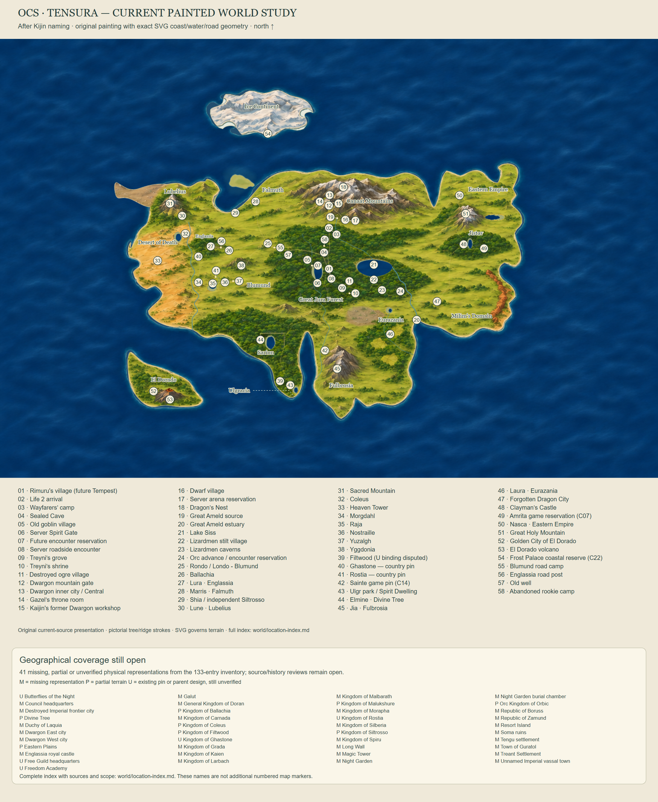

# Painted northern island and coastal water — round 78

[Editable atlas](https://github.com/Yasuke2000/ocs-two-lives/blob/bc54ebe/world/painting-round78/atlas.svg) · [continent PNG](https://github.com/Yasuke2000/ocs-two-lives/blob/bc54ebe/world/painting-round78/continent.png) · [native composition](https://github.com/Yasuke2000/ocs-two-lives/blob/bc54ebe/world/painting-round78/continent.svg) · [independent audit](https://github.com/Yasuke2000/ocs-two-lives/blob/bc54ebe/world/painting-round78/audit.json) · [provenance](https://github.com/Yasuke2000/ocs-two-lives/blob/bc54ebe/world/painting-round78/provenance.json) · [height/depth samples](https://github.com/Yasuke2000/ocs-two-lives/blob/bc54ebe/world/painting-round78/relief-samples.json) · [measured footprint](https://github.com/Yasuke2000/ocs-two-lives/blob/bc54ebe/world/painting-round78/change-mask.json) · [58-site registration](https://github.com/Yasuke2000/ocs-two-lives/blob/bc54ebe/world/painting-round78/site-registration.json)

This presentation follows production source **e8f17470**, map commit **08527b0**. [R77](https://github.com/Yasuke2000/ocs-two-lives/blob/chatgpt/world-map/world/northern-island-review.md) restored an unnamed northern island visible in the official introductory illustration. The current painting now includes that fourth coast, its low rolling hill and surrounding shallow-water colour. The island’s name, owner and dated S1E10 condition remain unverified. Its exact outline, 615×350-block size, height/default grassland and F administrative coverage are the original R77 interpretation, not a newly verified canonical country.

## Composition and measured extent

The new coast clip and outline use the exact source polygon. Island colour/light uses 2100 bilinear height/gradient samples at 8-block spacing. The coastal wash uses 2436 current-minus-prior shallowness samples at 16-block spacing. Both sets were independently recomputed from the normal height rasters. Brush grain, colour ramps, light direction and faint shore glow are illustration choices, not additional terrain or vegetation claims.

The mask follows all **38397 changed four-block height cells**, with a 16-block illustration buffer. It includes the surrounding bathymetry as well as the island. Colour is an indication of relative shallowness rather than a metric depth legend. The composition does not claim to execute the complete runtime density, noise, water or placement pipeline.

A direct insertion of the new wash among the prior filtered image layers produced unrelated RGB changes. The final SVG therefore uses the **verified R69 continent PNG as its own underpainting**, with the new native island/water layers above it. The complete prior editable nodes are retained in `retained-r69-native-composition` with display disabled; the original R69 SVG and all earlier round files remain unchanged. The raw textures are unchanged. No raster pixels were edited and no new AI image was generated; these PNGs are browser exports of the SVG composition.

Compared with the R69 PNG, **5171 pixels** change in the 1536×1024 continent, maximum 193/255 in one RGB channel. The larger colour difference is expected where ocean becomes land. Bounds are pixels (516, 290)–(601, 370); every changed pixel centre lies inside the actual measured height-change footprint. No image pixels outside that footprint change. This verifies local integration without asserting that a stylized picture is a heightmap.

## Geometry and registration

The current source has four coasts, nine lakes, eight rivers and 21 roads, plus the two earlier habitat overlays. All source-vector geometries are checked against the retained/new composition nodes; the unchanged three earlier coasts and water/road art remain in the verified underpainting. The active new coast clip and ocean masks include all four landmasses. Earlier Dwargon, Englassia, Nest and Sacred Mountain lighting survives in the underpainting and editable prior nodes.

All **58 site IDs, x/z coordinates and page projections** are checked. All non-image atlas elements match R69 except the inventory-caption count 132→133. Browser measurements verify 16 context names, 58 number bubbles and 41 open rows; text avoids the padded number boxes, 15 full stroked labels sit inside their gameplay masks, and the Ulgracia leader ends in U. F is checked as the union of its mainland and separate island coverage polygons. Minimum bubble spacing is 32.47px. The atlas embeds the exact newly exported continent PNG.

The current inventory has 133 records, including the R77 landmass; the 41 existing physical follow-ups remain open and their displayed names match the CSV. Ledger 277 unique records, 14 directly read printed-LN and 6 author-side-story claims are unchanged. No new geographical fact or missing-location completion is inferred from this painting update.

## Initial era and handoff

The snapshot remains immediately after Kijin naming, anime S1E10. Later city growth, visits, political outcomes and story residents are not activated. Copyrighted reference images remain outside the repository and were not generation inputs. No production SVG change, converter rerun, terrain application, Minecraft chunks, protected edit, main merge or deployment in this presentation round.

R78 closes the painting-integration follow-up for the fourth-coast terrain change. The source hierarchy, remaining source/fixed-rule disagreements, initial-state questions and 41 physical follow-ups still require work. Technical conversion and placement remain Claude’s handoff; the faithful-world goal is not complete.

## Validation

Fresh feature-branch validation and 472 tests pass (26 skipped, zero failures, 62.794s). The inherited source was checked again: zero errors,56/56 relations and the two existing warnings. Independent vector/mask,underpainting/source hashes,2100 land samples,2436 sea samples,pixel locality,58 registrations and browser label/panel checks pass. Final atlas,continent,island detail and checker preview were visually compared with the official reference. No new production SVG edit was needed after this presentation review.
