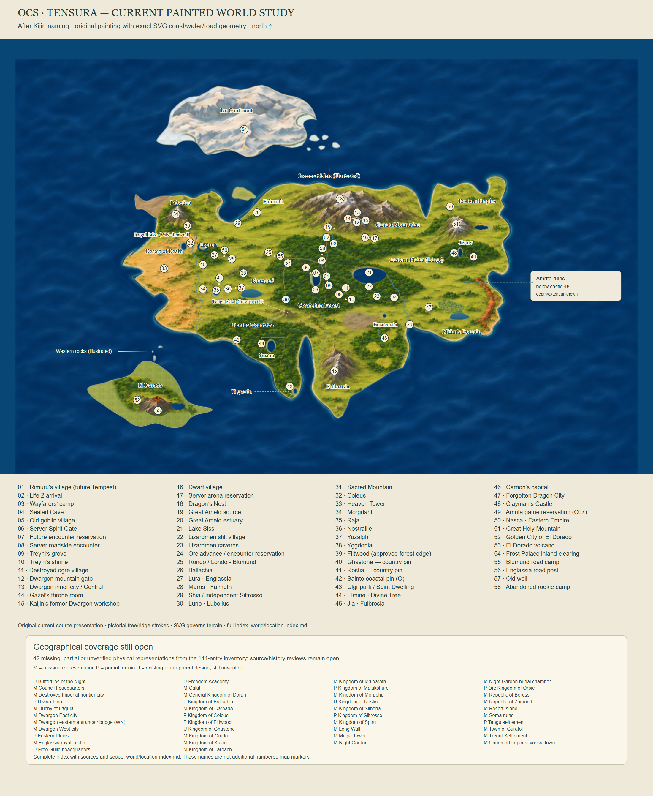

# Current world-map delivery

Yasuke's larger islands and coastal Malukshure are active. The snapshot remains immediately after Kijin naming, with early Tempest forest trails. Eastern Empire, western countries, Jura, Dwargon, southern countries and both offshore landmasses are included.

[Adoption, coordinates and checks](approved-islands-coast.md) · [geometry](map.svg) · [checked preview](preview.png) · [numbered terrain atlas](atlas.png) · [terrain/painting comparison](painting-round112/current-source-comparison.png) · [regions](regions.md) · [58 place concepts](../docs/art/places/README.md) · [manifest](current-delivery.json) · [source conflicts](../docs/research/tensura-world-2026-11-19/contradictions.md).

**Map check passes:** 58 sites, 24 roads, 0 errors / 56 relations / 2 standing warnings; normal export 91.6 seconds without skip-check. All 13 finite lake cases pass and every strict native land centre has gameplay coverage. All 58 atlas anchors in each map match current coordinates.

**The whole task is not finished.** The repository gate has three legacy-registration failures plus failed validation (Filtwood U/J and Sainte H/O). Claude's coordinated Amrita nesting, runtime registration, Minecraft terrain/structures and in-game acceptance remain. There are 42 physical follow-ups from the 144-entry source inventory. No owner geography choices remain pending; source gaps and technical work remain. Nothing has been applied or deployed to the server.

[Current technical-source handoff](runtime-source-review.md):the applied technical branch still uses the older source. All11core inputs and5placement records differ;old reported38-site tests do not certify the current58-index design. Full-box generation extent and source-aware acceptance are specified for Claude.

[Orbic cached category and later village lead](../docs/research/tensura-world-2026-11-19/orbic-category-current-review.md):361qualified ledger records and144expanded inventory entries. The new later-state lead adds no initial map point;42physical follow-ups remain.

[Current requirement-by-requirement readiness](../docs/research/tensura-world-2026-11-19/current-map-readiness.md) regenerates the stale tracked checker report and rebases the inactive Amrita trial onto the selected map. Active geometry passes;the accepted underground target still needs coordinated technical adoption.
