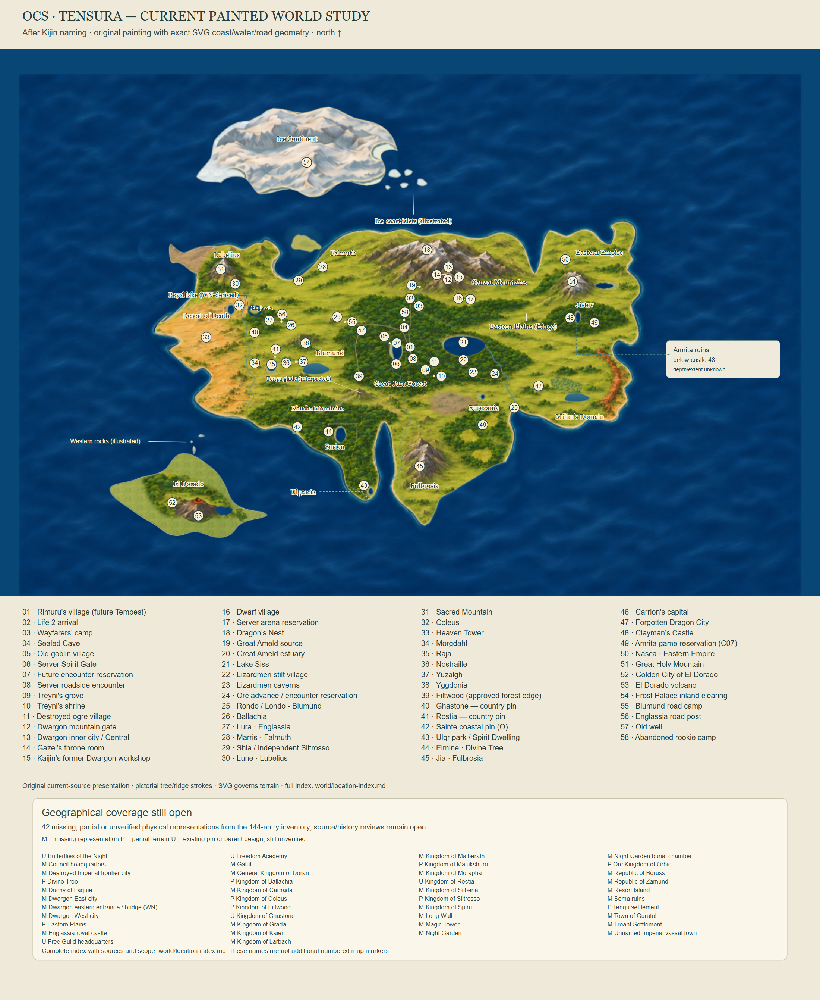

# Approved larger islands and coastal Malukshure

Yasuke selected the larger Ice Continent and El Dorado from PR #161 and the Malukshure coastal proposal from PR #163, including Sainte gameplay H to O. Both are now active in `map.svg`. These choices supersede the smaller-island brief and the inland H pin. No owner geography choice remains pending.

[Checked geometry](map.svg) · [checked preview](preview.png) · [numbered terrain](atlas.png) · [terrain versus original painting](painting-round112/current-source-comparison.png) · [machine audit](approved-islands-coast-audit.json) · [all 116 atlas anchors](approved-islands-coast-atlas-check.json) · [13 finite lake cases](approved-islands-coast-finite-checks.json) · [22-region biome census](approved-islands-coast-biomes.json).

Source `36c77b45ee33edb37d737e062327ae936eeae68eeb6904d5054b4325196a8627`. Standard map checker: **0 errors, 56 relations, 2 standing warnings**. Normal conversion: **91.6 seconds without skip-check**, 58 sites, 24 roads. Output box 13824 by 11264 blocks, mainland 9983 by 6250. The fixed continent retains the generated outer-ocean design; these artifacts do not prove runtime ocean generation.

| Changed reservation | x | first air y | z | radius | Scope |
| --- | ---: | ---: | ---: | ---: | --- |
| `sainte_malukshure` | -2320 | 64 | 1645 | 8 | Unplated country pin;gameplay O,not sovereignty |
| `el_dorado` | -4900 | 70 | 3202 | 100 | Existing identity and preparation type retained |
| `el_dorado_volcano` | -4359 | 222 | 3473 | 8 | Existing identity and preparation type retained |
| `frost_palace` | -2130 | 75 | -3799 | 89 | Existing identity and preparation type retained |

The other 54 complete site-index records remain exact. 32 of 34 flat-preparation configurations and 21 old road exports remain exact; two island routes move and one Malukshure approach is added. Every exported road grade stays at or below 0.5 within floating-point tolerance. All 13 finite lake cases pass; 2,954,426 strict native land centres have gameplay coverage with zero unassigned. Exact shoreline centres are outside that coverage census.

The island brushwork is transformed from original project art and clipped to the approved coast. The cape and approach are original SVG work. Both numbered atlases are checked against actual browser transforms for all 58 anchor points; inherited Filtwood marker/leader errors were also corrected. The illustration is not an exact height reconstruction. Original place-concept PNGs and exact generation prompts are retained; their current registration notes are updated.

The official map supports broader apparent island proportions, but its projection is unknown: the selected 41.5% and 32.5% mainland-relative widths are authored choices, not canonical measurements. Malukshure's coastal setting and Sarion adjacency have source support; the exact west bearing, cape, route and coordinates are interpretation. Gameplay O does not make Malukshure part of Morgdahl or Sarion. The eight-block Sainte pin is not a whole capital. No initial Magic Tower, harbour build or later vacation event is instantiated.

**Still incomplete:** `bash tools/check.sh` ran 494 tests in 72.283 seconds, 26 skipped, with three failures plus failed generator validation. Filtwood's old grid reads U instead of approved J; Sainte's retained legacy anchor reads H instead of approved O. The third failed test detects the generator check failure. Claude must reconcile normal generated registration and the legacy runtime grid; protected code and tests were not changed. This adoption is for authoring review, not a main-ready deployment.

[Amrita beneath Clayman's castle](amrita-approved.md) remains the approved final target. Its old eastern circle is serialized only as a coordinated migration input until Claude reconciles parent/depth/carve/road/template data; the failed marker-only trial is not activated. 42 physical follow-ups from the 143-entry inventory remain open, including full cities and unlocated places. Complete wiki coverage, final noise, fluid columns, actual structures and in-game acceptance are not certified. No runtime apply, main merge or deployment was performed.
