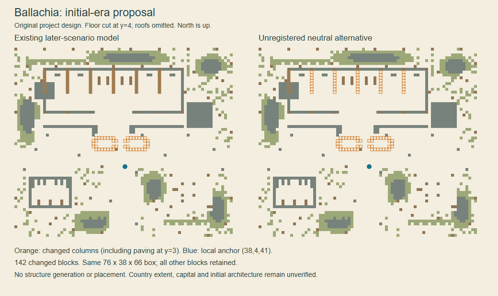

# Ballachia initial-era correction — R101

The earlier lore page presented the later Orthrus rescue as the playable state.
The corrected [lore brief](../design/lore/ballachia.md) separates later events,
secondary country identity and original architecture from the S1E10 snapshot.
No new primary geographical fact is claimed. Ledger **305**, inventory **138**
and **42 physical follow-ups** remain unchanged; Ballachia remains partial.

## Reviewable model alternative

[Candidate Python](build-proposals/ballachia_initial.py), [SVG plan](ballachia-initial-r101.svg),
[voxel diff](ballachia-initial-r101.json). The candidate lives outside `blueprints/`:
`build_structures.py` discovers only that directory's top-level model files.
No registry, generated structure or registered blueprint was changed.

Build both models in memory using the existing Blueprint/Town helpers. The
alternative makes exactly **142 block replacements**: 80 internal partition
blocks become air, 16 west-wall blocks become bricks, and 46 paving blocks return
to the existing deterministic plaza palette. Size 76 × 38 × 66 and anchor
(38, 4, 41) stay the same. All other voxels are identical. A repeated candidate
build is identical; all coordinates are within bounds. Generic lamp chains,
roof details, window bars, wagon and supplies stay intact.

The plan is an original floor cut at y=4 with changed-column overlays including
the y=3 paving. It is not an in-game screenshot or a country map. Neutral use is
our interpretation; it does not establish that this building existed in S1E10.
Claude must review support/access, register the chosen model, generate structures,
and test terrain placement and era behaviour locally before activation.

## Evidence inspected

- [Official episode 65 synopsis](https://www.ten-sura.com/anime/tensura/story/no69):
  later Orthrus defeat; no named Ballachia or capital coordinate in the synopsis.
- [Publisher editorial review](https://thetv.jp/news/detail/1211892/p2/), dated
  8 August 2024: explicitly names Ballachia and the later return to Jura. This
  is secondary editorial context, not a primary geographic survey.
- [Publisher gallery](https://thetv.jp/news/detail/1211892/13401124/): all ten
  original image IDs 13401117–13401126 viewed individually. Portraits, festival
  planning, Dungeon context and wagon interior; no Ballachia exterior panorama
  in this selected set. No complete-episode playback or timestamp claim.
- The previously unavailable Fandom establishing frame and unread manga108
  remain leads. Dome/arcade/country placement claims are not upgraded from them.

Private references: `ocs-world-research/references/ballachia-r101/access.json`
records original URLs, HTTP statuses, byte lengths and SHA256 hashes. Copyrighted
frames are excluded from the repository. The comparison drawing is our own work.

No map SVG, biome, terrain, road, site registration, art prompt or painted atlas
changed. R100 remains the aligned painted atlas. The prior map check remains
0 errors / 56 relations / 2 existing warnings; it was not rerun for this
non-geographical proposal. Full kingdom extent, capital and runtime acceptance
remain open.

Validation: `bash tools/check.sh` passed: 472 tests, 26 skipped, zero failures
(64.150s); repository validation and zero changed-JavaScript check passed.
`git diff --check` passed. No in-game behaviour is activated by this proposal.
