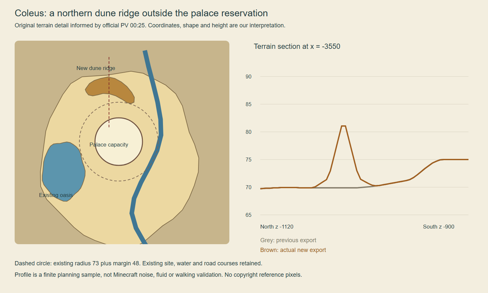

# Coleus: an authored dune outside the palace reservation

[Editable diagram](coleus-dune-relief.svg) · [Measured export](coleus-dune-relief.json) · [Current atlas](atlas.png).

## Direct anime reference and limits

The [official 27 September 2023 announcement](https://www.ten-sura.com/news/anime/coleus/news/post/9015) links the public [Coleus PV](https://www.youtube.com/watch?v=WuIDVoKdVGU). At [00:08](https://www.youtube.com/watch?v=WuIDVoKdVGU&t=8s), the named Coleus panorama shows a domed palace above a rocky hill and a lower town. At [00:25](https://www.youtube.com/watch?v=WuIDVoKdVGU&t=25s), a caravan travels between substantial sand dunes. The latter establishes visual terrain vocabulary in the promotional sequence; it does not supply compass bearings, distance to the palace, an exact travel itinerary or a surveyed dune outline.

Fourteen sampled public-player frames were captured and visually inspected privately. The player identified video `WuIDVoKdVGU`, duration90.101seconds, with no advertisement showing. Four later seek attempts at60/70/80/90seconds timed out. This is not continuous full-trailer or full-episode playback, and none of those failed frames is counted as inspected. No source image or dialogue is included in the repository.

The existing official [INEI concept](https://www.ten-sura.com/news/anime/coleus/news/post/8574) already supports the hill-palace/lower-town relationship (OFF-COL-002). The [occupied-model review](coleus-fit-review.md) shows the current blueprint provides its own stepped hill. There is no reason to add a duplicate palace mountain or enlarge its flat reservation.

## Original terrain change

Add one **22-vertex rolling dune ridge**, entirely within the existing Coleus desert selector and north of the current palace capacity. Its shape, northward position, extent and `data-height=110` / ruggedness0.12 controls are **our interpretation**, not measurements from the anime. The footprint is151×81.75blocks. The nearest drawn site-disc edge is49.30blocks away, exceeding Coleus's48-block margin; all58 site attributes remain unchanged. The nearby trade river, oasis and road courses are retained.

The first narrow trial produced only1.44blocks of maximum lift. It was rejected as insufficient for the intended landscape. The final broader rolling footprint produces a measured maximum11.25-block increase, with changed height samples reaching81.5. The110 input is a shaping control, **not an achieved crest altitude**: the converter's64-block hill blend attenuates a small footprint. No converter modification or artificial hard plateau is introduced.

Normal staging takes67.5seconds. Only661 height cells change, within world-centre bounds x-3622..-3466,z-1062..-970. Biome, ruggedness, water, road, site and exclusion PNGs are byte-identical. Every site export/height is unchanged; no changed height centre falls in any of the58 drawn site discs or any of the13 lake polygons plus8-block buffers. Lake/river index records remain equal.

The western desert caravan's source course is unchanged. Ten exported profile heights change by at most0.09blocks; its maximum sampled grade is0.3825. All22 exported road point profiles remain within0.5, with no vertical duplicate-coordinate segment. These are finite export checks, not final-noise, collision, fluid or in-game travel validation.

## Companion artifacts and era

The atlas replaces only its embedded normal terrain image; existing numbering and annotations retain their geometry. All22 region polygons and the biome PNG are unchanged, so the R128 regional census remains applicable. The current place-art registration remains applicable because every site export is unchanged. The existing painted atlas predates this new small dune and needs a native relief alignment; it must not be described as an exact rendering of this source.

The new source SHA256 is `0b8bcf56c8054ae0b03f60dcf5b8777672b5097078803390f2d82636a52f045e`. The checker reports zero errors, all56 relations and two standing warnings. The preview and original measured section were inspected. The post-Kijin S1E10 snapshot is retained; no later Coleus story party, ruler, night lighting, quest or event is instantiated. Coleus remains partial in the location inventory: this is one surrounding landform, not the whole country or city.

No tools, mod, pack, runtime application, chunk generation, merge or deployment changes accompany this source edit. The larger-island trials remain comments, unrelated to this local terrain correction.

Required repository gate: `bash tools/check.sh` passed;472tests in65.253seconds,26skipped,zero failures. `git diff --check` passed. No in-game terrain or fluid acceptance is claimed.
