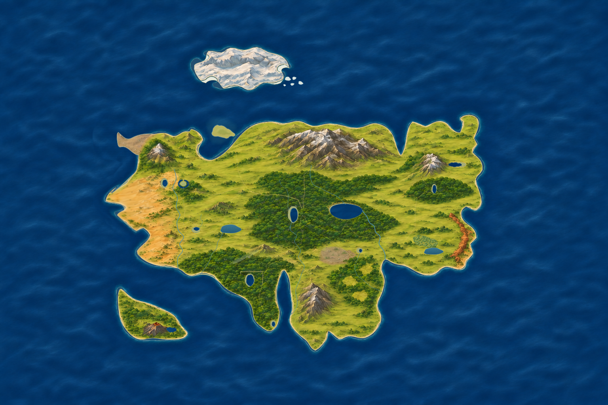

# Current continent comparison

| Original current painted continent | Official introductory geography reference |
| --- | --- |
|  |  |

The official panel is a remote link;no copyrighted reference pixels are copied into this repository. Our coast,relief and painting remain original. The [same-frame current terrain/painting comparison](painting-round112/current-source-comparison.png) shows the actual numerical export beside the illustration. [Numbered atlas](painting-round112/atlas.png) identifies all58places.

Current display and normal source 9526890d; mainland 9,983 × 6,250 blocks, export box 12,800 × 10,752. The approved Filtwood reservation at (-1050, 600), gameplay J, and its woodland trail are included; the map has 58 sites and 23 roads. This fits the hard14336x11264cap while exceeding the ordinary targetbox. Absolute distances,coast curves,biome edges and gameplay masks are server interpretations. The smaller Ice/ElDorado proportions remain a disclosed difference;the [larger-island proposal](https://github.com/Yasuke2000/ocs-two-lives/pull/132) awaits an owner choice and requires current-source/painting/art reconciliation before activation.

The selected state is immediately after Kijin naming,anime S1E10. Fulbrosia is south of Jura;Ulgracia south of Sarion. The approved inland palace,western islets and small Ulgr/Laura head interfaces are represented in current source. The painting keeps historical brushwork/height provenance and is not an exact vertical reconstruction. Politics,later buildings and roads retain their [era limits](era.md).

Remaining source/contract questions include the Imperial mountain bearing,Amrita nesting/reserve,Malukshure coast binding and extra-location registration. Filtwood placement is owner-approved; its legacy-grid/runtime integration remains open. [Contradictions](../docs/research/tensura-world-2026-11-19/contradictions.md),355-record [source ledger](../docs/research/tensura-world-2026-11-19/geography-facts.csv) and143/42 [location index](location-index.md) keep these visible. Whole-wiki coverage,all architectural details and Minecraft acceptance remain unproved.

Start with the [current delivery index](DELIVERY.md). [Earlier comparisons](comparison-history-through-r143.md) retain their original source versions and historical counts.
