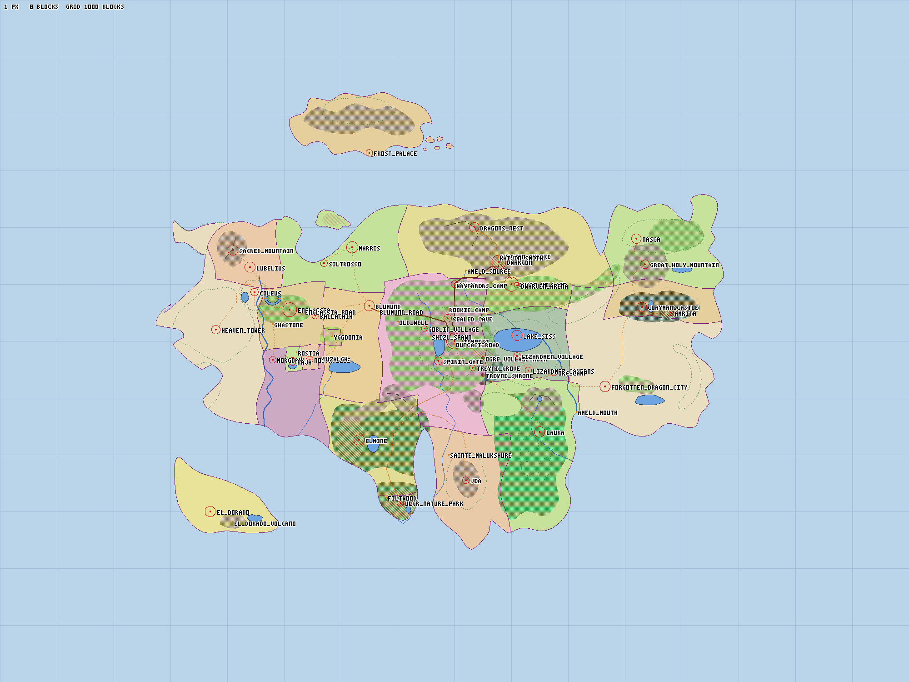

# Reference comparison — round43 current painted headland / post-Kijin snapshot

R87 [current painted atlas](https://github.com/Yasuke2000/ocs-two-lives/blob/d98513e79e386b493410ab219d110c5d5bd1fa61/world/painting-round87/README.md) aligns R86 northeast Dwargon: six moved site groups, three revised roads and local illustrative relief. All 58 registrations and 16 context names are checked; the 135-entry inventory and 42-row coverage panel remain current. Source `355d1a33` and ledger 286 are unchanged. Painting gate: 472 tests, 26 skipped, zero failures (63.210s). This supersedes earlier pending painting notes only; broader source/location/era questions remain open.

R86 [Dwargon northeast relocation](dwargon-relocation-r86.md) moves the gate to (780,−1390), retaining all 56 relations and 58 footprints. The secondary bearing discrepancy improves 35.31°→6.01°. Six related site records, two local relief shapes and three roads are aligned; water and all other native geography remain. Source355d1a33; ledger 286/inventory 135/42 follow-ups. R85 painting needs alignment; all 58 concept reservations are checked in the [art audit](https://github.com/Yasuke2000/ocs-two-lives/blob/120f5d5/docs/art/registration-r86.md).

Current presentation: [round53 native relief layer](https://github.com/Yasuke2000/ocs-two-lives/blob/chatgpt/current-painted-map-r38/world/painting-round53/comparison.md),source8c24a349. R50 and earlier statements below retain their historical sources. No production terrain change occurs in this presentation review.

Current source8c24a349 includes the [round52 Dwargon approach correction](dwargon-approach-fix.md). Official continent silhouettes and C12 departures are unchanged;the exact local foothill ramp is an authored fit,not a canonical survey. R50 painting retains its recorded sourcecb07cce7 and needs local-relief review.

Current presentation: [round50 native-mask refresh](https://github.com/Yasuke2000/ocs-two-lives/blob/chatgpt/current-painted-map-r38/world/painting-round50/comparison.md), sourcecb07cce7. R43 and earlier round statements below are historical. The original painting follows the current source without a new image-generation pass.

Round49 [shared-curve review](shared-curve-review.md) retains the official broad silhouette cues while making coast and region boundaries agree exactly in native sampled geometry. Current sourcecb07cce7/120 mainland nodes replaces source7d021766; all 58 markers stay fixed. Current checker/terrain atlas were visually compared with the linked official base; proportional compromises remain C12. R43 painting retains the earlier shoreline and is historical until refreshed.

Current presentation: [source7d021766 painting and linked official comparison](https://github.com/Yasuke2000/ocs-two-lives/blob/chatgpt/current-painted-map-r38/world/painting-round43/README.md) · [comparison table](https://github.com/Yasuke2000/ocs-two-lives/blob/chatgpt/current-painted-map-r38/world/painting-round43/comparison.md). The new headland now has original painted texture under exact native coast/water/road overlays. The active SVG is retained after visual review; no additional geography is inferred. R38 and earlier statements below retain their historical dates/hashes.

Current comparison: [western before/after](western-cape-study.png) · [terrain atlas](atlas.png) · [source and export review](western-cape-review.md). The official introductory image supports a broad western projection; exact shore,habitat and V assignment remain our interpretation. Production source7d021766 retains all 58 sites and earlier physical layers. PR102's R38 painting does not yet contain this new coast and must not be treated as a current-source overlay. Earlier descriptions below are historical.

Current presentation: [painted atlas PR102](https://github.com/Yasuke2000/ocs-two-lives/pull/102) · [side-by-side reference links](https://github.com/Yasuke2000/ocs-two-lives/blob/chatgpt/current-painted-map-r38/world/painting-current/comparison.md). It follows the current1ea6782d source with3 coasts/9 lakes/8 river reaches/21 roads/1 Orbic highlight/58 anchors. Native masks/vectors are audited; underlying tree/ridge/snow/bank strokes are pictorial. The production SVG and terrain exports are retained after review. The standalone terrain preview is refreshed byte-identically from the current normal export; the main numbered atlas already used those pixels. Earlier numbered comparisons below remain historical. Exact server geometry and fixed/source conflicts stay qualified.

## Imperial water cue — round35

[Current before/after](imperial-basin-study.png) adds the previously omitted unlabelled basin shown east/southeast of the Imperial cone in the official base illustration. This is a visual inference; exact shore/position/level/depth are our interpretation. No named LN lake, Silberia coordinate or drainage route is claimed. [Evidence and unchanged-site/road/raster checks](imperial-basin-review.md). The current atlas includes it; earlier painted atlases remain historical.

Earlier numbered comparisons below are historical at their stated sources.

Round32 comparison: [Ice coast review](ice-coast-review.md) adds three limited irregular inlets to the earlier smooth envelope. The official illustration is a visual reference, not a surveyed source for those precise bays. Fixed palace shore,58 reservations,21 roads,mainland and El Dorado geometry remain; sea gap916.98 blocks. Checker preview, fresh atlas and native before/after were visually inspected. Earlier painted passes predate this shoreline and Orbic habitat update.

Round31 comparison: [Orbic review](orbic-terrain-review.md) adds a small interpreted depleted-ground habitat and opens the overlapping jungle edge. Official continental illustration and fresh preview/atlas were visually compared; no surveyed Orbic boundary follows from that illustration. All58 sites/coasts/relief/waters/roads/masks remain unchanged. Earlier painted reviews predate this local vegetation change; current atlas/checker preview governs terrain.

Eurazania now has a sparse-jungle transition and three separated open field reservations within its existing southern woodland. This follows the official guide's warm climate/fruit-orchard premise (OFF-008); exact cultivation extent, vegetation species and polygon boundaries are our interpretation (DES-EUR-017). The overlays reserve a more open setting rather than automatically planting fruit crops. All58 site centres/radii and all 21 road profiles are retained; the complete height/water PNGs are byte-identical to5afa13d's staged build. No coast, river, relief, forest boundary or gameplay mask changes.

Round 16 moves the old Forgotten Dragon City from(2500,150) to(2650,800), retaining radius100, M membership and all fixed relations. This follows the official illustration's broad southeastern pattern and the wiki territory relationship south of Jura/east of Eurazania. The pinned secondary marker distance discrepancy improves from-9.8% to-0.3% and bearing discrepancy from-13.3 to+0.1 degrees; projection and precision remain unknown. Exact city coordinates and two rerouted approach trails are our interpretation. All other57 site centres/radii and every coast, lake, river, mountain, hill, forest, biome and gameplay polygon remain unchanged frome129131. This is the old settlement, not the later city/castle built at Laura.

Round 15 corrects Coleus using the directly read official anime outline: the independent kingdom lies between Ingrassia and Lubelius. Its authored centre moves from(-3650,-250) to(-3520,-860), retaining radius73, V membership and all fixed relations. The dunes move(+130,-610); the oasis moves(-175,-610), keeping water separate from the city and river. One caravan trail skirts the pond on its north side. The other57 site centres/radii, coasts, rivers, mountains, hills, forests and gameplay masks remain unchanged from147ea7e. Exact city position, shore/level and trail bends remain our interpretation; countries lying between others does not survey their capitals.

Round 14 moves Elmine from (-1100,1800) to (-1680,1740), retaining its 100-block radius and all fixed relations. Relative to the pinned fan marker pattern, its Siss-normalized distance discrepancy improves from -13.0% to -0.3% and bearing discrepancy from -17.5 to -4.9 degrees. Unknown projection and marker precision limit this comparison: exact server coordinates remain our interpretation. The pond follows the city (-580,-60); the hill shifts (-480,-60) to remain on the existing coast. Three trails approach the north edge and skirt the pond. The other 57 site centres/radii, coast, rivers, mountains, forests, biomes and gameplay regions remain unchanged from a2748f3.

| Authored Minecraft geometry | Official visual reference |
| --- | --- |
|  |  |

The reference image is linked externally and is not copied into this repository. Original geometry is in
[map.svg](map.svg). [Readable numbered atlas](atlas.png), [terrain preview](terrain-preview.png),
[evidence](../docs/research/tensura-world-2026-11-19/geography-facts.csv) and [deliberate differences](regions.md#research-round-4--source-traceability-and-deliberate-differences).

Visual review: the northern bay and southern gulf now appear in both broad silhouettes. The authored coast is
smoother; the western body and Canaat are broadened to preserve the required sites. Relative sizes and positions
are compressed nonuniformly around server constraints. This is an original adaptation, not a traced or surveyed map.

**Default map checker: zero errors, two disclosed warnings**, after exactly five owner-authorized data-rule
corrections. These screenshots do not prove source completeness, proportional fidelity or Minecraft runtime acceptance.

[Unresolved lore alternatives](lore-alternatives.png) are drawn as a separate review diagram and inert SVG comments; they do not change the active map.

Round 6 improves western/cave proportions, the northern bay bank and the hooked northeastern/eastern shore. [Constrained proportion alternatives](proportion-study.png) are drawn for owner review; exact reference-scaled points stay inert.

[Additional-location study](additional-location-study.png) draws C14/C15 coastal, summit, city and wall proposals in context. These are proposed interpretation geometry, not edits to the active terrain.

Current initial state: [immediately after Kijin naming](era.md), S1 episode10. Later chapter screenshots are comparisons, not initial politics. Round7 adds interpreted eastern foothill woodland/open ground. Round8 lengthens Siss east–west and corrects the false aquatic-whirlpool premise; exact shore shape remains interpretation. The current SVG has a fresh, SHA-matched staging build; details in [review](review.md).

Round9 replaces the broad equal-height Canaat wall with a concentrated summit spine and lower tapered eastern spurs. Fixed anchors still force compression relative to the official map; exact relief and elevations remain interpretation. [Empire evidence gaps](../docs/research/tensura-world-2026-11-19/eastern-empire-followup.md) stay explicit.

Round10 changes only a disputed label and inert source alternatives. [Filtwood/Orbic study](southern-location-study.png) shows the unresolved U binding and separate homeland vicinity. The official base image alone does not locate those missing settlements.

Round11 reduces the authored Milim red-biome accent69.8% while retaining the fixed brief's small red crescent. This is a disclosed server palette, not a verified canonical desert. [Episode locators](../docs/research/tensura-world-2026-11-19/anime-episode-locators.csv) correct the generic still labels and their evidential limits.

Round13 rounds five existing river reaches within14.17 blocks of the previous lines, retaining all control points/endpoints and hydraulic metadata. Exact meanders remain interpretation; broad continental hydrography and source conflicts are unchanged. [Measurements](river-centreline-review.csv).

A small western trail waypoint adjustment within20 blocks corrects the actual exported grade after the river change; its old route points and endpoints remain. This is authored game geometry, not a new canonical travel claim.

Coleus detail: [official INEI production panorama and source/placement review](../docs/research/tensura-world-2026-11-19/coleus-placement-review.md). The panorama supplies local visual character; the official outline supplies the between-country relationship. Neither supplies surveyed coordinates.

Round20 adds an official episode64 Tengu source review and an inert ridge/terrace proposal. Current preview and official base map were reinspected; all live geometry and preview bytes remain unchanged. [Study and exact evidence limits](tengu-settlement-study.md). No new continental-geography claim is inferred from the illustrative plan.

## Forest/painting comparison — round22

Three eastern forest boundaries now use restrained broad bays/lobes rather than smooth oval/ribbon edges. All sites, water, relief, roads, gameplay masks and nine other forests remain unchanged. The official base illustration, first painted study and new checker/terrain previews were compared; precise woodland boundaries are still our interpretation. [Before/after measurements and deliberate differences](forest-edge-review.md). No new sovereign border, canonical acreage or climate zone is inferred.

## Amrita access / Soma identity comparison — round24

Official episode81 synopsis and five stills plus the legal LN10 historical passage were inspected. The source supports a beneath-castle relationship and distinct older Soma, not a measured external entrance or whole-city centroid. Active geography remains identical; an inert castle-linked access alternative and a game-reservation label expose C07. Current checker/terrain previews and the official base illustration were reinspected; no new coastline, mountain, forest or political-border difference is introduced. [Plan/section study and limits](amrita-placement-review.md).

## Third painting/SVG review — round25

[Draft PR92](https://github.com/Yasuke2000/ocs-two-lives/pull/92) compares current geometry/terrain with a third original painting. A compact southern massif and more open Imperial plains reduce pictorial overstatement. An invented stream is removed before8 exact native source courses are restored;3 coast/8 lake/21 road vectors and 58 anchors pass audit. The source SVG is retained: illustrative errors supply no source-backed reason to change actual terrain. No new deliberate continental-geography difference is introduced. Official base illustration reinspected; previous source/constraint differences remain open.

## Frozen-continent palace review — round28

A newly read WN78 passage supplies an inland palace relationship distinct from the active south-coast reservation. The current preview, official base and original C22 study were compared; the source alternative stays inert. All active geography and 58 sites remain unchanged. Exact server centroid is interpretation and LN equivalence remains unverified. [Study and limitations](frost-palace-source-review.md).
