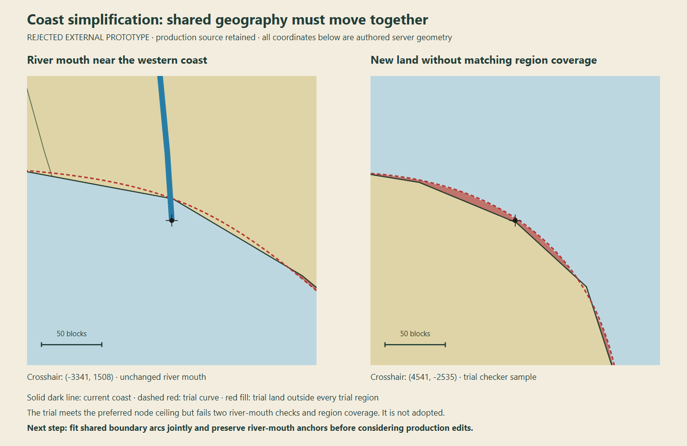

# Curve simplification review — round 48

The production map is retained. An external prototype gets all nine over-budget
outlines to at most120 SVG nodes using cubic paths, but fails **three mandatory checks**:
two river mouths and land coverage. It is not a deliverable map and is not adopted.
Only the diagnostic presentation and [result data](curve-simplification-review.json)
are committed; the failing candidate remains outside the production repository.

## Method and measured result

The [round44 study](vertex-budget-study.md) used straight-line simplification.
This follow-up instead fits cubic segments with chord-length least squares, source
endpoint tangents and original corners above35 degrees retained. Recursive splitting
checks the sampled curve against each original polyline segment; two-point spans
stay straight. Nine outlines are fitted independently. This is an authoring experiment,
not a new geography source or proof that any untested fitting method is impossible.

| Outline | Candidate SVG nodes | Tested tolerance, blocks | Densely sampled boundary displacement, blocks |
| --- | ---: | ---: | ---: |
| coast/mainland | 114 | 12 | 11.770 |
| forests/jura-eastern-foothill-woodland | 97 | 0.5 | 0.494 |
| regions/nation-V | 100 | 2 | 1.909 |
| regions/nation-F | 108 | 0.25 | 0.244 |
| regions/nation-D | 120 | 0.25 | 0.249 |
| regions/nation-J | 118 | 0.25 | 0.249 |
| regions/nation-M | 110 | 0.5 | 0.477 |
| regions/nation-B | 119 | 0.25 | 0.249 |
| regions/nation-R | 91 | 0.25 | 0.248 |

The native source counts curve segment ends as nodes; handles are not additional
nodes in the existing checker. The coastline trial has113 cubic segments and114
nodes including the initial point. It changes actual shape; this is not a renaming
of all388 original line vertices. The original preferred20–120 range remains unmet
in the **active** nine polygons.

The dense comparison samples48 subsegments per cubic. The actual repository parser
flattens C curves to16 steps; with that geometry the trial's maximum coast boundary
displacement is11.868 blocks and land classification changes108,119 square blocks.
These are sampled geometry diagnostics, not an analytic continuous-curve error bound,
affected Minecraft-column counts or a normal converter export.

## Why the trial is rejected

All56 site relations still pass and all58 site attributes, roads and waters are
identical to the source. That is insufficient:

- The western trade river mouth ends about17 blocks offshore after the coast moves,
  exceeding the existing16-block allowance.
- The Laura waterfall mouth also exceeds that allowance; the checker rounds its
  displayed distance to16. The normal Laura escarpment warning is a separate issue.
- 45 of26,614 checker land samples fall outside every region, first at(4541,-2535).

An exact check on the repository-flattened trial finds60,217.923 square blocks of
uncovered land and48,383.279 square blocks of masks outside the coast. Existing
source uncovered land was53.045 square blocks. Independently fitting the masks does
not preserve their common coast even when their individual displacements are small.
The diagnostic image magnifies two failures that are easy to miss in a full-world
preview. The full trial preview was inspected; a visually similar silhouette does
not make these errors acceptable. No checker threshold or technical code changed.

Snapping the old masks independently to grids0.01,0.05,0.1,0.25,0.5,1 or2 did not
produce a valid exact coverage. Coordinate rounding alone is not the repair.

## Next available action

Fit **shared boundary arcs jointly**, preserve coastal region junctions and river-mouth
contact intervals, then assemble each outline from those shared arcs. Keep site
buffers and the current58 reservations. Check the combined topology and the native
16-step geometry before a production edit. Only after a passing source candidate
should the normal converter, world-aligned exports and presentation be refreshed.

Do not repair this experiment by moving rivers merely to accommodate an independently
smoothed coast or by loosening the coverage rule. The current source remains
`7d021766b648dcfd89a6dcbebeaede431d4b7375773692a341d27bb3506503aa`.
No production SVG, preview, atlas, normal export, art, canon fact or site tuple changes.
The ledger stays224/14 direct LN; inventory129/32 follow-ups and58 art pairs remain.

## Other completion checks

The previous round made progress by adding direct licensed manga evidence and
correcting the cave-state brief. No process from that round remains running.
The current PR discussion contains only an automated draft-review notice; it supplies
no new owner resolution of the recorded source/fixed-rule questions. A limited
filename search in Documents,Downloads and Desktop found pack/world archives but
no matching source ebook. This is not a claim to have searched every file or all
storage/cloud locations, and no unverified local video was used as a licensed source.
No main merge, apply, runtime acceptance, chunk generation or deployment occurred.
