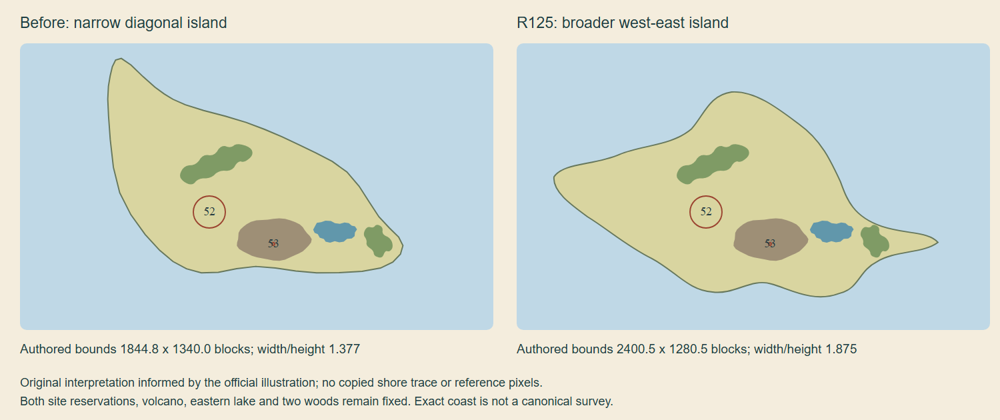

# El Dorado: broader island silhouette — R125

[Editable comparison](el-dorado-coast-r125.svg) · [Native/export evidence](el-dorado-coast-r125.json) · [Current atlas](atlas.png) · [All 13 lake checks](lake-banks-r125.json) · [Current biome census](region-biomes-r125.md).

## Geography and interpretation

The original [official introductory map](https://www.ten-sura.com/4GfGdAp7/wp-content/themes/tensura_portal/assets/images/portal-map/world/intro/map-base.webp) was visually compared with the current coast: its southwestern island has a broad west-east form, western arm, central northward bulge and eastern projecting tip (MAP-ELD-COAST-125). The old authored island instead formed a narrow diagonal wedge. Fourteen original cubic reaches now make that overall silhouette more faithful; no traced shore file, copyrighted reference pixels or reproduced map panel is committed.

The exact curves and server dimensions are **our interpretation** (DES-ELD-COAST-125). Authored width/height changes1.377→1.875; these are measurements of our two designs, not a surveyed canonical target. New bounds2400.50×1280.55blocks. Added land430654.89blocks²; removed land247840.82blocks². The matching X mask follows the coast; it is an administrative gameplay mask, not a new sovereign-border claim. Mainland9983×6250 and design12800×10752 stay unchanged. Global C12 projection/compression limits remain.

Only native `el-dorado-island` and `nation-X` change. All58 site attributes,22 road courses, all other coasts, volcano and rocky biome selector, eastern lake and both woodland shapes remain. Every internal island landscape shape stays completely on land; the lakeside wood is 7.14 blocks from shore and the lake 90.42 blocks from shore at their nearest points. These are authored geometric clearances, not canonical measurements. The S1E10 snapshot gains no later eruption, plot party, excavation or altered ownership.

## Actual terrain consequences

Normal staging takes67.5 seconds without converter warnings. Changed height samples 248590, max84.625blocks; ruggedness 59772 cells andbiomes 44356 cells. The seabed blend extends305.13 blocks beyond the union of old/new island outlines; it is not just a narrow cosmetic shoreline stroke. Water, road, site andexclusion PNGs are byte-identical.

The city plateau first-air changes72 → 73; the volcano pin196 → 197. Inside their registered discs 1968/12 height samples change, maximum1.0/1.125 blocks. All other site discs and exported site fields remain; generated anchors/site metadata therefore need the two current height values during eventual integration. No live anchors, builds or original art/prompts are edited. R113 art-registration elevations are historical for these two sites and need a matching review before claiming all 58 concept metadata current.

Three height samples in the eastern lake plus8-block bank neighborhood change by at most0.4375 blocks. A fresh finite audit passes all 13 lakes, bank/depth tests andeight designed contacts. Water levels/shore polygons are unchanged. Only the volcanic-way exported road profile changes:106 height points; maximum grade remains0.5000000000000455before/after (floating-point tolerance). The course and bridge data stay fixed. These are normal-raster/profile checks, not final noise, fluid behavior or actual in-game travel tests.

The full22-region census has106biome rows andno unassigned inland biome sample. El Dorado’s authored mix is85.0634%plains,5.8530%stony peaks,4.7904%forest,2.6243%beach,1.6689%river. It describes design samples, not canonical climate or surveyed habitat shares.

## Visual delivery and remaining work

The checker preview, normal terrain, original before/after andupdated terrain atlas are reviewed. The atlas embeds the exact current normal preview, retains the R123 Amrita association, all 58 numbers,20 context names, three association-caption lines and42 inventory rows. Browser bounds show no label/number orlabel/label overlap; minimum numbered spacing31.621px.

Default checker:zero errors, all 56relations pass, two standing warnings (Laura escarpment and preferred design size). The R124 painted atlas is now historical for the island coast and needs a real silhouette/paint follow-up; it must not be labelled aligned to source a637. This source proposal does not silently replace that painting. Ledger 330/inventory 142with42 physical follow-ups remain. C07 nesting, C18 initial-state implementation, C23 fluid/style, unlocated countries andwider primary-source review remain open. No tools/mod/pack file, live world apply, chunks, main merge ordeployment.

Required repository gate: `bash tools/check.sh` passed validation and 472 tests (26 skipped, zero failures) in 65.006 seconds. Zero changed JavaScript files. `git diff --check` passed.
