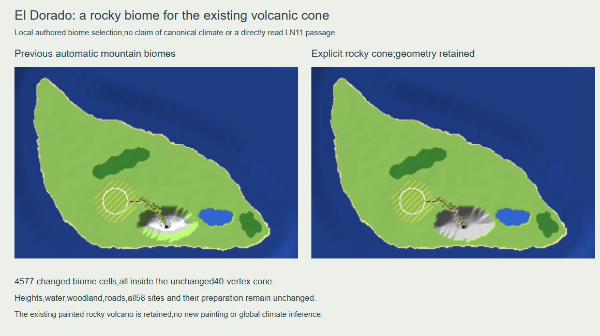

# El Dorado rocky-cone interpretation — R114

The [official introductory illustration](https://www.ten-sura.com/4GfGdAp7/wp-content/themes/tensura_portal/assets/images/portal-map/world/intro/map-base.webp) depicts a rocky brown cone and smoke plume on the southwestern island. Its enlarged original was inspected. The [indexed wiki](https://tensura.fandom.com/wiki/Golden_City_of_El_Dorado) describes an active volcano;that remains secondary evidence. Neither illustrative brown colour nor an active volcano proves that snow is impossible.

Public LN11 retailer routes were investigated:the publisher identifies the edition;Apple’s sample link returned an iTunes launcher,Google exposed product/preview metadata andKobo’s native request was403. No actual LN11 passage was read. The source-access log records those limits;no indexed translation or unverified upload is promoted to a directly read novel source.

**Our interpretation:** use the allowed existing `minecraft:stony_peaks` biome for the exact unchanged40-vertex cone. This local rock treatment is preferable for this authored depiction to the automatic snowy-slope band. No island-wide climate,canonical biome,dated eruption,ash deposit,lava flow or runtime snow condition is inferred. No water is relabelled as lava.

Source `2463d771cd28cff62138fe2e87ae0dc0dd8bccc7c3d02bc21f6bd6bbb3ed7426`. [Independent audit](el-dorado-rock-cone-r114.json):all5850 cone sample centres use stony_peaks;4577 change(3039plains,1538snowy_slopes),all within the exact cone. The other1273 were already stony_peaks. All prior active shapes remain;one explicit biome polygon is added. Height,rugged,water,road,site/exclusion rasters,site/road JSON andanchor/site TOML are byte-identical. All58 site attributes and22 routes remain. The cone’s lake gap is35.90blocks;no water overlap. [Current census](region-biomes-r114.md) leaves El Dorado forest at5.3940%.

Checker0errors/56relations/2existingwarnings;normal staging67.0s,no converter warnings. Source preview and original before/after are visually reviewed. The existing R112 painting already depicts a rocky volcano and retains the same landform,canopy,water,site androute geometry. Its original pinned source hash remains historical;this review adopts its appearance for the new local biome interpretation without editing images or pretending that its old metadata has changed. No new painting round or global relief resampling is needed.

The R113 place-sheet audit checks all58 concepts andcorrects only Frost Palace’s stale coastal metadata. Its enclosed interior PNG does not depict a coast;original image andprompt history stay unchanged. This is separate from canon/era completeness andwhole-palace construction.

No protected tools/mod/pack edit,live anchor,blueprint,world apply,Minecraft chunks,main merge,deployment or in-game acceptance. Claude retains technical integration. Full map/source/initial-era requirements remain open;see the [current deliverable-readiness audit](../docs/research/tensura-world-2026-11-19/deliverable-readiness-r114.md).

Required repository gate:472 tests,26 skipped,zero failures(64.499s);validation,zero changed-JavaScript and `git diff --check` pass. Browser audit:58 numbers,20 labels,42 open rows,no overlap,min31.62px.
