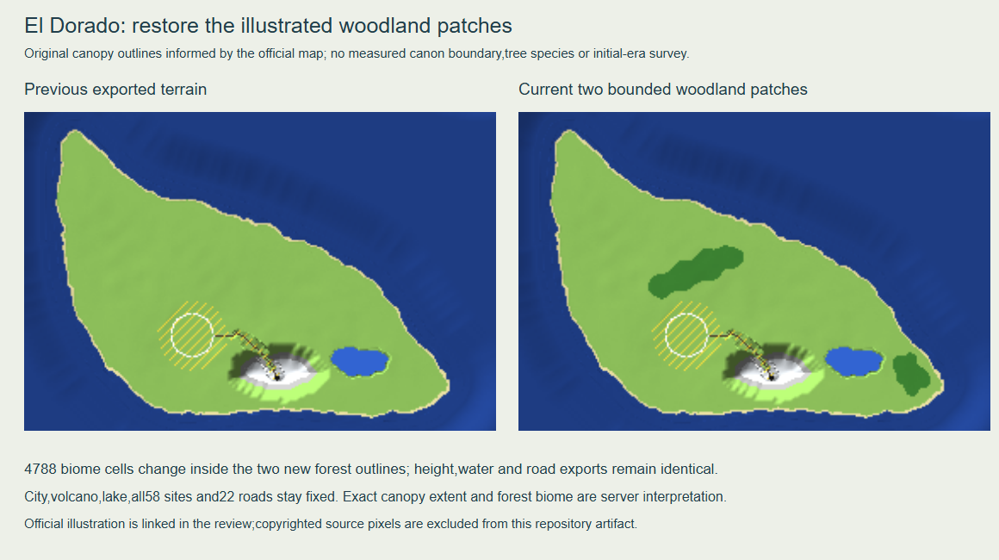

# El Dorado illustrated woodland — R111

[Official introductory illustration](https://www.ten-sura.com/4GfGdAp7/wp-content/themes/tensura_portal/assets/images/portal-map/world/intro/map-base.webp) shows a broken woodland group northwest of the southwestern island’s volcanic cone and another tree group east/southeast of its eastern lake. Fresh original GET200;full and enlarged island image directly inspected privately. The portal page timed out in web-open;the original image was accessible. Copyrighted source pixels are not distributed here.

The old production SVG had no El Dorado forest layer;its normal export measured zero explicit forest-biome cells in X. Plains can still contain trees,so that measurement did not prove a completely treeless world. These two source-informed canopies restore the missing authored woodland relationship.

## Original geography and source limits

- `el-dorado-northwestern-woodland`:72 rounded vertices,53,848.27blocks²;native coast gap137.56,nearest site-edge gap102.65.
- `el-dorado-eastern-lakeside-woodland`:60 rounded vertices,22,845.86blocks²;native coast gap31.21,lake gap48.24,nearest site-edge gap561.07.

The eastern group’s preliminary outline was north of the lake. Enlarged source inspection showed east/southeast placement;the corrected contour was checked and exported again before delivery. Neither the discarded northern outline nor its measurements are presented as current.

Exact vertices,extent,light-forest biome and tree choice are **our interpretation**. Map tree symbols do not prove a particular Minecraft tree species,density,climate percentage or dated post-Kijin cover. No new forest name,settlement,sovereign border,ownership,logging event or water outlet is inferred. Existing compressed island geography remains the disclosed server liberty. Source claims MAP-ELD-WOOD-111 and DES-ELD-WOOD-111 keep visual evidence separate from authored geometry.

## Current export and registration

Source SHA `74d63267bfa7032d1f6d7203e8e27dfa01ae948e8e5cf03f26f4bbeab2c0c079`. [Independent audit](el-dorado-woodland-r111.json) records all4,788 changed biome-cell centres inside the two new outlines,all now minecraft:forest. Height,rugged,water,road,site and exclusion PNGs,site/road JSON,anchors/sites TOML and canon_map.txt are byte-identical to the R109 terrain. All prior active shape attributes/text and58 site records remain;only the two forest shapes are added. There are now15 forest polygons;all22 roads remain exact.

The [R111 census](region-biomes-r111.md) measures5.3940% forest within the X gameplay mask. The old20% target stays retired. All22 current region descriptions reference the new snapshot with two-decimal shares and explicit tiny-positive formatting. These are designed gameplay areas,not surveyed sovereign or canonical climate percentages.

Inventory142/42 classifications remain. The existing El Dorado country entry now links its woodland evidence;the habitat components are not invented named destinations or proof of whole-city construction. Ledger316 unique records,including58 unchanged authored site-coordinate rows. Directly read printed-LN and LN-aligned side-story totals are unchanged;this pass adds no novel-text claim.

## Checks and next review

Default checker0 errors,all56 relations pass,2 existing warnings(Laura river/escarpment and preferred design size). Corrected normal staging67.0s,no converter warnings. The checker preview and original source/terrain comparison are inspected;all58 atlas number positions and20 geographical labels retain their geometry. Current atlas embeds the exact new normal preview. No protected tools/mod/pack edit,world apply,Minecraft chunks,main merge,deployment or in-game acceptance.

R110 painting predates these canopy masks. Next presentation step is an exact clipped native overlay and visual review,retaining the source positions and established composition. The older painting already suggests generic greenery;that does not substitute for source/native mask alignment. The active cone’s automatic snowy-slope biome and the painting’s volcanic appearance are a separate source/climate review;this woodland pass does not settle that question or silently change the volcano.

Required repository gate:472tests,26skipped,zero failures(64.832s);validation,zero changed-JavaScript and `git diff --check` pass. Browser checks58 numbers/20 labels/42 rows,no overlaps,min31.62px. Original before/after and checker preview visually reviewed against the enlarged official reference.
