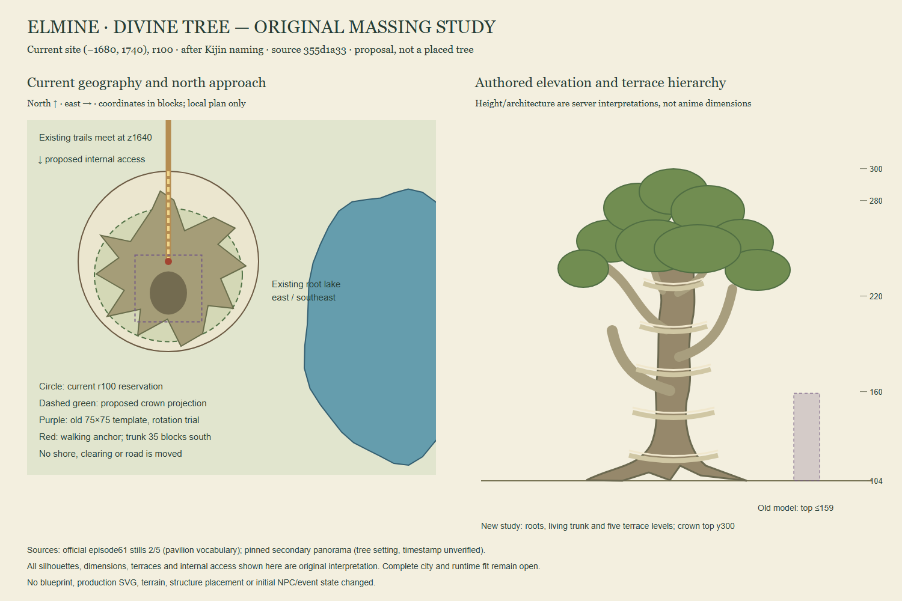

# Elmine: current setting and a larger Divine Tree study

[Editable study](elmine-tree-study-r88.svg) · [measured geometry](elmine-tree-study-r88.json) · [official episode 61](https://www.ten-sura.com/anime/tensura/story/no65) · [current source](map.svg)

The old lore page still referred to Paulzero's grove on the replaced Lerfing world. That is historical placement, not the Divine Tree on this authored continent. Current reservation: **(−1680, 1740), radius 100, margin 64**, designed walking first-air **104**, source `355d1a33`. Three incoming trail records share a northern connection at (−1680, 1640). The existing lake is **east/southeast**, not southwest; its closest shore lies 57.661 blocks beyond the disc. These are source measurements, not canon coordinates.

## Inspected evidence

The [indexed Divine Tree article](https://tensura.fandom.com/wiki/Divine_Tree), Appearance and References 1–2, describes a mountain-scale tree housing Elmine within and on its trunk. It cites LN6 chapter 2 and anime episode 61. This remains **fan-wiki** evidence: the relevant novel passage and complete episode have not been directly read/viewed here. The already recorded [secondary panorama](https://git.fish/KartoffelChipss/TensuraMap/src/commit/ec4d0e3db2ba4b229d412a273bbcdd19f45425b6/public/img/locations/elmine.webp) shows intertwined pale roots/trunk, tiered habitation, a spreading green crown and foreground water; its exact episode/timestamp remains unverified. This is not a verified official establishing shot.

The official page is **displayed episode 61**, despite URL `no65`. Its synopsis names invitations reaching Dwargon and Sarion. All five linked stills were inspected. Stills 2 and 5 show the silver-haired elven character's open pavilion setting: pale columns with curling botanical ornament, open greenery/sky, pale seating and a round table. This is a bounded primary **anime visual reference** for material vocabulary. It does not show the complete tree, survey a compass bearing or date the building to S1E10. Stills 1, 3 and 4 provide no additional Sarion landscape dimensions. Five private originals are SHA256-recorded outside the repository; the delivery includes links/hashes and paraphrase only.

## Small model versus whole landmark

Existing `blueprints/elmine.py` and build metadata define a **75×60×75** representative lower terrace, walking anchor (37, 4, 67). The module has a compressed tree, nine main limb directions and small public pavilions; it is not the full capital. At walking datum 104, the declared size gives a nominal vertical box **100..159**. This is metadata arithmetic, not decoded occupied-block or runtime acceptance.

The old model opens south. A **180° rotation trial** around its walking anchor faces the northern approach; all four horizontal box corners then lie within 76.538 blocks of the site centre. The trunk centre becomes 35 blocks south of that anchor. No placement rotation is configured. Claude must reconcile actual placement conventions, foundations and access. The source trails end at the disc edge; dashed internal access is proposed, not a generated road.

## Original larger-tree proposal

Retain the north entrance and south-offset trunk, with asymmetric roots within radius 95.037; crown ellipse centred 15 blocks south, radii 82×74; crown top **y300**, 196 above the walking datum; possible terrace levels **120,147,174,201,228**. Crown maximum horizontal radius is approximately 89.086, leaving 10.914 blocks inside r100. The elevation is illustrative, not a projected 3D mesh or canonical dimensions. Every dimension, root shape, branch, terrace and access path is **our interpretation**.

This tree would dominate the immediate authored hill. It remains a massing study, not the whole city, a block model or implementation. Branch supports, interior circulation, inhabited capacity, collision, foliage and actual foundations remain open. Lake, terrain and roads are unchanged; no river connecting this tree to the sea is invented. The Divine Tree remains **partial** in the 135-entry inventory with 42 physical follow-ups. Later invitation delivery, residents and political outcomes remain inactive at the post-Kijin snapshot. No production SVG edit, converter rerun, structure generation, protected-path/tool change, main merge or deployment.

Validation: repository gate **472 tests, 26 skipped, zero failures (63.908s)**; no changed JavaScript. Original diagram visually inspected. All 286 prior ledger records and all 135 coverage classifications remain unchanged; three separate records bring the ledger to 289. Production SVG, checker preview, terrain preview, atlas and protected paths are unchanged.
