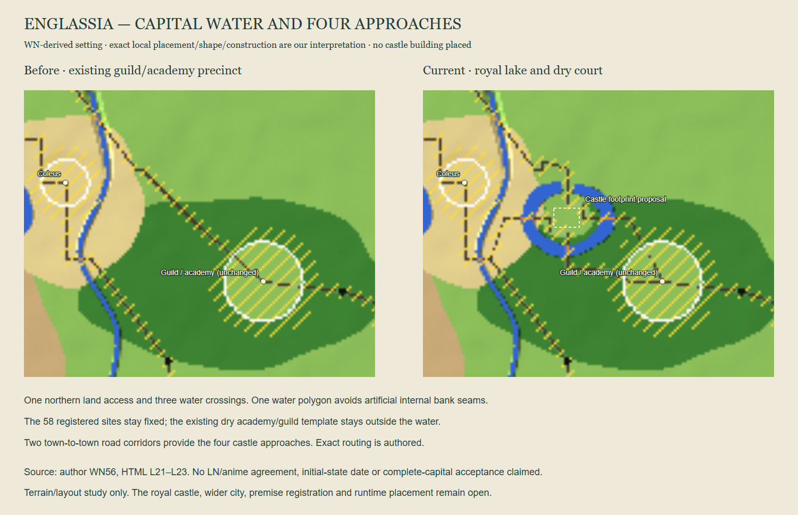

# Englassia: WN-derived capital water outside the existing precinct — round 91

[Editable comparison](englassia-lake-r91.svg) · [geometry/export audit](englassia-lake-r91.json) · [current atlas](atlas.png) · [58-site registration](atlas-registration-r91.json) · [source provenance](../docs/research/tensura-world-2026-11-19/englassia-source-provenance-r91.json)

## Source and continuity

The author's public [WN chapter 56](https://ncode.syosetu.com/n6316bn/59/#L21), actual HTML L21–L23, places a white castle in a central city lake, with four connections. The selected passage and original cached Japanese HTML were reread against live web-reader text. This is a **WN relationship**, not independently verified LN or anime geography. The later visit does not directly date every construction detail to S1E10. Existing WN56-003 retains this qualification.

Three additional scoped WN records provide exact urban-source locators in the ledger. They are parent-capital leads, not completed buildings, surveyed quadrant bearings or server access rules. Licensed LN11/12 legacy sample endpoints return 404; no new LN passage is claimed. All five official episode20 selected stills were inspected; they do not show a royal-lake plan or verify bridge construction. Source precedence remains LN > WN > manga > anime > official map > wiki.

## Adopted original layout

The existing `englassia` r124 game reservation at **(−2900,−550)** contains the academy/Guild fragment, not the whole royal capital. Its 128×60×112 model, all 58 site attributes, all exported flat-site records and all registered plated height cells remain unchanged. The earlier [R74 miniature basin](englassia-castle-lake-study.md) overlapped that dry model and is now explicitly historical/inert in the source comment.

The new lake is centred approximately **(−3200,−750)**, northwest of that existing fragment, wholly within gameplay G. This precinct offset is **our interpretation**, not a measured canonical capital centre. One original 96-vertex simple polygon surrounds a dry central platform on three sides, leaving a northern land access. The water area is 25,851.669 square blocks, designed level 70/depth 5. A small original plains-biome court occupies the dry platform. Exact shores, platform, dimensions, levels, lawn, road construction and compass alignment are authored. The source specifies four connections, not whether each is a bridge or causeway.

The existing Blumund–Englassia–Lubelius road now uses the eastern crossing and northern land approach, passing around the proposed castle footprint. One new Englassia–Coleus trail supplies the southern and western crossings. Both are meaningful town-to-town corridors with registered endpoints; no extra anchor, rule exception or artificial disconnected road endpoint is introduced. The other 20 native routes and their full exported records remain unchanged. The source does not name these particular route destinations or survey their paths.

A separate **80×60 castle-footprint proposal** remains inside an inert source comment. It is not a registered site, structure exclusion, flat castle plate or placed palace. Its sampled dry surface varies 74.375..76.5625; foundations and access still require technical design. No full-city wall outline, second gate, church, subsidiary office, NPC roster or completed capital is inferred from the small existing model. This revision makes the water geography more faithful to the available WN source; it does not complete those premises.

## Checks that changed the design

The four touching sector polygons in an early trial produced raised internal bank seams. Although their binary water mask was connected, some annotated water cells had dry terrain above the intended level. That trial was rejected. The adopted single water polygon has **one four-connected wet component**, with all **1,624 new water cells** below level 70: bed 65..68.6875, sampled depth 1.3125..5. The northern approach is dry and above water. No older designed water cell is removed or changed.

A separate road trial yielded one rounded exported grade 0.51282. Integer-length bridge approaches corrected it. All **22 final road profiles** satisfy 1:2 within floating tolerance; maximum 0.5000000000000455. The new lake's three water runs are **44,36 and40 blocks**, all below 64. The longest run across all road records is 44. Counts are route-record runs, not a claim of unique constructed Minecraft bridges or runtime walkability.

Final normal export **50.942s**, no converter warnings, source **43fed30354a1aeca839b8ac3c13dc0ab16c200af62332695dc72c3cb7238ad9a**. The raster preview is separately rendered from those final rasters. The required checker after the production edit reports **0 errors, 56/56 relations, 2 existing warnings** (Laura crossing and preferred design-box size). All coasts, rivers, relief, forests, gameplay masks and prior biome polygons remain. Height changes 2,072 cells; ruggedness 3,663; water 1,624; biome 1,317; site raster 0; roads/exclusion change locally. Detailed bounds are in the audit.

## Delivery scope

The atlas retains all 58 numbered registrations and previous 17 orientation labels, adding a qualified royal-lake callout. The inventory becomes **136**, with all **42 previous physical follow-ups retained**. The royal castle remains missing as an implemented structure. Additional capital subpremise/source/era questions extend beyond that indexed count. Ledger **294 unique records**, including the three scoped WN readings and one separate original-design record. Fourteen directly read printed-LN and six author-side-story records remain; inaccessible samples do not increase those counts.

**Painting follow-up:** R90/source `2ce669a0` predates the new water, court and road layout. Its 58 numeric registrations remain valid, but local scenery, two routes, the new callout and 136-entry caption need alignment. Use the current terrain atlas for current geography. Original place-concept PNGs remain; the Englassia picture is a precinct vignette, not a complete capital plan.

C17's dry-model/water overlap is avoided, while source continuity, initial-state dating, C15 castle/city registration and actual foundations remain open. No main merge, terrain application, Minecraft chunks, protected runtime/mod/tool edit, structure generation or deployment. Claude handles technical conversion and placement.

Repository gate: **472 tests, 26 skipped, zero failures (66.962s)**; zero changed JavaScript. Final checker preview, normal comparison and atlas visually inspected. Browser checks retain 58 numbers, 18 context names and 42 open rows without label overlap; minimum bubble spacing 31.62px. Atlas embeds the exact final normal PNG.
