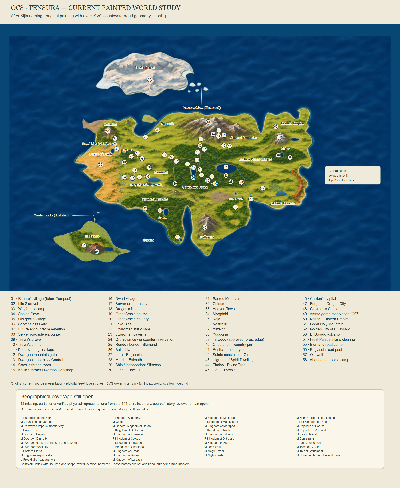

# Filtwood: approved western Jura forest edge

Yasuke selected **"Bosrandvoorstel gebruiken; Filtwood U → J"** on22November2026. The existing8-block reservation now sits at(-1050,600),with margin24 and gameplay region J. Normal staging gives first-air74. The independent kingdom is not claimed as Jura territory. Exact western bearing,coordinate,room and route remain our interpretation.

The adopted1102-block woodland trail joins the existing network32blocks west of Old Well. Its exported maximum grade is0.04,with no wet samples. All57other site exports and22existing road exports are unchanged. Only241height-raster centres change; water and biome PNGs are byte-identical. All13lake polygons plus8-block banks contain no changed height centres. These finite results do not certify final Minecraft noise,fluids or structures.

## Validation and technical integration

Standard `python -I tools/world/map_check.py world/map.svg --preview world/preview.png`: **0errors,56relations,2standingwarnings**. Fresh normal `python -I tools/world/build.py`,without skip-check: **71.9seconds**,58sites,23roads. Source and export SHA: `9526890d27a6896b5a5e08d9269629bb0a8e5db5aa09882dabbebd90173be3f4`.

Required `bash tools/check.sh` was run: **472tests,26skipped,2failures** in70.131s; validation also fails on the same legacy-map mismatch. Both failing tests are recorded in the [audit](filtwood-approved-audit.json). The old Lerfing `canon_map.txt` still reads U at the retained legacy anchor(-900,700),whereas the approved source binding is now J. Thus the earlier question's single-field change suffices for own-world checking but also exposes a legacy integration dependency.

Claude must reconcile the own-world/legacy anchor transition and regenerate runtime derivatives during the technical integration. The generated own-world `world/build/anchors.toml` already contains(-1050,74,600),J. It is staging output,not a partial runtime patch. Do not move one legacy anchor arbitrarily or alter the old world to hide the failure. `pack/kubejs/server_scripts/`,mod and tools are untouched by this approval change. No world apply,main merge or deployment.

## Updated deliverables

[Map geometry](map.svg),[checked preview](preview.png),[marked terrain atlas](atlas.png),[original painted atlas](painting-round112/atlas.png),[same-frame comparison](painting-round112/current-source-comparison.png),[current delivery manifest](current-delivery.json),[Filtwood concept sheet](../docs/art/places/filtwood.md). The original concept PNG and exact generation prompt are retained. Painted marker39 now uses the approved world coordinate. Historical conditional candidate reports and component height provenance remain scoped to their earlier revisions; outer painting source metadata is corrected to this adopted source.

Source ledger354records;58registered sites;143location entries with42physical follow-ups still open. This small reserved place and room concept do not constitute a full capital. Larger-island proportions and Malukshure coastal placement remain pending owner choices.
