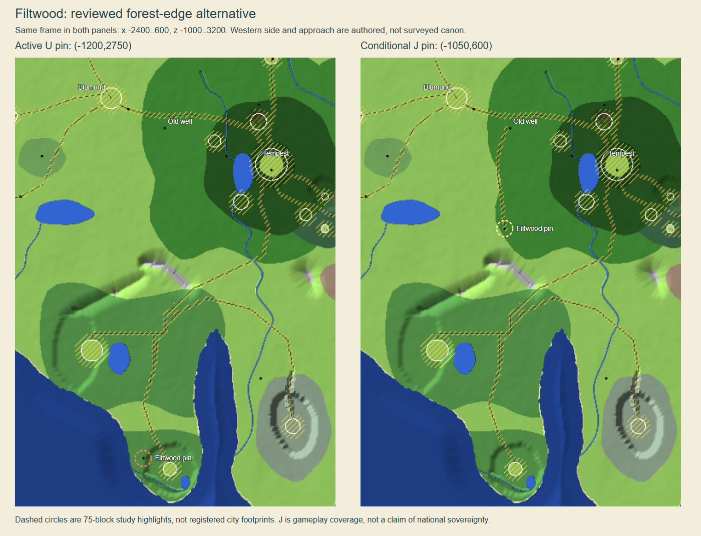

# Filtwood: concrete western Jura-edge candidate

[Full candidate checker preview](filtwood-jura-edge-alternative.png) · [candidate SVG](filtwood-jura-edge-alternative.svg) · [normal terrain preview](filtwood-jura-terrain.png) · [measurements](filtwood-jura-candidate-audit.json) · [proposed generated registration](filtwood-proposed-registration.toml).

## Source and interpretation

The [official episode24 synopsis](https://www.ten-sura.com/anime/tensura/story/no24),freshly read,identifies Filtwood as a kingdom in a story before Rimuru's reincarnation. It supplies no compass bearing or Ulgracia affiliation. The [wiki](https://tensura.fandom.com/wiki/Kingdom_of_Filtwood) near-Jura setting remains the existing secondary record WIK-FIL-001;it is not upgraded to primary evidence. OFF-FIL-001/002 retain their established scope. The active U binding is a server contract,not evidence of membership in Ulgracia.

This candidate develops the already-commented western Jura-edge interpretation at **(-1050,600)**. The exact western side,coordinate,terrain and approach remain our interpretation. The forest-edge context does not establish a canonical capital name,border,castle design or preserved flashback roster. No named Shizu,Diablo,king or flashback event is activated.

## Concrete terrain and access

Move only the existing8-block representative pin from(-1200,65,2750) to **(-1050,74,600)**,inside current gameplay J. The code J is a spatial coverage mask;this does not make the independent kingdom part of Jura's political ownership. A new **1102-block** lightly curved woodland trail begins32blocks west of the old well and approaches the pin. Its four-block source steps follow a gentle macro curve. Maximum exported grade0.04 and no wet sampled cells. All22prior road exports remain byte-equivalent as records;all23finite grade profiles pass the ordinary0.5limit.

The separate75-block-radius study envelope has1102dry four-block sample centres,first-air73.25..74.375,native coast edge clearance1004.12 and nearest existing site-edge gap659.81. It shows useful space for later architectural design;it is **not a registered clearing or complete city**. The canonical kingdom's size and exact urban layout remain unverified. Registered radius8 is retained,not reduced to obtain a passing result.

A first trial put the trail directly at the old well and raised its exported first-air by1. The revised junction32blocks west removes that effect. Final normal export67.9s retains all57other complete site records/heights and all22old road exports. Only241height centres change. Water PNG is byte-identical;all13lake-plus8bank height inputs are unchanged. Existing bank/contact cases are retained through identical inputs,not reported as a freshly rerun bank helper. No coast,lake,river,mountain,hill,forest,biome or region source geometry changes.

## Explicit conditional contract

The ordinary default checker fails exactly one declared error: Filtwood is required in U,but the candidate is in J. The [alternate anchor input](filtwood-alternative-anchors.toml) changes only that region field and passes with0errors/all56relations/the2standingwarnings. Its legacy x/z fields are not the final registration. The normal converter has no alternate-anchor CLI option,so this private review export used `--skip-check` solely for the disclosed binding. Its ordinary generated anchor still says U and is **not adoptable**. The separately proposed registration is generated with the unmodified existing converter functions from the conditional input;it correctly says J and matches(-1050,74,600). No generated file is hand-edited.

Active map.svg/displayb48666e9,ordinary anchors,world/sites.toml,current normal staging and painting remain unchanged. The C20 choice is not activated. The older source-comment circle remains an illustrative proposal;this candidate supplies the actual existing pin and a measured access route. Ledger352adds one interpreted design record;inventory143/42 remains open. No tools/mod/pack edits,main merge,live apply,chunks or deployment.

Required `bash tools/check.sh` passed:472tests,26skipped,zero failures in65.341s;validation and `git diff --check` pass. Conditional checker preview,normal comparison and candidate were visually inspected.
