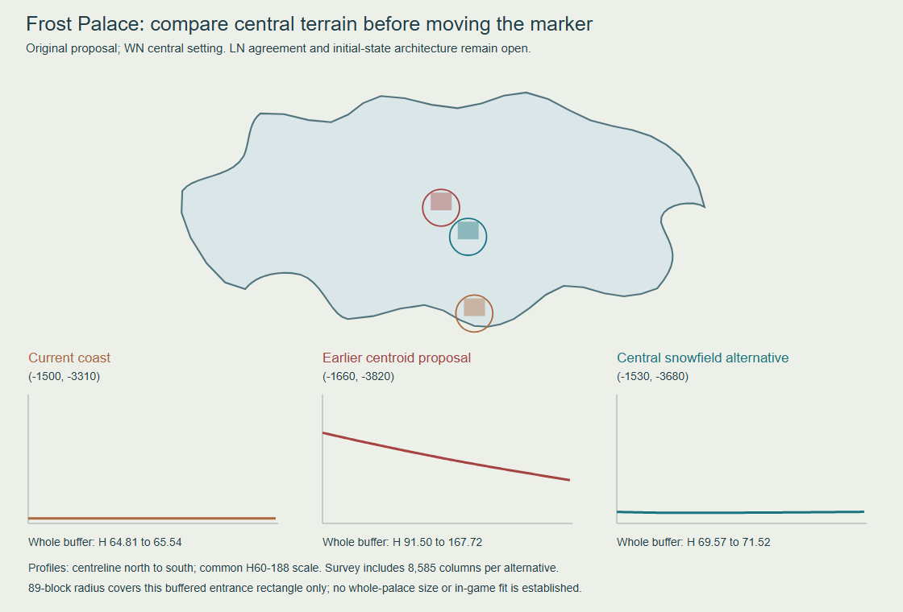

# Frost Palace: current-terrain placement comparison — R103

The earlier inland proposal is near the authored island centroid but intersects
a steep part of the existing ice mountain. It cannot simply replace the coastal
marker with the current entrance model. A second, central snowfield alternative
at **(-1530,-3680)** is 185.41 blocks from the current island centroid and offers
much lower relief. These are original design coordinates, not a canonical survey.

## Reproducible measurements

Run `python -B world/build-proposals/frost_palace_fit.py` against current normal
rasters. [Script](build-proposals/frost_palace_fit.py), [raw results](frost-palace-fit-r103.json),
[original SVG](frost-palace-fit-r103.svg). Source hash `dbef5ac0` must match the
normal index. The script samples all **8,585 integer column centres** in the
101 by85 buffered rectangle of the existing85 by69 entrance model, using its
actual local anchor(42,4,65) and eight-block preparation margin. Heights are
bilinear samples of the four-block normal export; water is a containing-cell
sample. This is not a density/noise/support/collision or in-game test.

| Alternative | Designed first-air range | Relief | Rounded median trial floor | Largest height difference to that floor |
|---|---:|---:|---:|---:|
| Current coastal(-1500,-3310) |64.8125–65.5391|0.7266|65|0.5391|
| Earlier inland(-1660,-3820) |91.4971–167.7188|76.2217|125|42.7188|
| Central snowfield(-1530,-3680) |69.5654–71.5234|1.9580|71|1.4346|

The coast already has generated site preparation, so it is not an untouched
natural-terrain control. The inland alternatives are sampled before any site
move. No sampled water occurs in the three rectangles. The snowfield centre is
374.57 blocks from the current coast. The drawn89-radius circles are buffer-fit
studies; the active coastal reservation remains67. A rectangle needs89 to cover
all its sampled column centres, but that is **not** a reason by itself to enlarge
a site: actual occupied voxels and the preparation method still need review.

The diagrams show the current authored coastline, not the retired R28 coastline.
The current land centroid is(-1647.3336,-3823.5567); old reports used older coast
geometry. The profiles share one height scale and run north to south through the
model anchor x. Full-rectangle extremes can differ from the centreline profile.

## Source and integration decision

[Fuse WN78, URL81](https://ncode.syosetu.com/n6316bn/81/), selected passage at
web-rendered lines318–343, puts White Ice Palace centrally on the frozen
continent. This is the existing WN078-001 claim. LN6's relevant interlude and
LN16's epilogue remain unread; no stronger continuity agreement is claimed.
The earlier [source study](frost-palace-source-review.md) records C22.

The current `world/sites.toml` contract says `coast`; an inland site would need
a reviewed kind change and generated preparation update. The existing model is
an **entrance**, not a complete palace. A coast arrival and an inland palace are
distinct locations; representing both requires an honest registration and access
plan, not a duplicated ID or a road endpoint trick. The current authored local
forecourt does not establish a coast-to-palace route. Canon travel method and
initial-state architecture remain unverified.

Yasuke has been asked whether to move the palace inland, retain the coast as a
separate arrival, or await LN confirmation. The decision is pending. The
snowfield alternative makes the inland option physically reviewable without
assuming approval. It does not replace the inert SVG comment or change the map.

All58 active site records,22 roads,coasts,biomes,heights and painting remain
unchanged. No new map check or terrain generation is claimed. This study closes
an important fit uncertainty in the old proposal, not C22, whole-palace coverage
or runtime acceptance. No copyrighted source image is distributed.

Validation: `bash tools/check.sh` passed:472 tests,26 skipped,zero failures
(63.753s); repository validation and zero changed-JavaScript check passed.
`git diff --check`, source/hash/count assertions and308 unique ledger keys pass.
The original SVG was exported in Chrome and the PNG visually inspected.
