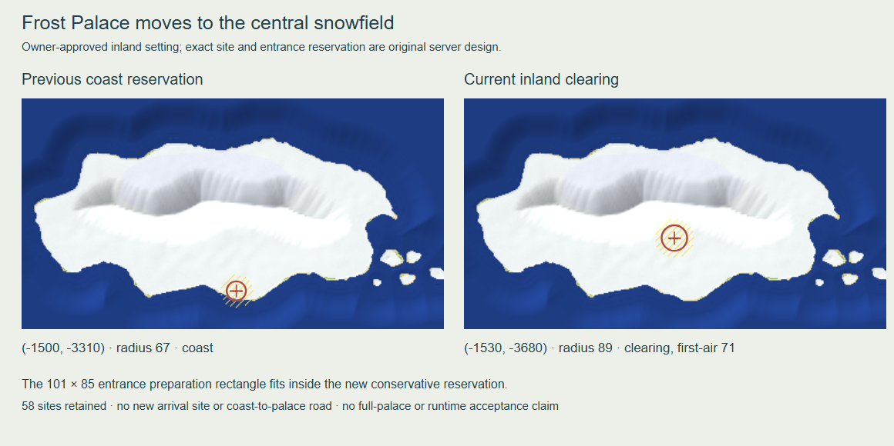

# Frost Palace moves inland — owner decision R109

Yasuke chose **“Paleis naar binnenland; kustregistratie laten aanpassen”** on21 November2026. The active map now places the existing Frost Palace site at **(-1530,-3680)** on the reviewed central snowfield,kind **clearing**,radius **89**,generated first-air **71**. The local80-block forecourt moves with it; no new coast-arrival site or coast-to-palace road is invented.

The former coastal site(-1500,-3310),r67 is retired in the drawing. The old near-centroid proposal(-1660,-3820) stays historical/inert because it intersects steep mountain terrain. The89-block reservation conservatively contains every column centre in the existing entrance model’s101×85 offset preparation rectangle (maximum corner radius88.35); it is an original design decision,not a complete palace footprint.

## Source and era

Fuse’s directly read WN78 supports a central frozen-continent setting (WN078-001). This remains WN evidence; LN6/LN16 agreement is unread. The owner’s placement choice is resolved. Full initial-era palace architecture,access and later-scene contents remain qualified. See the [historical source review](frost-palace-source-review.md) and [pre-move fit study](frost-palace-fit-r103.md).

## Registration and technical handoff

[Exact generated table](frost-palace-registration-r109.toml) is copied from normal staging `world/build/sites.toml`;[measurements](frost-palace-inland-r109.json) pin the source. Normal staging also supplies the new anchor(-1530,71,-3680). Under Yasuke’s explicit registration approval, the existing `tools/world/sites_from_builds.py` generator updates only Frost Palace’s `site` and `r` in `world/sites.toml`,plus its kind row in `world/site_sizes.md`. No generated file is hand-edited. The staged table additionally supplies y71; Claude must integrate the live anchor,build grounding and preparation together. Pack and runtime remain untouched. No tools rule change is needed.

This is an existing85×69 entrance/causeway model,not an entire palace. Check actual occupied voxels,support,orientation,collision,foundation and the initial-era complete design during technical integration. No world apply,Minecraft chunk generation,merge or deployment occurred.

## Verification

Standard checker: **0 errors,56 relations pass,2 existing warnings** (Laura river/escarpment and preferred design size). Fresh normal staging **67.3s**,no converter warnings. Every one of8,585 buffered integer column centres bilinearly samples first-air71; no sampled water. New reservation edge is285.57blocks from the native coast. This is four-block raster evidence,not final-noise or in-game acceptance.

All58 identities remain; only Frost Palace’s active site attributes,its local forecourt and its label change. Coast,lake,river,mountain,hill,forest,biome and region XML remain exact. Height changes5,210cells,rugged4,923,road156,biome108;water is identical. Old coastal preparation is removed and new inland preparation introduced. Current preview,terrain atlas and the new before/after are regenerated;[R109 biome census](region-biomes-r109.md) replaces current descriptive shares while retaining R108 history.

[R110 painting](https://github.com/Yasuke2000/ocs-two-lives/blob/e3963e24ed15157d524cc39d3243c69526dbeebc/world/painting-round110/README.md) now follows this site/forecourt move;R107 is historical. Source/era/whole-map obligations remain open.

Required repository gate:472tests,26skipped,zero failures(65.002s);validation and zero changed-JavaScript pass. Initial gate caught the stale coastal generated tables;running the existing generator resolved both failures. `git diff --check` passes.

## Registration note correction — 22 November 2026

The source `design/data/anchors.toml` intentionally still holds the legacy live coordinates until Claude integrates the own-world export. Its Frost Palace `notes` field now distinguishes those legacy coordinates from the approved inland destination **(-1530,71,-3680)**. No position, region, build binding or gameplay field changes in this correction.

The converter preserves source notes verbatim. Earlier generated staging snapshots consequently retain the former shore-plain note even when their numerical coordinates are inland. That note is historical, not evidence of a coastal placement. The next normal export will inherit the corrected source note. Existing exports and their published hashes remain historical and are not relabelled or hand-edited. The map and `world/sites.toml` already use the approved inland clearing; runtime integration remains separate.
