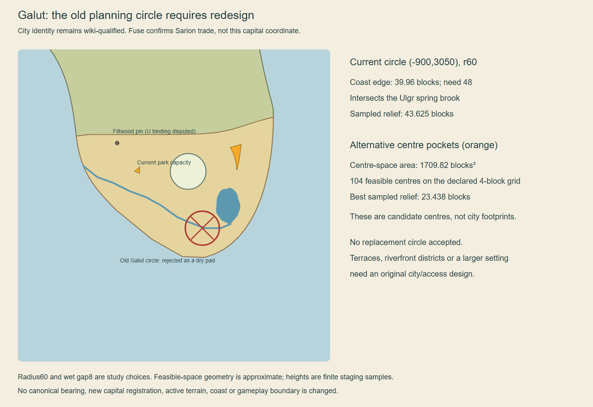

**Further layout study:** the [terraced precinct](galut-terraced-precinct.md) retains the60-radius envelope and follows the nearly flat west interior plus stepped northeast edge. It does not accept the failed old flat-city plan or close location/registration/foundation questions. Earlier measurements below retain their original source pins.

# Galut: reject the old circle as a ready dry-site plan

**New primary naming evidence:** the licensed guide8.5 map card directly names Galut (`GUIDE85-GALUT-001`). The earlier wiki-only identity assessment below is historical. Exact location and every terrain-fit objection remain unresolved. [Direct guide review](guide85-source-review.md).

[Editable study](galut-site-review.svg) · [Exact declared checks](galut-site-review.json).

## Source identity and geography

The indexed [Ulgracia article](https://tensura.fandom.com/wiki/Republic_of_Ulgracia) identifies Galut as the capital. The [Magic Continent overview](https://tensura.fandom.com/wiki/Magic_Continent) repeats that table entry; repetition within the same wiki is not independent primary corroboration. WIK-ULG-001 remains `fan-wiki`. No directly read passage here supplies the name's Japanese spelling, the city's exact bearing, a shoreline, a national plan or a measured park-to-capital distance. Search misses do not establish that the city is noncanonical.

Fuse's public [WN chapter61, URL64](https://ncode.syosetu.com/n6316bn/64/#L45), HTML paragraphL45, directly describes Ulgracia's trade with Sarion. This adds WN61-004, `canon-explicit` **in WN continuity**. The same chapter's L76–L81 already distinguishes the unnamed town's ordinary contract altar from the rock doorway in the park (WN61-001/002). Neither the trade statement nor that altar passage identifies Galut's location. A modern public request returned403; the previously lawful private paragraph cache and readable indexed author page were used, without bypassing access controls. This is not a complete LN or full-episode review.

Keep the ordinary city altar, park threshold, apparent beyond and near-Tempest server Spirit Gate distinct. Trade supports a relationship between countries, not an invented road endpoint, port, coast, distance or full capital. Later student travel and ritual outcomes are not instantiated at the post-Kijin S1E10 snapshot.

## The existing proposal has material problems

The historic inert circle at **(-900,3050), radius60** remains recorded for review, but now carries `data-review-status="requires-redesign"` in the SVG comment. It is not a registered site or an accepted full-city footprint.

| Declared dry-circle check | Current result |
| --- | --- |
| Entire disc in current gameplay U | Yes; this does not prove a sovereign border |
| Coast clearance beyond disc | 39.959blocks; below the ordinary48-block requirement |
| Water | Disc intersects the current Ulgr spring brook |
| Nearest existing site-disc gap | 83.155blocks |
| Nearest road course | 263.188blocks |
| Finite4-block height samples in disc | 67.8125..111.4375; relief43.625blocks |

The older overview correctly noted that the circle stays on land, but that alone does not establish dry terrain, sufficient coast margin or a usable city foundation. Flattening it as a generic clearing would interfere with a stream and steep terrain. No water is diverted or hill flattened to hide this problem.

## Alternative space, without pretending the capital cannot fit

The study computes possible **centres** for the same radius60 disc wholly in current gameplay U, at least48blocks beyond its edge from coast, with spacing at least the larger of48/current-site margin, and8blocks clear of mapped wet features. Radius60 and wet clearance8 are authored planning choices, not canonical capital dimensions or additional owner rules. Geometric buffers use128segments per quadrant on the checker's flattened curves; this remains numerical geometry, not a continuous exact survey.

The remaining centre-space has area1,709.82blocks². The declared4-block centre grid contains104candidates. Their lowest sampled relief is still23.4375blocks, at(-776,2836), with only0.263block spare coast clearance above the48-block threshold. It is shown as a diagnostic, **not chosen as a replacement**. A narrow candidate pocket and a lower sampled range do not validate a flat city, and a finite grid does not rule out every continuous alternative.

Galut may need a terraced or riverfront urban layout, a different representative precinct, or a separately reviewed expansion of the setting. A circle is not an entire capital. Those designs and C15 registration remain open; the current park is not renamed Galut, no source coordinate is invented, and no smaller circle is substituted simply to pass the check.

## Verification and unchanged terrain

Only an inert comment changes in `world/map.svg`. Every active element/attribute/text/child order is retained; the freshly checked preview is byte-identical. Checker: zero errors, all56relations, two standing warnings. The study and unchanged preview were visually inspected.

Current file SHA256 is `a5e1c2f6d811ff367da3da90aa60871ce421a99a9bfeb564501a0e533cda9c3a`; existing normal staging remains explicitly pinned to active-geometry source `0b8bcf56c8054ae0b03f60dcf5b8777672b5097078803390f2d82636a52f045e`. No new export or in-game test is claimed. The current paired painting and place-art registrations remain applicable to the unchanged active geography. Inventory142/42 remains open; ledger338 adds one narrowly scoped WN fact and refines the existing interpreted proposal record.

No tools, mod, pack, active coast/river/region, terrain apply, chunks, merge or deployment changes accompany this review.

Required repository gate: `bash tools/check.sh` passed;472tests in65.109seconds,26skipped,zero failures. `git diff --check` and protected-path checks passed.
