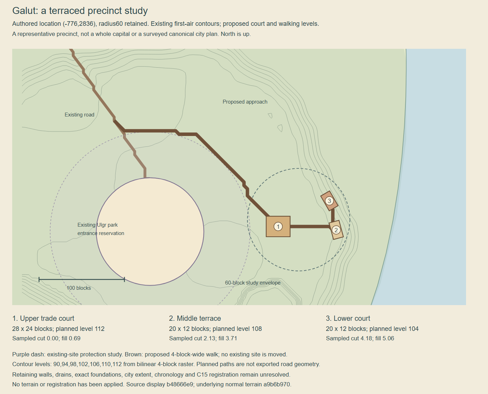

# Galut: terraced precinct study on the existing ridge

[Editable plan](galut-terraced-precinct.svg) · [source-pinned measurements](galut-terraced-precinct.json) · [planned walking profiles](galut-terraced-walk.csv) · [earlier site-space review](galut-site-review.md).

## Sources and authored choices

The licensed guide8.5 card names Galut as Ulgracia's capital (GUIDE85-GALUT-001). WN61 paragraphL45 supports Ulgracia/Sarion trade (WN61-004),not the city's coordinate. WN61's ordinary town altar and Spirit Dwelling threshold are distinct;the unnamed town is not thereby identified as Galut. See the [guide review](guide85-source-review.md) and [source history](galut-site-review.md). No new LN passage or complete-volume reading is claimed.

The proposed ridge location **(-776,2836)**,precinct,court roles and walking alignments are our interpretation. The later guide does not prove the city's founding date or initial-era architecture. No royal castle,ritual altar,children's visit,transfer scene or new resident roster is placed here. Existing Ulgr Nature Park remains a separate entrance reservation. Gameplay U is not a surveyed sovereign border.

## Preserve the radius; work with the relief

The earlier search found a radius60 dry disc with23.4375blocks of relief and only0.263block spare coast margin beyond48. It did not establish a ready flat city. This follow-up retains the same radius and examines a terraced precinct. Current source sampling confirms716dry4-block centres,height88.6875..112.125. Much of the western interior is nearly flat;the steep northeast edge drives the whole-disc range.

Three proposed courts occupy1152blocks² within the disc:

| Court | Footprint | Planned whole-block first-air | Sampled cut / fill |
| --- | --- | ---: | ---: |
| Upper trade court | 28x24 | 112 | 0 / 0.69 |
| Middle terrace | 20x12,rotated75degrees | 108 | 2.13 / 3.71 |
| Lower court | 20x12,rotated60degrees | 104 | 4.18 / 5.06 |

These are representative public-space planning envelopes,not complete buildings or a whole capital. The lower court requires substantial foundation/retaining/drainage design. The chosen whole-block levels avoid implying that a quarter-block height is an ordinary build foundation. Dimensions are not canonical city measurements. No clearing is shrunk to manufacture acceptance.

## Connected walking design,not an exported road

A250.39-block northern approach joins an actual existing `ulgracia_south_road` vertex at(-992,2720) to the upper court. Internal links are69.66 and35.31blocks. The maximum planned geometric grade is0.35632;the approach is0.08563. These profiles are continuous proposed surfaces based on existing bilinear first-air values and the three new flat court levels. They are **not current normal road exports**. Actual blockwise stairs,earthworks,supports and traversal remain unverified.

The plan reserves a4-block walking width and an additional4-block planning spare beyond each existing site's ordinary48-or-larger margin. A first route only barely cleared the park protection study;the revised approach starts farther north. Segment-level checks against flattened native geometry confirm minimum walk-edge coast clearance60.74 and more than4blocks of spare existing-site clearance. This is stronger than checking route endpoints alone,but it is not a continuous cubic-coast or final-noise test. Existing site records and source road courses remain untouched.

## What remains open

The full60-radius study circle still has the earlier narrow coast allowance. Actual court/walk geometry is inset,but the envelope is not accepted as a ready city site. C09's exact capital location and C15's additional registration/terrain/build contract remain unresolved. Galut stays missing from the active-site inventory;the park is not renamed. This study demonstrates a possible topographic programme,not a verified canonical city or a generated terrain alternative.

Active map.svg/displayb48666e9,normal terraina9b6b970,58sites,22roads,painting,water and all14normal artifact bytes are retained. No terrain conversion,source SVG edit,live anchor,tools/mod/pack change,main merge,world apply,chunks or deployment. Ledger353adds one explicitly interpreted planning record;all352prior rows remain unchanged and the143/42inventory is retained.

Required `bash tools/check.sh` passed:472tests,26skipped,zero failures in65.738s;validation and diff checks pass. Final diagram visually inspected. All14normal artifact hashes and the active SVG remain exact;no new conversion or active-map check is claimed.
