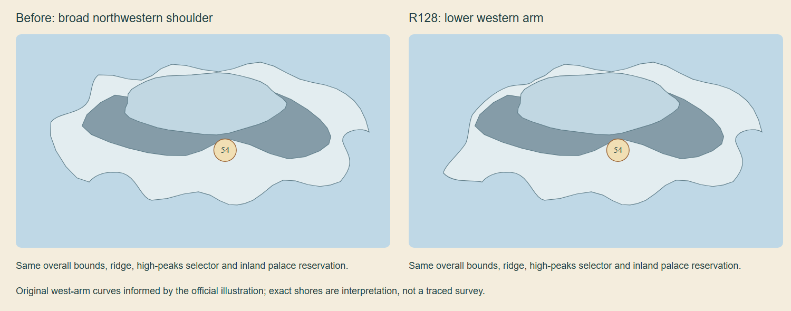

# Ice Continent: lower western arm — R128

[Editable study](ice-west-arm-r128.svg) · [Native/export evidence](ice-west-arm-r128.json) · [Current terrain atlas](atlas.png) · [All 13 lake checks](lake-banks-r128.json) · [Current census](region-biomes-r128.md).

The original [official introductory map](https://www.ten-sura.com/4GfGdAp7/wp-content/themes/tensura_portal/assets/images/portal-map/world/intro/map-base.webp) was visually reinspected on 22 November. Its frozen landmass has a tapering west/southwestern arm attached to a broader eastern mass (MAP-ICE-ARM-128). The old authored shore instead had a broad northwestern shoulder. Five original cubic reaches now make the western end lower relative to the retained body. No reference pixels, traced shore file or copyrighted map panel is committed.

The exact coast is **our interpretation** (DES-ICE-ARM-128). The westernmost authored point moves 296 blocks south, from (-2910,-3796) to (-2910,-3500). The other 77 original shore vertices remain at the same coordinates and order. Overall bounds 2518.15 × 1129.02 blocks are unchanged. Added land 20,226.04 blocks²; removed land 92,955.23 blocks². These measurements compare two designs, not canonical survey coordinates or a measured source-map projection. C12 precision/compression limitations remain.

Only `ice-continent`, its matching `ice-permafrost` selector and the `nation-I` gameplay mask change. The original ridge and high-peaks selector stay completely on land, with minimum native clearances 43.60/9.01 blocks. All other coasts, all five coastal islets, relief, rivers, lakes, forests, 58 registered site attributes and 22 road courses retain their source geometry. The gameplay mask is not a surveyed political frontier.

## Approved inland palace and actual terrain

Yasuke’s R109 inland decision is retained: centre (-1530,-3680), clearing radius 89, margin 48. The centre stays 374.57 blocks from the shore; the reserved disc therefore remains inland. Its normal designed first-air is still 71. No coastal registration, arrival point or palace state is reintroduced. The [owner decision review](frost-palace-inland-r109.md) remains authoritative; earlier pending-choice text is historical.

Fresh normal staging takes 67.6 seconds without converter warnings. Height changes affect 62,452 samples, with maximum 72.75 blocks including the changing coastal seabed. The furthest changed centre is 305.18 blocks beyond the old/new land union. Ruggedness changes 11,718 cells and biomes 7,160 cells. No height sample changes inside any registered site disc or any lake plus an 8-block bank neighborhood. All 58 exported site records and the water/road/site/exclusion PNGs, site/road JSON and anchor/site TOML are byte-identical. This is a real local terrain change, not merely a presentation edit.

All 13 lake bank/depth/contact cases and eight designed interfaces pass a fresh finite audit. The full 22-region census has 106 biome rows and no unassigned inland biome sample. Current I samples are 75.8393% snowy plains and 24.1607% frozen peaks; these are authored Minecraft shares, not canonical climate percentages. Final terrain noise, fluids, travel and placement remain separate runtime work.

All 58 numerical values from the [R127 art-registration proposal](https://github.com/Yasuke2000/ocs-two-lives/pull/115) remain applicable within that report’s scope because the normal site records remain byte-exact. No new image or repeated all 58 art audit is required merely for this source hash change.

## Visual delivery and remaining work

The checker preview, original before/after, official original and current atlas detail were inspected. The terrain atlas embeds the exact current normal preview and retains all nonimage nodes: 58 numbers, 20 context names, three Amrita caption lines and 42 inventory rows. Browser bounds find no label/number or label/label overlaps; minimum numbered spacing 31.621 pixels.

Default checker: zero errors, all 56 relations pass, two standing warnings (Laura escarpment and preferred design size). Mainland 9,983 × 6,250 and design 12,800 × 10,752 remain unchanged. The subsequent [R129 painting](painting-round112/README.md) supplies actual western-arm alignment to source 8c41e924 while retaining the El Dorado correction. R126 remains historical for the ice shore; its original version is not relabelled as aligned. Ledger 332; inventory 142 with 42 physical follow-ups. Broader primary-source, location, proportion, initial-era and C07/C18/C23 obligations remain open. No tools/mod/pack edit, live world apply, chunks, main merge or deployment.

Required repository gate: validation passed; 472 tests, 26 skipped, zero failures in 65.431 seconds. Zero changed JavaScript files. `git diff --check` passed.
