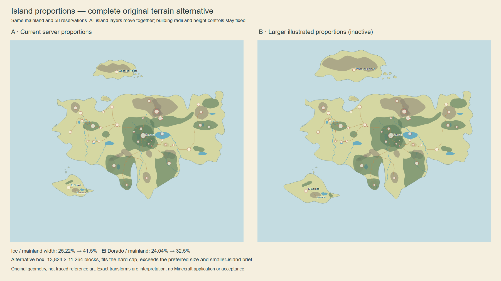

# Full-layer island proportion alternative (inactive)



[Complete alternative SVG](island-proportion-alternative.svg) · [checker preview](island-proportion-alternative.png) · [normal terrain preview](island-proportion-alternative-terrain.png) · [exact audit](island-proportion-alternative.json) · [13-lake audit](island-proportion-alternative-lakes.json).

## What this resolves

The earlier [trial B](island-proportion-review.md#trial-b-a-coast-only-layout-within-the-hard-box) enlarged only the original coastlines. This alternative also transforms every island-specific mountain, hill, lake, woodland, biome, gameplay mask, road, site centre and label. It is a complete source file with all 58 reservations, not a proposal to place coastlines around unrelated old terrain. It is **not** the active `world/map.svg`.

The [official illustration](https://www.ten-sura.com/4GfGdAp7/wp-content/themes/tensura_portal/assets/images/portal-map/world/intro/map-base.webp) supplied the previously recorded approximate horizontal-span bands; those are not surveyed dimensions or a known projection. The chosen 41.5% Ice/mainland and 32.5% El Dorado/mainland widths remain **our interpretation**, compared with current 25.22%/24.04%. The licensed guide8.5 repeats the same illustration rather than independently proving exact scale. No source pixels or traced shorelines are included.

## Geometry and authoring choices

Use trial B's uniform scales 1.645301988 / 1.351640282 and westward shifts of 600 blocks, with its separate north/south offsets. All 37 affected elements are itemised in the audit; the other 250 parsed layer children remain identical. The mainland and the three new western rocks do not move. Existing site radii, vertical relief controls, lake levels/depths and road widths stay fixed; scalar height controls are not the same as generated walking levels.

The scaled El Dorado road initially started 35.16 blocks outside the unchanged city radius, exceeding the allowed 32-block join. Its start was extended into the reservation. A first normal trial then exposed 40 road-profile segments above 1:2, with maximum grade 0.74074. Short scaled source legs were subdivided more finely than the converter's two-block-per-sample height envelope assumes. The final source follows the same corridor using four-block cardinal stair steps, snapping original route vertices by at most 2.68 blocks. No converter code or generated raster was edited. The final exported route profiles pass the finite 1:2 check.

| Registration | Current (x, walking y, z) | Alternative (x, walking y, z) | Radius |
| --- | --- | --- | ---: |
| Frost Palace | -1530, 71, -3680 | -2130, 75, -3799 | 89 |
| El Dorado city | -4300, 73, 3000 | -4900, 70, 3202 | 100 |
| El Dorado volcano marker | -3900, 197, 3200 | -4359, 222, 3473 | 8 |

All 55 other registration records remain exact; the palace stays inland. The source uses sub-block transformed centres while generated registrations round to block coordinates. The old 58-place concepts and painted atlas describe the **active** map; their three island registrations would need updating if this alternative is chosen. Existing structures are not moved by this study.

## Fresh finite evidence

Alternative SHA256 `cc097cf0a9f360188f9a9ba961937ed63ed5b2015b79fcf3c909068144580acb`; active baseline `50c27a6ff1e8d9f39ee9f5571062ef2b7b25ed5a3a16760dcd4ca9e9d334b561` remains unchanged.

- Standard checker: zero errors; all 56 relations pass; the existing Laura crossing and above-preferred-box warnings remain.
- Fresh normal staging: 73.7 seconds, no converter warnings. All 14 generated artifacts are privately retained with hashes in the audit; the preview is copied exactly into this study.
- Design box: 13,824 × 11,264, within the hard 14,336 × 11,264 limit. Rounded bounds preserve the required outer sea. Box area rises 13.14% from current staging, not a measured generation-time increase.
- All 22 exported road point profiles have grade at most 0.5 within floating-point tolerance; 20 road exports remain exact. This does not prove final per-block travel or constructed stairs.
- All 13 freshly audited lakes pass the finite depth, cardinal bank and expected-river-contact checks. There are four separately recorded dry boundary centres; strict interior and bank checks pass. No fluid-column acceptance is inferred.
- Every sampled four-block native-land centre intersects a gameplay mask: zero unassigned centres. Coverage does not establish national ownership.

Reproduce with the existing tools, without `--apply`:

```sh
python -I tools/world/map_check.py world/island-proportion-alternative.svg --preview world/island-proportion-alternative.png
python -I tools/world/build.py --svg world/island-proportion-alternative.svg --out <private-alternative-output>
```

## Owner decision and remaining limits

The brief in `design/architecture/own-world.md` §8 fixes an Ice Continent around 2,500 × 1,500 and El Dorado around 2,000 × 1,600, with a preference for a smaller design box. This alternative is roughly 4,143 × 1,858 and 3,245 × 1,731. It fits the hard cap but changes that island-size choice; it must remain inactive until Yasuke chooses between compact server proportions and the larger illustrated proportions. The existing active-map comments already show the coast alternative; this linked file supplies its complete internal-layer counterpart.

This is an original authored alternative, not proof of exact canon proportions, relative bearings, complete architecture, S1E10 content placement, final noise, fluid behaviour or Minecraft chunk acceptance. The post-Kijin era overlay and other open source/contract questions remain. Technical integration, any new generated registration adoption, revised painting/art registration and runtime validation follow only after the choice. No protected paths, active geometry, normal active staging, main merge or deployment change here.

Repository gate: `bash tools/check.sh` passed, 472 tests, 26 skipped, zero failures in 65.278 seconds. Validation and diff checks pass. The checker preview, final normal terrain, original comparison and private official reference were visually inspected.
