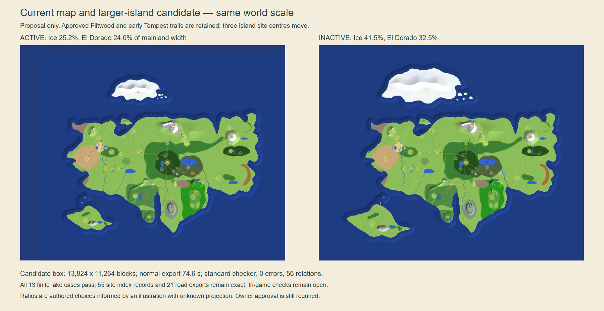

# Current full-layer larger-island proposal — inactive

[Full candidate source](island-proportion-current-candidate.svg) · [checker preview](island-proportion-current-preview.png) · [normal terrain preview](island-proportion-current-terrain.png) · [audit](island-proportion-current-audit.json) · [finite water/coverage checks](island-proportion-current-finite-checks.json) · [official reference link](https://www.ten-sura.com/4GfGdAp7/wp-content/themes/tensura_portal/assets/images/portal-map/world/intro/map-base.webp).

The earlier full-layer proposal was verified against source50c27a6f. This version retains current source534d07ad's approved Filtwood placement,early Tempest trail kinds,Laura water correction and all other mainland changes. Exactly37 island-specific source elements were still identical to that older baseline;their reviewed replacements are copied onto the current source. The active map,preview,painting and normal outputs are untouched.

## The choice this makes reviewable

Current apparent widths are25.2percent of mainland width for Ice and24.0percent for ElDorado. The proposed41.5percent/32.5percent follow the broad official illustrative comparison. Projection is unknown;these are authored ratios,not surveyed canon scale. They exceed the earlier smaller-island recommendation and remain pending Yasuke's choice. [Original size conflict and coast-only trial](island-proportion-review.md).

The candidate transforms all related coast,mountain,hill,lake,woodland,biome,gameplay-mask,road,site-centre and label elements. It retains all radii and scalar relief controls rather than resizing existing blueprints. The earlier ElDorado route endpoint and grid-step corrections are retained. Only the three island site indices move:

| Site | Active x,y,z | Candidate x,y,z |
| --- | --- | --- |
| Inland Frost Palace | -1530,71,-3680 | -2130,75,-3799 |
| ElDorado precinct | -4300,73,3000 | -4900,70,3202 |
| ElDorado volcano marker | -3900,197,3200 | -4359,222,3473 |

These are generated candidate positions and first-air values,not canonical measurements. All55other index records are exact. Separate sites.json contains34flat terrain-preparation records,of which32remain unchanged. The58-entry placement index also covers4carved sites and20unplated markers. Only the city and palace alter flat configurations;the volcano marker changes the index. The earlier56configuration count was incorrect and is superseded by these direct counts. Both selected early Tempest road kinds and the new Filtwood trail remain intact.

## Fresh candidate evidence

- Candidate source97667b2a;default checker0errors,56relations,2standing warnings.
- Normal isolated export74.6seconds withoutskipcheck;all14candidate artifact hashes recorded;no converter warnings.
- Box13824x11264 fits the hard14336x11264cap,using the full height budget. Mainland source geometry remains unchanged. This is no measured generation-time or memory claim.
- All23exported road profiles meet1:2 within floating-point tolerance;21road records are byte-equivalent as parsed records.
- All13native lake cases pass finite wet-bed,level,cardinal dry-bank and expected-river-contact checks.
- All2,954,302strict native land centres at4-block spacing have a gameplay mask. Exact native shoreline centres are excluded;this is not sovereign border verification.
- Candidate preview and common-frame comparison were visually inspected against the already reviewed official illustration. No reference pixels or copyrighted story text are embedded.

## Activation remains separate

This is an inactive source alternative,not the production map or accepted final Minecraft terrain. Yasuke's island-size choice is still pending. If selected,the active source must be replaced and checked;the original painting/atlas and three island concept registrations must be reconciled with it. Final fluid/noise,full city architecture and in-game placement remain unverified. No source-independent acceptance is inferred from these finite checks.

No protected file,runtime,anchor binding,main branch,world apply,chunk generation or deployment is changed. The Filtwood legacy U/J test dependency and Malukshure coastal choice remain open. Ledger358includes one explicitly authored proposal record,not another verified canon statement.

Repository gate:494tests in66.671seconds,26skipped,the same two legacy Filtwood U/J failures plus validation;zero changed JS files. Gate is not passing. All14active output hashes,active preview and original painting remain exact. Local delivery links resolve. These checks do not activate the candidate or certify final in-game terrain.
