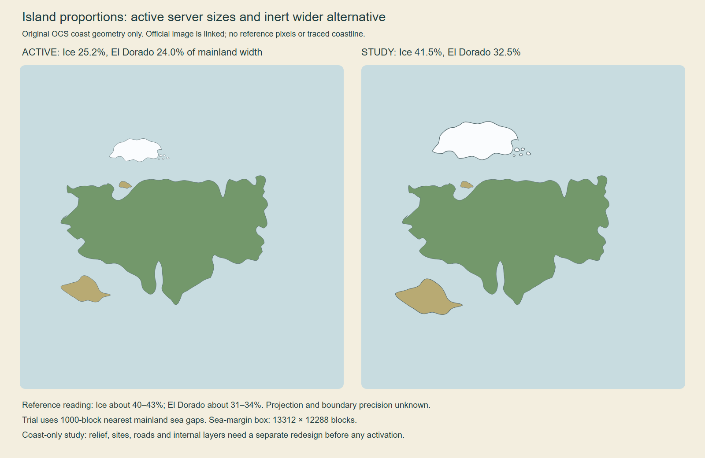
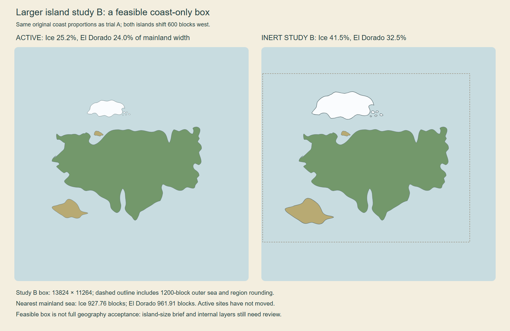

# Island proportions against the official illustration

**Follow-up: trial B fits the hard box.** The initial trial A below exceeds the height budget, but this is no longer the only concrete alternative. [Trial B](#trial-b-a-coast-only-layout-within-the-hard-box) keeps the same larger proportions with western shifts. Both remain inactive because the smaller island-size brief and complete internal-layer fidelity still need resolution.

[Editable comparison](island-proportion-review.svg) · [Measurements and transforms](island-proportion-review.json) · [Official reference, linked only](https://www.ten-sura.com/4GfGdAp7/wp-content/themes/tensura_portal/assets/images/portal-map/world/intro/map-base.webp).

## A remaining C12 difference

The two large outlying islands remain compressed relative to the mainland. Their current coast shapes were improved in R125/R128, but shape improvements did not establish faithful relative size. A new visual comparison with the official base image exposes this distinction.

| Landmass | Active width / mainland width | Broad reading of official image | Chosen illustrative alternative |
| --- | ---: | ---: | ---: |
| Ice Continent | 25.22% | About 40–43% | 41.5% (4,143.12 blocks wide) |
| El Dorado island | 24.04% | About 31–34% | 32.5% (3,244.61 blocks wide) |

The reference bands are approximate visual horizontal-span readings, not surveyed canon dimensions, a known projection or a traced shoreline. They measure apparent extent on an illustration; land height and area are not inferred. The exact chosen percentages and all trial coordinates are **our interpretation**. A directly verified LN geographic statement would outrank this image evidence.

The active mainland width is 9,983.41 blocks. Its current Ice Continent is 2,518.15 × 1,129.02; El Dorado is 2,400.50 × 1,280.55. The server brief instead recommends islands around 2,500 × 1,500 and 2,000 × 1,600 respectively. Those compressed server dimensions are not a canonical proportion claim.

## Concrete alternative, kept inactive

`world/map.svg` now contains `reference-island-scale-*` paths inside a **comment**. They uniformly transform our existing original coast geometry, including the five detached ice-coast forms. They contain no licensed reference pixels or traced coast. The study does not activate a new shoreline, move a site or rescale relief, lakes, biomes, forest, roads, gameplay masks or art.

The Ice Continent's coast is enlarged by 1.645302 about the current inland palace, then moved 377.68 blocks north. El Dorado's coast is enlarged by 1.351640 about its city reservation, then moved 420.40 blocks south. Those anchors define the transforms; their sites are **not** accepted at new transformed coordinates. Each large trial island is separated from the unchanged mainland by a measured nearest-boundary distance of 1,000 blocks. Distances are computed from the checker's flattened original curves, rather than image pixels.

With the required 1,200-block outer sea margin and 512-block rounding, this particular coast-only layout needs **13,312 × 12,288** blocks. Its height exceeds the **11,264** hard design-box limit by **1,024 blocks**. This demonstrates a real conflict for this trial, not a proof that every possible rearrangement is impossible. Repositioning, changing sea gaps or changing mainland scale would require a separate whole-map review; none is silently accepted here.

## Verification and delivery scope

Every active XML element, attribute, non-whitespace text and child order is identical to the baseline before adding the comment. All 58 sites, all 22 roads and all native terrain layers are unchanged. The freshly generated standard preview is byte-identical to the previous preview; checker: **zero errors, all 56 relations, two standing warnings**. The preview and original comparison were visually inspected.

The first comment-only version had SHA256 `016977e5c503277d1f741599c1d4c98b84386cc1fe3f9417ae2b4f18cd895bb3`. Adding trial B changes the current file SHA256 to `9dbec53483073eb05ce8c106dc1713c10b10a4f0c0450689c9248a4f856f863c`. The existing normal rasters remain outputs from the original R130 source `ade502105956db450831e0991b2f10e6b29f8b73a1827f1d0184299c505917bb`; they are adopted for the identical active geometry. No new converter run or acceptance of either alternative is claimed. Historical hash-pinned audit commands continue to describe their original input.

The facts ledger adds one qualified image observation and one original-design record. C12 and the region guide now explicitly disclose the relative-island compression. The post-Kijin snapshot, existing inland-palace choice and initial political state remain applicable. No tools, runtime data, world application, chunk generation, merge or deployment changes accompany this study.

Required repository gate: `bash tools/check.sh` passed; 472 tests in65.313seconds,26skipped,zero failures. `git diff --check` passed. These checks validate the delivered inert study and unchanged active map, not the unactivated larger-island terrain.

## Trial B: a coast-only layout within the hard box

[Editable comparison](island-proportion-fit.svg) · [Exact transforms and finite checks](island-proportion-fit.json).

The first trial fixed each island's east-west position and translated only north/south. A follow-up tests westward translations instead. Both large islands now shift **600 blocks west**, retaining the same 1.645302 / 1.351640 uniform scales. The Ice Continent's northward translation is 118.53 blocks; El Dorado's southward translation is 202.42 blocks. These remain original design choices, not canonical coordinates.

| Constraint | Trial B result |
| --- | --- |
| Ice nearest mainland sea | 927.76 blocks, within the brief's 900–1,200 range |
| El Dorado nearest mainland sea | 961.91 blocks, near the brief's approximately 900 |
| Outer sea and rounding | At least 1,200 blocks, then rounded to 512-block regions |
| Resulting design box | 13,824 × 11,264, within the 14,336 × 11,264 hard limit |
| Expected box area increase over current staging | 608,256 versus 537,600 chunks; +70,656 (+13.14%), before any actual generation |

The one-block inward slack at the limiting north/south coast extrema avoids relying on exact equality before region rounding. The source viewBox also contains these trial coasts. The new box reaches the full height budget; this is not spare capacity for arbitrary later expansion.

The **unchanged** Frost Palace, El Dorado city and volcano marker centres remain inside the respective trial islands. Their drawn disc edges have 223.51, 404.61 and 216.46 blocks of coastal clearance. The existing ice spine, ice high-peak selector, volcano and rock-cone selector are contained by the trial coast. These are selected geometric checks, not certification of all forest/lake/road/biome masks, generated site heights, final noise or completed builds. In particular, keeping the approved palace coordinate is possible in this coast study; it does not automatically verify its relationship to an enlarged island's centre.

The fit disproves an inference that larger illustrated island proportions necessarily require exceeding the world-box limit. It does **not** resolve the smaller recommended island sizes or verify that the westward shifts best match the official illustration's relative bearings. The original reference projection remains unknown. Both trial A and B stay in comments; active terrain and all current reservations are unchanged. No technical rule is relaxed.

Trial-B repository gate: 472 tests in 65.277 seconds, 26 skipped, zero failures; validation and diff checks passed. Fresh map checker: zero errors, all 56 relations, two standing warnings. Active XML and checked preview remain identical to R130; the original comparison was visually inspected.
