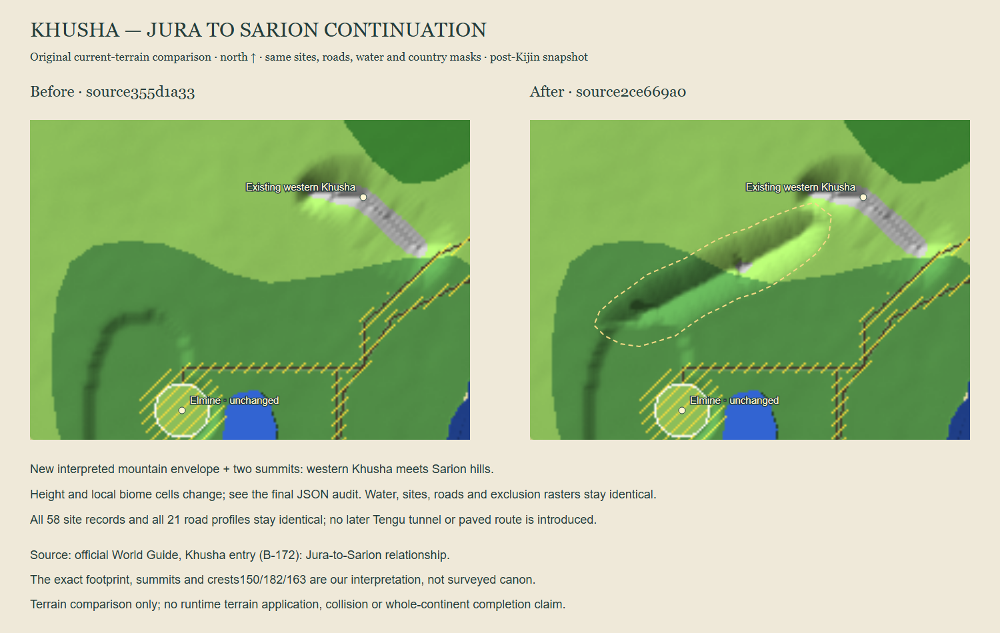

# Khusha continues towards Sarion — round 89

**R90 painting follow-up closed:** [current painting](https://github.com/Yasuke2000/ocs-two-lives/blob/f0b91746124104cdfc7c141dd17762a9d8783410/world/painting-round90/README.md) integrates the relief and new range label. Earlier pending statements below retain their historical R89 context.

[Editable study](khusha-continuation-r89.svg) · [independent audit](khusha-continuation-r89.json) · [current terrain atlas](atlas.png) · [58 registrations](atlas-registration-r89.json)

The official [World Guide](https://www.ten-sura.com/map#B-172), actual HTML entry `dl#B-172`, describes Khusha as extending from Jura towards Sarion. That entry was fetched and reread directly; its URL, exact locator and private-cache SHA256 are recorded in the [source provenance](../docs/research/tensura-world-2026-11-19/khusha-source-provenance-r89.json). The existing OFF-007 claim is retained with improved provenance. It establishes the broad range relationship, not surveyed vertices or heights. The [official introductory illustration](https://www.ten-sura.com/4GfGdAp7/wp-content/themes/tensura_portal/assets/images/portal-map/world/intro/map-base.webp) was separately viewed as geographical context; no reference pixels or shore geometry are copied.

The old drawing had two Khusha mountain groups and a separate low Sarion hill. This revision adds a **31-vertex southwestern mountain envelope** and two **28-vertex nested summit polygons**, joining the existing western mountain footprint to the Sarion hill footprint. The envelope spans x−2010..−1120,z960..1500. Heights 150/182/163 and ruggedness 0.58/0.64, exact placement, uneven shoulders and extent are **our interpretation**. Existing old mountain/hill elements remain unchanged. Footprint connection does not assert a surveyed continuous crest or a minimum saddle altitude.

An initial long 175 ridge looked too straight and uniformly elevated in the normal preview. It was rejected and replaced by the lower envelope and unequal summits. The rejected source/preview are archived privately, not presented as current geometry. No later Tengu tunnel, completed highway, envoy visit or political expansion is installed at S1E10.

## Exported effect

Current source **2ce669a04d878cf18c4ae9ed7b22ccd48f9e2dfcefdc944deeeba07091431b5f**. Final normal export **47.565s**, no converter warnings. The separate raster-preview command was run against the final rasters; the old baseline preview independently rerenders with zero changed pixels. An earlier draft reused a stale preview and was discarded before publication.

| Layer | Changed four-block cells | Scope |
| --- | ---: | --- |
| Height | 12,575 | x−2022..−1114,z970..1430; rises 0.0625..108.0625; resulting changed-cell first-air 67.6875..179.25 |
| Ruggedness | 16,610 | Local continuation and smoothing support |
| Biome | 117 | Small new summit patch; all native biome/forest polygons retained |
| Water, site, road, exclusion | 0 each | PNGs byte-identical |

All 58 site attributes and every existing active SVG element remain unchanged. All flat-site JSON records and all 21 road records/profiles are byte-identical; maximum road grade remains 0.5000000000000455. New envelope is 480.530 blocks from the coast, 122.046 from the nearest native road and 174.970 from the nearest site-disc edge. These are authored geometry/export measurements, not in-game collision or continuous-rock acceptance. Smoothing reaches 18.4 blocks beyond the polygon for changed height-cell centres and 39.159 for ruggedness; the claim is not restricted to raw polygon interiors.

The terrain atlas embeds the exact new normal preview. The old 58 marker groups, 16 context labels and 42-row panel retain their XML/layout; a seventeenth context label names Khusha Mountains. Browser checks find no label/number or label/label overlap; minimum numbered-bubble spacing remains 31.621px. Khusha is a geographical label, not a new nation or political border. The previous 15 full stroked country-label mask fits remain unchanged because both masks and labels are unchanged; the new range label is not a country-mask claim.

The required checker after each production edit reports **0 errors, 56/56 relations, 2 existing warnings** (Laura crossing and preferred design-box size). Current counts: 4 coasts, 10 lakes, 8 rivers, 14 mountain polygons, 8 hills, 12 forests, 20 biome polygons, 23 region polygons, 21 roads, 58 sites, 4 ridge lines. Mainland 9989×6250/design12800×10752 unchanged. No relation/tool exception.

## Remaining work

Ledger **290 unique records**: 232 thematic/design/reference plus 58 coordinate interpretations. One original design record is added; 288 prior records remain exactly unchanged and OFF-007 changes only locator/verification. Inventory 135 and 42 physical follow-ups remain; no extra settlement or whole-tree/city is completed. Broader source, continuity, proportional and initial-state questions remain open. R88 Elmine datum/reservation and R86 Dwargon geometry remain; original place-concept PNGs are unchanged.

**Painting follow-up:** R87 follows source `355d1a33` and predates this new Khusha relief. Its 58 registrations remain numerically valid, but local painted relief needs alignment. Use the terrain atlas linked above for current geography. A new painting review must not silently certify the older continent against this source.

No main merge, terrain application, Minecraft chunks, runtime/mod/tool edits or deployment. Claude handles technical conversion and placement.

Repository gate: **472 tests, 26 skipped, zero failures (63.975s)**; zero changed JavaScript. Final checker preview, normal comparison and local atlas visually inspected.
