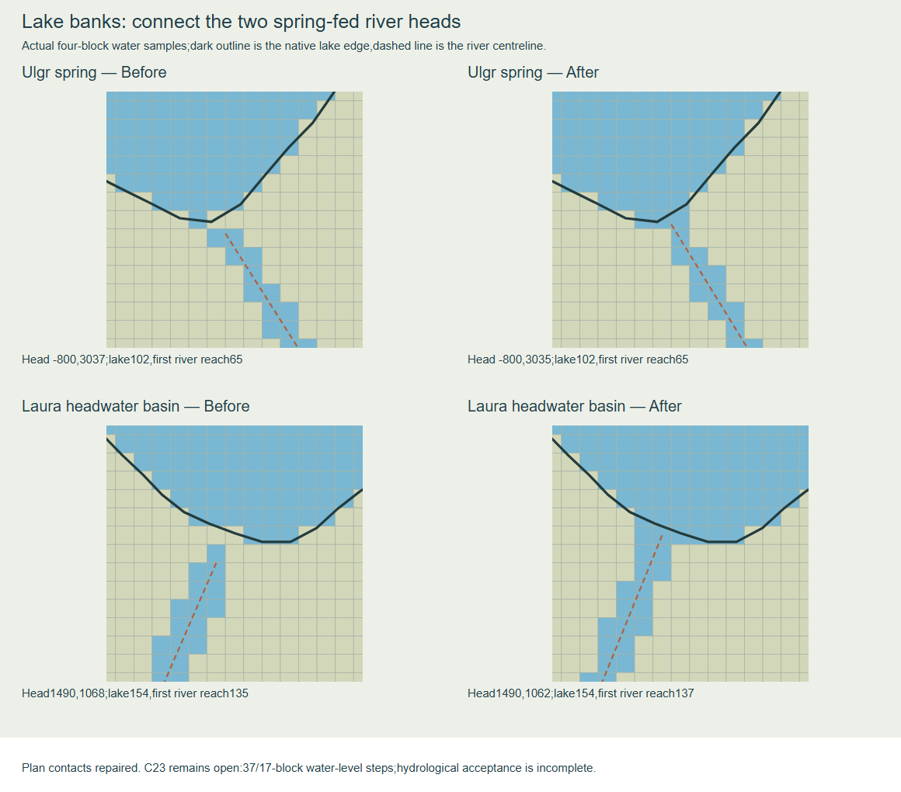

# All13 lake banks andsource contacts — R115

[13-row CSV](lake-banks-r115.csv) · [full audit](lake-banks-r115.json) · [source/export delta audit](lake-head-connection-r115.json) · [reproducible measurement script](lake_bank_audit.py).

All13 native lakes are checked together against matching normal source `89b01c4c960b6347f680c50114debaa979c1a11c7bfd1f77b35c5268f03c847b`. This is independent measurement of the authored export,not new Tensura canon evidence.

## What was found andcorrected

All13 dry-bank/depth checks already passed in the baseline. Two designed spring-fed connections did not:Ulgr andLaura’s river starts were near their lakes under the checker’s geometric slack,but their actual wet masks lacked cardinal contact. The final fix changes only these two source first vertices:

| River | Previous head | Corrected head | Shore distance after correction | Wet half-width |
| --- | --- | --- | ---: | ---: |
| Ulgr spring brook |(-800,3037)|(-800,3035)|2.0444|3 |
| Laura mountain falls |(1490,1068)|(1490,1062)|1.8385|4 |

The initial inside-lake trial violated the fixed land-origin rule andwas discarded. Final points remain on land,with their channel widths touching water;the default checker passes without rule/tool edits. Every other river vertex/attribute,all lake contours/levels,58 site attributes and22 routes remain exact. These are authored coordinates andconnections,not surveyed canonical waterways.

| Measurement | Baseline | Corrected |
| --- | ---: | ---: |
| Passing dry-bank/depth checks |13/13|13/13|
| Passing combined lake/connection checks |11/13|13/13|
| Designed river–lake contacts observed |6|8|
| Missing candidate contacts |2|0|
| External dry-bank sample centres |2545|2540|
| Exact-boundary dry-bank centres |8|8|
| External wet contact samples |15|20|
| Matching wet source samples |42760|42760|

## Separate larger-transition review — C23

The [head-level diagnostic](river-head-profiles-r115.md) finds37/17block differences at Ulgr/Laura:only6of8interfaces meet the normal2-block step criterion. Bank/contact success does not establish acceptable waterfall character or runtime fluid placement. C23 stays open for style/source assessment. The2-block diagnostic is not an additional numeric owner requirement,andmust not drive artificial river routing.

## Method andlimits

Run `python -B world/lake_bank_audit.py` after matching normal staging (NumPy,Pillow,Shapely required). The script checks every four-block centre in each native polygon andthe cardinal four-neighbor ring around its matching water cells. Water encoding is0dry,otherwise water first-air+64;terrain first-air is heightPNG/16−64. Every sampled dry bank has at least2blocks of freeboard andevery matching wet bed has positive depth(1.25–12blocks across these samples).

The8 dry source samples are exactly on polygon edges/vertices,not strictly inside. Their boundary distance is0 andthey are valid high banks under the raster fill convention. No interior water holes or wrong lake levels were found. All20 wet exterior contact centres lie within the actual widths of named source rivers. Candidate connections are inferred from river endpoints within8blocks of a native lake;that is an explicit finite design rule,not canonical topology.

This proves those normal-raster properties. It does not prove continuous/per-block banks,final noise,density,fluid updates,Minecraft chunks or in-game leak acceptance. The classifier checks contacts rather than entire downstream hydrology. Technical integration remains Claude’s handoff.

For the reproducible negative control,rebuild pinned baseline source2463d771 in another output directory,then run the script with `--baseline --svg <baseline.svg> --rasters <baseline-build> --out-base <private-report>`. It intentionally returns1 for the two missing contacts. The corrected profile returns0. Baseline/review source hashes are pinned to prevent stale raster/source mixtures.

## Export andpresentation

Only188 height cells,247 rugged cells and26 water cells change. Their maximum distances to the old/new affected river centrelines are33.34,19.94 and4blocks respectively;do not claim all changes are confined to just the moved head points. Road,biome,site andexclusion PNGs,site/road JSON andanchor/site TOML are byte-identical. All42760 lake source-water samples retain their levels.

Because the entire biome raster andnative biome/region geometry are unchanged,the measured R114 distributions remain exact andare adopted without a duplicate census. Their original source hash stays historical. All58 place-art reservations anddesigned levels remain valid by identical source attributes/site exports. The painting needs only the two native river-head updates;no concept/image regeneration or new palette is required.

Fresh normal staging67.0s,no converter warnings;standard checker0errors/56relations/2priorwarnings(Laura river/escarpment,preferred design size). Current preview,water-grid comparison andatlas layout are inspected;58 numbers/20context names/42open rows retain geometry,no overlap,min31.62px. Height changes range−41.375to+41.3125blocks at shifting cliff cuts;no changed height sample lies in a registered site disc. No protected tools/mod/pack edit,live placement,world apply,chunks,main merge,deployment or in-game acceptance. Ledger321 andinventory142/42 do not prove exhaustive source/wiki coverage;the full goal remains open.

Required repository gate: 472 tests, 26 skipped, zero failures in 64.793 seconds. Validation and `git diff --check` pass. The separate larger-transition diagnostic intentionally flags two cases; it is not a failing repository gate.
