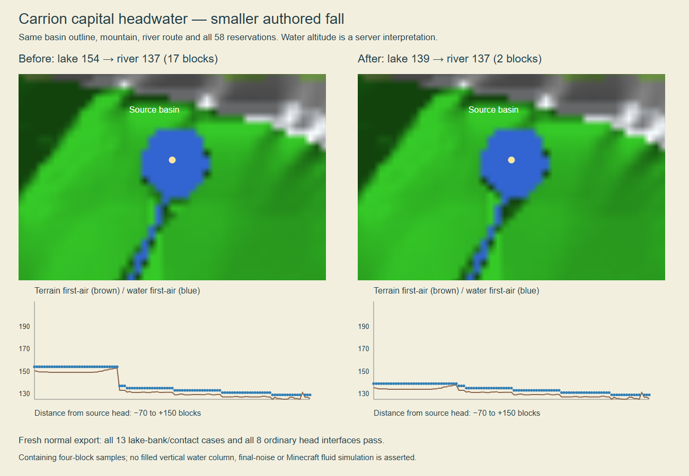

# Carrion capital headwater: smaller authored fall

[Editable comparison](laura-headwater-level.svg) · [exact change/export audit](laura-headwater-level.json) · [13 fresh lake cases](lake-banks-laura-level.json) · [all eight head interfaces](river-head-profiles-laura-level.json).

## Design choice and source limits

The owner-approved water brief in `design/architecture/own-world.md` §8/Q3 asks for flat reaches with small waterfalls. The previous source put this basin at154 while the converter’s remaining-reach budget capped the adjacent river at137:an authored17-block discontinuity. The [earlier profile review](laura-waterfall-review.md) explains that cap; it did not establish a canonical waterfall height.

Lower the authored basin level and river-head control **154→139**, retaining every plan vertex, the mountain’s225 control, the river route/mouth and the five-block lake depth. The exported adjacent river stays137, giving a **two-block** interface. This is **our interpretation** to implement the small-fall brief;two is the ordinary converter step,not a new exact numeric rule imposed by Yasuke. No primary source measures139,154,137 or the river course.

The [publisher’s LN5 prologue](https://gcnovels.jp/reading/slime5.htm), passage beginning with Carrion looking up at the sacred peak behind his castle, was reread. It supports the mountain/castle relation,not this basin or a waterfall height. FAN-009 remains a secondary waterfall-image lead without a verified episode/timestamp. The earlier suggestion to keep154provisional is superseded by this explicit server-style choice,not by a new claim about the anime. The guide8.5 Rondo/wiki Laura name issue remains C24;the stable technical ID stays `laura` and the readable display stays Carrion’s capital.

## Fresh normal evidence

Source SHA256 `a9b6b9708d90705e05fac52714e8caef943241a95dded621223b3805cb44b7cb`;normal staging67.6seconds,no converter warnings. Only two native scalar attributes differ from50c27a6f;all plan geometry and other attributes remain exact.

- All58 site records and heights and all22 road exports remain exact. No changed height/water sample enters any site disc or any of the other12 lake+8-block neighbourhoods.
- Height changes347four-block samples,all within x1462..1538,z982..1082. Maximum lowering15blocks. Water changes311samples,all within the existing basin neighbourhood,x1462..1538,z982..1062,by15levels.
- Ruggedness,biome,road,site and exclusion PNGs are byte-identical,as are site tables,anchors,roads and `canon_map.txt`. The existing22-mask western-islet biome census is adopted through identical biome bytes and native region polygons,not relabelled as newly sampled.
- All9 river exported reach profiles are unchanged. All13 fresh lake bank/depth/contact cases pass;all8 ordinary head-interface diagnostics pass,including Ulgr92→91 and this139→137 interface. Eight dry exact-boundary lake samples remain separately recorded;strict-interior and bank checks pass.
- All22 finite exported road grades still pass1:2. Neither the diagnostic nor the bank audit simulates vertical water columns,final terrain noise,fluid ticking or in-game leaks.

The current readable atlas embeds the exact fresh normal preview;all nonimage XML and58 markers remain unchanged apart from the source pins. The existing painted atlas in PR130 remains a compatible **plan illustration** with its historical50c27a6fheight basis;it is not promoted to a new vertical-height reconstruction. All place-art numeric registrations remain applicable. The before/after study exposes the lower bowl rather than silently treating the two terrain surfaces as identical.

## Remaining scope

C23’s finite oversized head-step problem is corrected;actual fluid-column and landscape acceptance remain Claude’s integration checks. The post-Kijin initial state,source attribution limits and C24 remain unchanged. No protected tools/mod/pack edit,generated data hand-edit,world apply,chunks,main merge or deployment.

The separate larger-island alternative PR132 was generated from50c27a6fand does not include this later water correction. If chosen,it must incorporate the two scalar changes and refresh its matching normal checks;its earlier hashes are not silently relabelled.

Required repository gate passed:472tests,26skipped,zero failures in65.273seconds;validation and diff checks pass. Standard map checker:zero errors,56relations pass,two standing warnings. Checker plan preview,full atlas,normal before/after basin detail and head-profile diagrams visually inspected.
