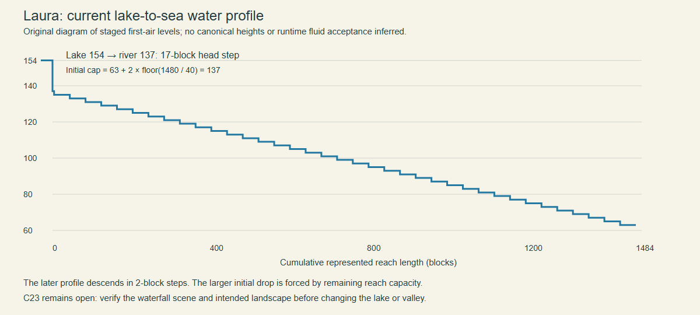

> Historical read-only profile review. The154→137baseline below is superseded by the [authored139→137correction](laura-headwater-level.md). Source qualification and the explanation of the converter cap remain applicable;the old instruction to retain154provisionally is not the current drawing decision.

# Laura waterfall: source and exported-profile review

The active lake remains at first-air154 and the river immediately below it at137. This17-block transition is **not a measured anime waterfall**. Read-only inspection of `tools/world/svg2rasters.py:1386` explains it:371 samples represent1484blocks; the first sample has1480blocks remaining. With mouth63, ordinary maximum step2 and minimum reach40, the initial cap is `63 + 2 * floor(1480 / 40) = 137`. The converter therefore forces17blocks of descent at the head. The38 exported reaches then descend in2-block steps. This separates a planning artefact from a canonical landscape claim.

The current SVG hash is a5e1c2f6d811ff367da3da90aa60871ce421a99a9bfeb564501a0e533cda9c3a; the retained normal staging is pinned to 0b8bcf56c8054ae0b03f60dcf5b8777672b5097078803390f2d82636a52f045e. The later SVG difference is an inert Galut review comment. Laura's active lake, river and surrounding normal-height inputs are unchanged. This review reads the existing export; it does not claim a fresh conversion or live water-column acceptance. [Measurements and exact exported reaches](laura-waterfall-review.json).

## Source assessment

The directly read publisher LN5 fragment supports a sacred peak behind Carrion's castle and the town below it (LN05-001/002). It does not establish this waterfall height, compass bearing, headwater lake or river itinerary. [Publisher fragment](https://gcnovels.jp/reading/slime5.htm).

FAN-009 remains a secondary anime-image attribution: the pinned fan project's Laura image shows a mountain waterfall, but its episode and timestamp remain unverified. It is a useful visual lead, not independent primary confirmation. No source image is copied into this repository.

Official galleries were inspected at full resolution: route28/displayed episode26, route34/32, route37/35 and route38/36, five images each. None of these20 selected stills confirms the broad Laura waterfall panorama. Route38 image2 contains cultivated-looking parallel ground bands behind Milim; the cropped setting does not establish a waterfall or surveyed irrigation layout. This is not a claim about the complete episodes. [26](https://www.ten-sura.com/anime/tensura/story/no28), [32](https://www.ten-sura.com/anime/tensura/story/no34), [35](https://www.ten-sura.com/anime/tensura/story/no37), [36](https://www.ten-sura.com/anime/tensura/story/no38).

Six images on the [official season2 PV2 announcement](https://www.ten-sura.com/news/anime/news/post/4101) were also inspected; none supplies the required panorama. The linked public video `5DENp__AQdc` was opened in a fresh normal browser, but the uploader's country restriction prevented playback:readyState0,no advertisement,no frames captured. No region workaround was used. Route39's HTML was fetched but its displayed episode could not be parsed by the selected pattern; no gallery or episode identity is claimed for that route. Fan-fiction search results were excluded from geographic evidence.

## Drawing decision and next evidence

Keep the current geometry provisional while obtaining an identifiable primary panorama or licensed scene. **C23 stays open**: neither the green bank/contact tests nor a secondary image proves compliance with the fixed request for small falls, or proves a filled vertical water column in game. The diagnostic's2-block threshold is an ordinary converter setting, not a numeric owner rule.

Lowering the lake to138 would remove most of this first discontinuity but would also change the authored mountain bowl. Extending the river merely to satisfy the reach budget could create an artificial route. Neither action is justified by the sources read here. Conversely, retaining17 does not turn it into canonical scale. If a later technical waterfall implementation is chosen, its actual appearance and fluid continuity still need review by Claude. No geometry, source control, runtime file, site reservation or painting changes in this review.
