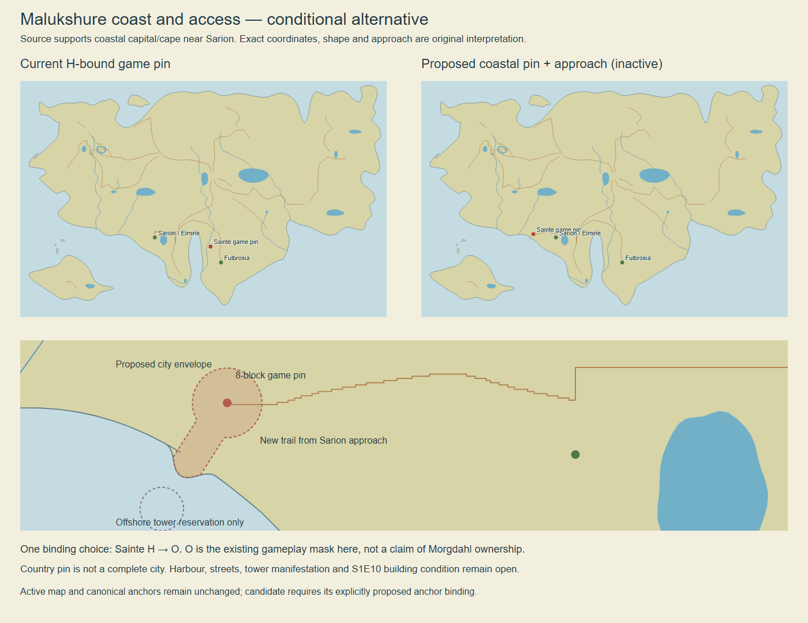

# Malukshure coastal access: conditional full source alternative



[Complete candidate SVG](malukshure-coastal-alternative.svg) · [checker preview](malukshure-coastal-alternative.png) · [normal terrain preview](malukshure-coastal-terrain.png) · [exact finite audit](malukshure-coastal-access.json) · [13-lake checks](malukshure-coastal-lakes.json) · [proposed checker anchor input](malukshure-alternative-anchors.toml).

**Inactive;one owner binding choice remains.** The default checker rejects precisely the current Sainte H/Fulbrosia requirement. With the separately supplied proposal changing only that anchor’s region to O,the candidate has zero errors,all56 relations and the two existing warnings. The active `world/map.svg`,canonical anchors,normal active staging and current atlas remain unchanged. This is not a passing-default-map claim.

## Source and interpretation

The [author’s book-aligned vacation side story,episode02](https://ncode.syosetu.com/n7972ib/2/#L2) places the country beside Sarion and describes a capital cape overlooking the offshore tower/whirlpool setting. [Episode05](https://ncode.syosetu.com/n7972ib/5/#L40) supplies the fishing-harbour/protected-sea relation. Selected public paragraphs were reread;the existing AUTH-VAC-001..006 facts and [source-layout review](malukshure-source-layout.md) retain their continuity limits. This is not a freshly read printed LN volume. The author calls the capital a sage city here;the stable `sainte_malukshure` game ID does not by itself verify a primary proper name.

The western coast position,coordinates,road,cape geometry,city envelope and heights remain **our interpretation**. The source establishes Sarion adjacency,not these exact bearings or a surveyed political border. The small current marker in H at(-100,2000) is a game reservation,not primary evidence that this coastal country belongs in Fulbrosia.

## Full source proposal

Move the existing8-block country pin to(-2320,1645);the normal export gives walking first-air64,compared with69 at the old pin. Keep all57 other registrations exact. The pin is **not a complete capital** and is not enlarged into an invented city template.

The [earlier cape/envelope](malukshure-cape-study.md) still fits current geometry. Merge its36-block seaward extension into one mainland coast,adding1970.89square blocks and removing no existing native land. The matching O boundary uses the same local reversed shoreline splice;all other curve commands remain. A plains selector covers the cape. The64-radius city-core study stays dry,and the broader urban envelope fits the proposed land. Those reserve design space;they do not implement buildings,streets,a harbour or urban retaining works.

Add a749-block trail with a gentle bend along the low foothills,from the existing Sarion/Elmine approach at(-1680,1640) to the new pin. All22 previous road exports remain exact. The new route has no wet samples and passes the finite1:2 exported-grade limit. Its stair-step source discretisation is an authored path representation,not a canonical surveyed alignment or runtime walk-through.

The old offshore tower disc remains a study annotation only:radius40 at(-2440,1840),entirely in sea and30.33blocks from proposed land. There is no tower island,causeway,permanent manifestation,portal or later vacation party. Source new-moon access and the selected S1E10condition still need separate treatment.

## Why the proposed binding is O

The coastal proposal lies inside the existing **O gameplay mask**,not S and not H. This is a measured source-map fact. Changing H→O lets the existing game registration follow the coast;it does **not** assert that Morgdahl owns Malukshure or define a canonical Malukshure/Sarion border. The regional guide already distinguishes gameplay coverage from sovereignty.

`world/malukshure-alternative-anchors.toml` is a complete **checker-input copy** of canonical anchors with only Sainte’s `region` field changed. Its inherited coordinates are input metadata,not the final generated own-world registration. The generator’s ordinary output still retains H because `build.py` has no alternate-anchor option. A separate proposed registration was produced privately using the unmodified tool’s `anchor_coords`/`update_anchors` functions;the audit records its exact Sainte fields and hash. No generated registration or live config was hand-edited or adopted.

The candidate checker command is:

```sh
python -I tools/world/map_check.py world/malukshure-coastal-alternative.svg --anchors world/malukshure-alternative-anchors.toml --preview world/malukshure-coastal-alternative.png
```

The private normal trial used `build.py --svg ... --out ... --skip-check` **only** because its built-in default check necessarily rejects the disclosed H/O binding. It is not evidence that the current contract accepts the move. No other default checker error is suppressed;the exact default error is in the audit. Never use this study as authority to apply a conflicting generated anchor table.

## Fresh finite evidence and decision

Candidate SHA256 `2383ed5a312dc8fcfbb8ca293b2120bce1b023583871b3fb95c5b8ce8ff7925b`;normal70.2seconds,no converter warnings. All58 registrations remain,57exact. All23 finite road grades pass,the22old road exports and all9 river profiles/lake levels remain exact,andall13fresh bank/depth/contact cases pass. Every four-block native-land centre has gameplay coverage. The design box remains12800×10752. These checks do not prove final noise,fluid columns,fully level city blocks or in-game travel.

Yasuke can choose this source-informed coastal reservation and its H→O binding,or retain the current H-bound game slot. Until that choice,retain the active map. If selected,Claude reconciles the actual registration and normal generation;then the readable atlas,painted-map marker and place-art numeric registration need matching updates. This separate source alternative does not silently relocate their active Sainte marker.

C14 remains conditional;C15 city/harbour/tower architecture and early-state questions remain open. Physical-coverage counts are not closed by an inactive pin and cape study. No tools/mod/pack edit,active map/staging change,world apply,chunks,main merge or deployment.

Required repository gate passed:472tests,26skipped,zero failures in65.778seconds;validation and diff checks pass. Final conditional checker preview,normal terrain and original current/proposed comparison were visually inspected. These tests do not remove the explicitly failing default H/O binding.
