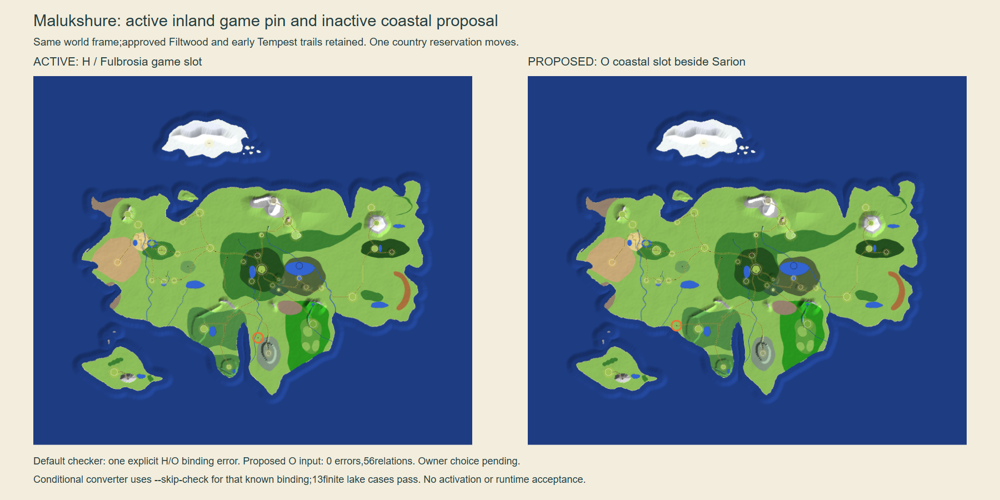

# Current Malukshure coastal proposal — inactive

[Complete candidate SVG](malukshure-current-candidate.svg) · [conditional checker preview](malukshure-current-preview.png) · [conditional terrain preview](malukshure-current-terrain.png) · [proposed anchor input](malukshure-current-anchors.toml) · [audit](malukshure-current-audit.json) · [finite lake and coverage checks](malukshure-current-finite-checks.json).

This updates the earlier coastal proposal onto current canonical source `534d07ade01d21f3763bebf98cfd18428761aba50388ec70cff4b77e87e787f0`. The approved Filtwood location, early Tempest trails, Laura water treatment and all other current changes are retained. It is a separate source file; the active map, canonical anchors, painting and normal outputs are unchanged.

## Source and choice

The author's [LN-aligned vacation story, episode02](https://ncode.syosetu.com/n7972ib/2/#L2), supports Sarion adjacency and a coastal capital cape overlooking the offshore tower setting. [Episode05](https://ncode.syosetu.com/n7972ib/5/#L40) supplies fishing-harbour and protected-sea context. The existing AUTH-VAC records retain their directly read scope; this round is not a new printed-LN reading. [Source-layout review](malukshure-source-layout.md).

The exact western bearing, cape, coordinates, path and elevations are our interpretation. The stable sainte_malukshure ID does not verify a primary capital name. O is a gameplay mask, not a claim that the country is Morgdahl or belongs to a specific political union. The current H/Fulbrosia binding conflicts with this proposed coastal slot and needs Yasuke's choice.

| Reservation | Current | Proposed |
| --- | --- | --- |
| Sainte country pin x,y,z | -100,69,2000 | -2320,64,1645 |
| Gameplay binding | H | O |
| Radius / preparation | 8, unplated country marker | Retained; not a complete capital |

The six scoped changes are the mainland cape splice, matching O shoreline, plains selector, new approach trail, moved pin and its label. They reuse the reviewed design; all replaced elements still matched their original baseline. The cape adds about 1,971 square blocks of authored land. The new approach is about 749 blocks long. No city buildings, harbour, offshore tower or sovereign border is implemented.

## Conditional checks, not a default pass

The standard candidate check reports exactly one error: Sainte lies in O while anchors require H. With the separate proposed anchor file, which changes only Sainte's region H to O and retains Filtwood J, it reports zero errors, all 56 relations and two standing warnings.

The converter CLI has no alternate-anchor option. Its isolated run therefore explicitly uses **--skip-check** for that known binding and completes in 68.9 seconds without converter warnings. This is not a normal default-check pass. The original CLI anchor output retains H; a separate proposed registration is generated using the existing build.anchor_coords/update_anchors helpers and the proposed O input. Parsed UTF-8 comparison proves that only that metadata field differs between the two generated registrations. Nothing is applied.

## Fresh finite evidence

- Candidate source `96324fe90cc835b900525c8bab4ae4651fb13ba41106121d37cc8f08bcf047d9`; 14 converter artifact hashes and the separate proposed-registration hash are recorded.
- All 58 index records remain: 57 are exact and only Sainte moves. All 34 flat-preparation configurations are byte-identical; the pin is unplated.
- All 23 existing road exports are exact. There are 24 total routes; all exported point profiles meet 1:2 within floating-point tolerance. The new trail has no wet samples.
- All 13 finite lake depth, level, cardinal-bank and expected-river-contact cases pass. All 2,659,658 strict native land centres at four-block spacing have gameplay coverage; exact shoreline centres are excluded.
- The export box remains 12,800 by 10,752. The checker preview and common-frame numerical comparison were visually inspected. They embed original project terrain, not licensed reference pixels.

Yasuke can select the coastal/O reservation or retain the H-bound slot as a server adaptation. Activation still requires that decision, a normal checked production build, matching atlas/painting and concept registration, and technical integration. Continuous bank geometry, final noise, fluid columns, complete architecture, initial residents and in-game acceptance remain unverified. The larger-island decision is separate. No protected-path edit, main merge, runtime application, chunks or deployment occurs here.

Required repository gate: 494 tests in 66.564 seconds, 26 skipped, the same two legacy Filtwood U/J failures plus validation; zero changed JavaScript files. The gate is not passing. This is separate from the candidate H/O error. Active source and all 14 normal hashes, canonical anchors, preview and painting are retained; local delivery links resolve.
